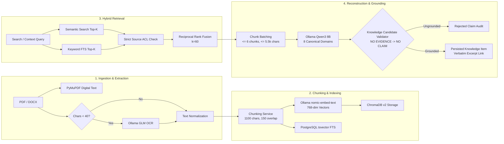

# The Handover — AI and Knowledge Reconstruction Pipeline Audit
## OCR, Embeddings, Vector Retrieval, LLM Orchestration & Epistemic Grounding

---

## 1. Executive Summary

The AI pipeline is the cognitive backbone of **The Handover**. It is responsible for ingesting multi-modal source documents, extracting text, generating dense vector embeddings, retrieving relevant evidence, reconstructing structured project knowledge across 8 canonical domains, resolving entity relationships, and preparing verifiable handovers.

### Key Audit Finding
The pipeline possesses **world-class epistemic grounding and anti-hallucination guardrails** via its `NO EVIDENCE -> NO CLAIM` validator, conservative fingerprinting, and verbatim excerpt matching. However, it suffers from **severe hardware throughput bottlenecks due to single-threaded sequential inference locks**, **a lack of embedding caching**, and **the absence of standardized automated benchmark datasets**.

---

## 2. End-to-End Pipeline Architecture

---

## 3. Subsystem Detailed Assessment

### A. Document Extraction & OCR (`document_extraction.py`, `ocr.py`)
- **Digital Extraction**: PyMuPDF (`fitz`) handles text extraction cleanly and rapidly ($< 50\text{ ms}$ for standard digital PDFs).
- **OCR Trigger Guard**: The pipeline intelligently avoids running expensive OCR on digital pages by checking if digital character count is $\ge 40$ chars. OCR is only triggered on image-heavy pages with low text density.
- **Ollama GLM OCR Adapter**:
  - Model: `glm-ocr:latest` (2.7 GB).
  - Context: 8,192 tokens; predict cap: 4,096 tokens; rendering scale: bounded between 150 DPI and 2,048 pixels max dimension.
  - Page Limit: Hard capped at 40 OCR pages per document (`ocr_max_pages_per_document`).
- **Telemetry & Truncation**: Captures duration, prompt eval count, eval count, and flags repetition loops or model truncation cleanly.

### B. Embeddings & Hybrid Retrieval (`embedding.py`, `vector_store.py`, `retrieval.py`)
- **Embedding Model**: `nomic-embed-text` (768 dimensions), pinned identically across ingestion indexing and query retrieval.
- **Batching & Validation**: Embeddings are batched in groups of 8 (`EMBEDDING_BATCH_SIZE=8`).
- **Absence of Embedding Caching**:
  - The system computes embeddings for every chunk on every ingestion run. If a document is re-extracted or re-indexed, identical chunks generate new API calls to Ollama.
  - **Remediation**: Introduce a content-hash key-value embedding cache in PostgreSQL or memory (`hash(chunk_text) -> vector`).
- **Hybrid RRF Fusion**:
  - Combines PostgreSQL full-text search (`websearch_to_tsquery`) and ChromaDB dense cosine similarity using Reciprocal Rank Fusion ($k=60$).
  - Graceful Degradation: If ChromaDB or Ollama is unavailable during a search, the service cleanly falls back to PostgreSQL keyword search with a warning payload.

### C. LLM Orchestration & Inference Bottlenecks (`llm.py`, `reconstruction_worker.py`)
- **LLM Model**: `qwen3:8b` (5.2 GB), local inference via Ollama `/api/chat`.
- **Generation Parameters**: `temperature=0.1`, `num_ctx=8192`, `num_predict=2048`, `think=false`.
- **Structured Output**: Strictly enforced JSON schema validation with fallback JSON fence cleaning and thinking block stripping (`<think>...</think>`).
- **VRAM Contention Guardrail (`_OLLAMA_INFERENCE_LOCK`)**:
  - To prevent out-of-memory errors on 6GB VRAM GPUs (NVIDIA RTX 4050), a global threading lock (`_OLLAMA_INFERENCE_LOCK`) synchronizes all calls to Ollama across OCR, embedding, and LLM inference.
  - **Throughput Consequence**: Total platform AI throughput is strictly limited to 1 execution thread. A single background extraction run blocks interactive AI queries or OCR tasks until completed.

---

## 4. Knowledge Quality & Epistemic Grounding

The knowledge reconstruction engine distinguishes between four distinct epistemic states:
1. `source_evidence`: Raw document text, commit messages, Jira worklogs, Slack turns.
2. `extracted_finding`: Direct facts extracted from evidence supported by verbatim excerpts.
3. `inferred_interpretation`: Analytical connections derived from multiple evidence items.
4. `human_verified`: Findings reviewed, approved, or edited by an authorized human.

### The `NO EVIDENCE -> NO CLAIM` Grounding Gate
In `backend/app/services/knowledge_validator.py`, every candidate claim returned by Qwen3 8B must pass rigorous validation:
- **Verbatim Excerpt Matching**: The candidate must declare a supporting text excerpt that exists verbatim inside the supplied evidence chunks. If the excerpt cannot be located, the item is **rejected immediately** as ungrounded (`claims_rejected_ungrounded`).
- **Conservative Fingerprinting**: Duplicate items are merged only when category, slugified title, status, and entity labels match exactly.
- **Uncertainty Transparency**: If critical fields are missing (e.g. decision maker, decision date, component), the validator flags the finding with explicit `uncertainty_reason` rather than guessing.

---

## 5. Missing Evaluation Datasets & Recommended Benchmarks

Currently, evaluation relies on ad-hoc test fixtures (`test_live_qwen3_knowledge_evaluation.py`). There is no standardized, version-controlled evaluation benchmark to measure precision, recall, and hallucination rates over time.

### Recommended Evaluation Metrics & Benchmark Harness

| Metric | Definition | Target Threshold | Measuring Methodology |
| :--- | :--- | :---: | :--- |
| **Extraction Precision** | Valid findings / Total candidate claims generated | **$\ge 90\%$** | Automated ground-truth dataset matching. |
| **Grounding Accuracy** | Persisted items with valid verbatim excerpts / Total persisted items | **$100\%$** | Zero-tolerance excerpt validator check. |
| **Hallucination Rate** | Claims rejected as ungrounded / Total candidate claims | **$\le 5\%$** | Worker batch rejection audit counters. |
| **Retrieval Recall@10** | Relevant chunks retrieved in top 10 / Total known relevant chunks | **$\ge 85\%$** | Synthetic synthetic question-chunk pair corpus. |
| **Conflict Precision** | Legitimate contradictions identified / Total flagged conflicts | **$\ge 80\%$** | Human reviewer validation on conflict queue. |
| **Human Acceptance Rate** | Findings approved without edit / Total findings presented | **$\ge 80\%$** | Telemetry on Verification Center approvals. |

---

## 6. Actionable AI Pipeline Optimizations

1. **Implement Content-Hash Embedding Cache**:
   - Store calculated 768-dim embeddings in PostgreSQL keyed by `sha256(chunk_text)`. Eliminates duplicate GPU inference when re-indexing identical text blocks.
2. **Selective Domain Reconstruction**:
   - Allow users and workers to trigger extraction for specific domains (e.g. `DECISIONS_RATIONALE` only) rather than executing all 8 domains simultaneously.
3. **Deterministic Pre-Filtering**:
   - Identify work items (e.g. Jira tickets with clear status/assignee) using deterministic regex and JSON extractors rather than dispatching them to the LLM.
4. **Establish Standardized Benchmark Suite**:
   - Create a curated dataset of 20 realistic project documents with labeled ground-truth findings to automate regression testing in CI without manual review.
