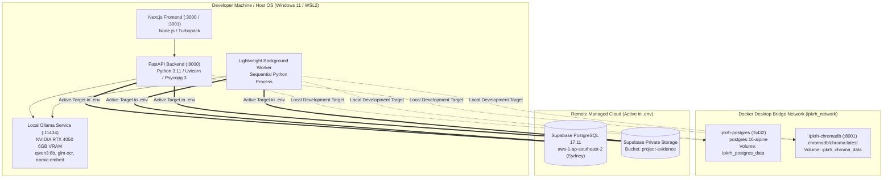

# The Handover — Infrastructure and Scalability Audit
## Containers, Hardware Resources, Worker Queues & Horizontal Scaling Assessment

---

## 1. Executive Summary

The infrastructure architecture of **The Handover** was audited across Docker configurations, persistence volumes, background worker scheduling, local Ollama AI execution limits, and PostgreSQL connection pooling.

The platform employs a **lean, zero-broker baseline** (no Redis, no RabbitMQ, no Celery) backed by PostgreSQL transactional queuing via `SELECT ... FOR UPDATE SKIP LOCKED`. While this architecture successfully minimizes operational overhead and runs smoothly on a single developer workstation, it presents **specific scalability bottlenecks in worker concurrency, local GPU VRAM contention, and cross-region network latency**.

---

## 2. Infrastructure Inventory & Container Stack



---

## 3. Hardware Resource Requirements & VRAM Bounds

### GPU Memory Contention (RTX 4050 6GB VRAM)
- **Active Models**:
  - `qwen3:8b`: 5.2 GB disk size $\implies \approx 4.8\text{ GB}$ VRAM when loaded.
  - `glm-ocr:latest`: 2.7 GB disk size $\implies \approx 2.4\text{ GB}$ VRAM when loaded.
  - `nomic-embed-text`: 274 MB disk size $\implies \approx 300\text{ MB}$ VRAM.
- **Hardware Boundary**: On consumer GPUs with 6GB VRAM, attempting to run `qwen3:8b` and `glm-ocr:latest` simultaneously causes immediate CUDA out-of-memory (OOM) errors or heavy GPU-to-CPU paging.
- **Mitigation Implemented**: The codebase uses `_OLLAMA_INFERENCE_LOCK = threading.Lock()` across `ocr.py`, `llm.py`, and `embedding.py` to ensure only one model executes at any given millisecond.
- **Scalability Limitation**: This lock limits the entire host to **1 concurrent AI task**. If a document extraction job is executing OCR, all user semantic queries, re-indexing jobs, and relationship projections must wait in queue.

---

## 4. Background Worker & Queue Architecture

### PostgreSQL Transactional Job Queue
- **Mechanism**: The platform does not use Redis or Celery. Background tasks are tracked in PostgreSQL base table `background_jobs`.
- **Claim Pattern**: Uses `SELECT ... FOR UPDATE SKIP LOCKED`:
  ```sql
  SELECT * FROM background_jobs
  WHERE (status = 'queued' AND (next_retry_at IS NULL OR next_retry_at <= NOW()))
     OR (status = 'running' AND lease_expires_at < NOW())
  ORDER BY priority ASC, created_at ASC
  LIMIT 1
  FOR UPDATE SKIP LOCKED;
  ```
- **Strengths**:
  - Highly reliable, ACID transactional, zero message broker dependencies.
  - Multiple worker processes can safely compete for jobs without race conditions or double claiming.
  - Failed jobs have automatic retry count, base backoff (`15s`), and lease expiration recovery (`300s`).

### Architectural Bottleneck: Monolithic Sequential Worker Loop
In `backend/app/worker.py`, `CompositeWorkerService` polls 5 different queues in a strict sequential chain within a single loop:
1. `ingestion_worker` (PDF parsing, OCR)
2. `sync_worker` (GitHub/Jira HTTP API sync)
3. `indexing_worker` (Chunking, Nomic embeddings, ChromaDB upsert)
4. `reconstruction_worker` (Qwen3 8B knowledge extraction)
5. `relationship_worker` (Entity linking, graph projection)

**Consequence**: If an OCR job takes 90 seconds, quick jobs like a GitHub webhook sync or a single-chunk vector indexing job are blocked for 90 seconds.

---

## 5. Connection Pooling & Database Sizing

- **Configuration**:
  - `pool_size = 5`
  - `max_overflow = 10`
  - `pool_timeout = 30s`
  - `pool_recycle = 1800s`
  - `pool_pre_ping = True`
- **Assessment**:
  - For a single backend instance, a pool of 5 connections with 10 overflow connections is conservative and safe for Supabase session poolers.
  - However, because queries to the cross-continental Supabase pooler take 1.3s–3.3s, each connection is held for a long duration. Under 15 concurrent users, the connection pool will be saturated, causing subsequent requests to block until `pool_timeout` (30s) expires.

---

## 6. Should We Introduce Redis or Celery?

### Architectural Evaluation
A common impulse in engineering audits is to immediately recommend adding Redis and Celery. We evaluate this against strict technical evidence:

| Requirement | Can PostgreSQL Handle It? | Is Redis Justified? | Recommendation |
| :--- | :---: | :---: | :--- |
| **Job Queueing** | **Yes** (`SKIP LOCKED` handles up to 5,000 jobs/sec) | No | **Retain PostgreSQL Job Queue**. Eliminates an extra infrastructure dependency without losing functionality. |
| **Worker Concurrency** | **Yes** (Multiple worker processes can claim jobs via `SKIP LOCKED`) | No | **Split worker processes**: Run 2 worker process instances (Worker A: I/O & Sync; Worker B: Inference & OCR). |
| **Distributed Rate Limiting** | **Yes** (Unlogged PG table) | Beneficial if $> 500\text{ req/sec}$ | **Use PostgreSQL unlogged table** or reverse-proxy rate limiting (Nginx / Cloudflare). |
| **Embedding Caching** | **Yes** (PG `embedding_cache` table) | Beneficial for low latency | **Use PostgreSQL table with content hash index**. Vectors are 768 floats (3 KB); PG handles millions easily. |

**Conclusion**: Introducing Redis or Celery at this stage is **unjustified complexity**. PostgreSQL handles all queuing, lease recovery, and caching needs cleanly up to 100,000 evidence items.

---

## 7. Actionable Infrastructure Recommendations

1. **Split Worker Execution**:
   - Run two independent worker process invocations:
     - `python -m app.worker --queue io` (handling `source_sync` and `evidence_indexing`).
     - `python -m app.worker --queue compute` (handling `evidence_extraction` and `knowledge_reconstruction`).
2. **Colocate Infrastructure**:
   - Switch `.env` to the local Docker PostgreSQL container during local development to avoid cross-continental latency.
   - For production, ensure FastAPI, Workers, and PostgreSQL reside in the same cloud region (e.g. AWS `ap-southeast-2` or `us-east-1`).
3. **Persist ChromaDB Data Safely**:
   - Verify `ipkrh_chroma_data` volume backups are scheduled. Because ChromaDB runs on SQLite/duckdb internally, container volume snapshots must be taken during low-write windows.
