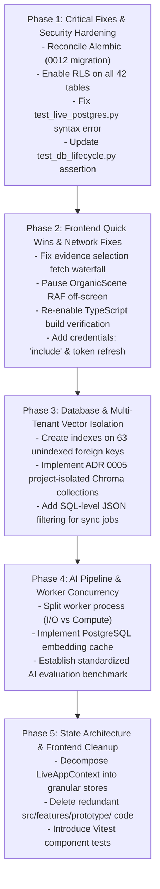

# The Handover — Optimization Roadmap
## Phased Implementation Plan & Engineering Remediation Schedule

---

## 1. Roadmap Strategy & Principles

This roadmap translates the audit findings from the Master Engineering Audit into an actionable, phased implementation plan.

### Core Implementation Principles
1. **Safety & Stability First**: Fix broken test suites, database migration desynchronizations, and critical RLS security gates before attempting performance refactoring.
2. **Zero Fabrication**: All test harnesses and benchmark datasets must use verified schemas and explicit synthetic test markers.
3. **Additive, Non-Breaking Steps**: Database index additions and context decompilations must maintain backward compatibility with existing API contracts.
4. **Verification at Every Gate**: No phase gate is marked complete until its corresponding automated tests have been executed and observed passing.

---

## 2. Phased Execution Roadmap

---

## 3. Detailed Phase Breakdown

### Phase 1: Critical Fixes & Security Hardening (Immediate Priority)
- **Goal**: Restore automated test collection, align database migration revisions, and secure public database tables.
- **Tasks**:
  1. **Fix Test Syntax Error (`ISS-03`)**: Remove the unmatched closing parenthesis on line 49 of `backend/tests/test_live_postgres.py`.
  2. **Merge Verification Center Branch (`ISS-01`)**:
     - Fast-forward or merge `remotes/origin/feature/verification-center-backend` into `main`.
     - Verify `20261113_0012_verification_center.py` exists in `infrastructure/database/migrations/versions/`.
     - Run `alembic current` to verify revision alignment.
  3. **Update Alembic Test Assertion (`ISS-08`)**:
     - Update `test_alembic_configuration_and_revisions` in `test_db_lifecycle.py` to assert heads match `["0012_verification_center"]`.
  4. **Enable Row Level Security (RLS) on Supabase (`ISS-02`)**:
     - Execute migration/script revoking `USAGE` on schema `public` from `anon` and `authenticated` roles.
     - Enable RLS on all 42 public tables: `ALTER TABLE {table} ENABLE ROW LEVEL SECURITY;`.
- **Exit Gate / Verification**:
  - `alembic current` outputs `0012_verification_center (head)`.
  - `pytest backend/tests/test_live_postgres.py backend/tests/test_db_lifecycle.py` passes 100%.
  - `SELECT count(*) FROM pg_class WHERE relrowsecurity = False AND relnamespace = 'public'::regnamespace;` returns `0`.

---

### Phase 2: Frontend Quick Wins & Network Remediation
- **Goal**: Eliminate UI request waterfalls, stop CPU-wasting animation loops, and secure frontend token handling.
- **Tasks**:
  1. **Eliminate Item Selection Waterfall (`ISS-05`)**:
     - Remove `selectedEvidenceId` from `refreshEvidence` dependencies in `frontend/src/context/LiveAppContext.tsx`.
     - Ensure clicking an item in the Evidence Library only calls `loadDetail` (`GET /evidence/{id}`) without re-fetching Overview, Members, and Sources.
  2. **Pause Off-Screen Canvas Animations (`ISS-09`)**:
     - Update `brand/OrganicScene.tsx` so that `requestAnimationFrame` is cancelled when `visible === false`.
     - Restart RAF only when `IntersectionObserver` signals `entry.isIntersecting === true`.
  3. **Re-Enable TypeScript Compiler in Build (`ISS-13`)**:
     - Remove `typescript: { ignoreBuildErrors: true }` from `frontend/next.config.ts`.
     - Verify `npm run typecheck` and `npm run build` pass with zero errors.
  4. **Implement Automatic Token Refresh (`ISS-07`)**:
     - Add `credentials: "include"` to `fetch` calls in `frontend/src/lib/api.ts`.
     - Implement a response interceptor: when an API response returns 401, call `POST /api/v1/auth/refresh` to rotate the `HttpOnly` cookie, update in-memory access token, and retry the failed request.
- **Exit Gate / Verification**:
  - Clicking an evidence item in the browser triggers exactly 1 API call in the DevTools Network tab.
  - Off-screen canvas instances exhibit 0 active `requestAnimationFrame` calls in Chrome Performance profiler.
  - `next build` succeeds with full TypeScript verification.

---

### Phase 3: Database Indexing & Multi-Tenant Vector Isolation
- **Goal**: Eliminate database sequential table scans and enforce ADR 0005 project vector isolation.
- **Tasks**:
  1. **Index 63 Foreign Keys (`ISS-06`)**:
     - Author Alembic migration `0013_index_unindexed_foreign_keys.py` adding b-tree indexes on all unindexed foreign key columns across `knowledge_*`, `verification_*`, `relationship_*`, and `evidence_*` tables.
  2. **Enforce Project-Isolated Chroma Collections (`ISS-04`)**:
     - Refactor `backend/app/services/vector_store.py`: dynamically resolve collection names per project: `th_proj_{project_id.hex[:16]}`.
     - Populate `project_vector_indexes` records in PostgreSQL when collections are created.
     - Migrate existing chunks from the shared collection into project-isolated collections.
  3. **SQL-Level JSON Query Filtering (`ISS-14`)**:
     - Refactor `BackgroundJobRepository.has_active_source_sync_job` to filter `mapping_id` via PostgreSQL JSON operators instead of looping in Python.
- **Exit Gate / Verification**:
  - `EXPLAIN ANALYZE` on evidence item deletion uses Index Scans for cascading checks.
  - Semantic queries to Project A never return vectors from Project B, even if metadata filters are omitted.

---

### Phase 4: AI Pipeline Throughput & Worker Decoupling
- **Goal**: Prevent worker starvation during long OCR/LLM jobs and optimize embedding latency.
- **Tasks**:
  1. **Decouple Worker Execution (`ISS-11`)**:
     - Refactor `backend/app/worker.py` to allow targeted worker flags:
       - `python -m app.worker --queue io` (polling `source_sync` and `evidence_indexing`).
       - `python -m app.worker --queue compute` (polling `evidence_extraction` and `knowledge_reconstruction`).
  2. **Implement Embedding Cache Table (`ISS-12`)**:
     - Create PostgreSQL unlogged table `evidence_embedding_cache` (`chunk_hash VARCHAR(64) PRIMARY KEY`, `embedding REAL[]`).
     - Check cache before dispatching embedding requests to Ollama.
  3. **Automated AI Evaluation Harness (`ISS-18`)**:
     - Add pytest markers (`@pytest.mark.live_ai`, `@pytest.mark.unit`) to `pyproject.toml`.
     - Standardize benchmark metrics (Precision, Recall@10, Grounding Rate).
- **Exit Gate / Verification**:
  - Fast sync and indexing jobs process immediately while a 2-minute OCR job is running on the compute worker.
  - Re-indexing an existing document completes in $< 500\text{ ms}$ via embedding cache.

---

### Phase 5: State Architecture Decompilation & Frontend Cleanup
- **Goal**: Decompose monolithic frontend context and eliminate redundant prototype code.
- **Tasks**:
  1. **Delete Redundant Prototype Code (`ISS-10`)**:
     - Remove `frontend/src/features/prototype/` (5,992 lines) and remove `app/prototype/` routes.
  2. **Decompose `LiveAppContext.tsx` (`ISS-17`)**:
     - Split into modular React contexts or Zustand stores:
       - `AuthContext`: session, login, logout.
       - `WorkspaceContext`: active org, active project, navigation.
       - `EvidenceContext`: evidence list, filters, selection.
       - `UIContext`: modal states, sidebar toggle, toasts.
  3. **Introduce Frontend Component Tests**:
     - Install Vitest and React Testing Library in `frontend/`.
     - Add unit tests for `AppLayout`, `Sidebar`, `EvidenceCenterView`, and `AuthModal`.
- **Exit Gate / Verification**:
  - Typing in evidence search filter causes only `EvidenceCenterView` to re-render; `Sidebar` and `TopNav` do not re-render.
  - Frontend bundle size decreases by $\approx 150\text{ KB}$ after prototype removal.

---

## 4. Summary Schedule & Resource Allocation

| Phase | Focus Area | Estimated Engineering Effort | Risk Level | Target Completion |
| :---: | :--- | :---: | :---: | :---: |
| **Phase 1** | Critical Fixes, Migration Reconcile, RLS | **1 – 2 Days** | Low | Week 1 |
| **Phase 2** | Frontend Quick Wins, Waterfall Fix, Token Refresh | **2 – 3 Days** | Low | Week 1 |
| **Phase 3** | 63 DB Indexes, Project Chroma Collections | **3 – 4 Days** | Medium | Week 2 |
| **Phase 4** | Worker Splitting, Embedding Cache, AI Benchmarks | **4 – 5 Days** | Medium | Week 2–3 |
| **Phase 5** | Context Decompilation, Prototype Cleanup, Vitest | **5 – 7 Days** | Medium | Week 3–4 |
