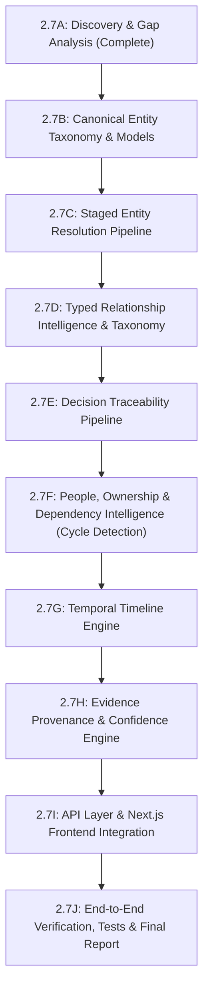

# Phase 2.7A: Repository Discovery & Architecture Gap Analysis
## Knowledge Intelligence & Graph Reconstruction Engine

**Platform:** The Handover (*Intelligent Project Knowledge Reconstruction & Handover Platform*)  
**Phase:** **Phase 2.7A — Repository Discovery and Architecture Gap Analysis**  
**Date:** 2026-11-14  
**Git Branch:** `main` (commit: `b236cbc`)  
**Working Tree Status:** Clean  
**Database Status:** Live Supabase PostgreSQL 17.11 at revision `0016_rls_hardening` (61 public tables, RLS 100% active)  

---

## 1. Executive Summary & Objective

Phase 2.7 transforms raw extracted unstructured knowledge into a structured, interconnected, evidence-backed representation of a project.

This discovery audit surveyed:
1. Existing backend SQLAlchemy models, Alembic migrations, services, workers, and API contracts.
2. Existing frontend page layouts, component structures, API clients, and visualization libraries.
3. The exact delta between what is already implemented versus the requirements in Steps 1 through 10 of the Phase 2.7 specification.

**Core Finding:** The backend already has an extensive relational knowledge graph schema implemented in migration `0011_relationship_explorer` and SQLAlchemy models (`backend/app/models/relationship.py`, `backend/app/models/knowledge.py`), alongside mature orchestration services (`RelationshipDiscoveryEngine`, `DecisionTraceabilityEngine`, `TimelineEngine`, `IdentityResolutionEngine`). However, key functional gaps exist:
- Entity type coverage needs normalization to support the full 19 canonical entity categories.
- Specific relationship verbs requested in Step 3 (e.g. `motivated_by`, `revises`, `deployed_as`, `corroborated_by`) are missing from the controlled taxonomy enum.
- Dependency cycle detection algorithm (Tarjan / Kahn's DAG check) is partially drafted but not fully verified with automated test suites.
- The frontend pages (`/relationships` and `/knowledge`) currently render placeholder `Phase2ModuleView` landing cards rather than interactive explorers or node inspectors.
- React Flow (`@xyflow/react` or `reactflow`) is not yet installed in `frontend/package.json`.

---

## 2. Existing Implementation Inventory

### 2.1 Database & SQLAlchemy Models
The relational knowledge graph is already backed by 8 dedicated PostgreSQL base tables in `backend/app/models/relationship.py`:
1. `knowledge_entities`: Project-scoped nodes with canonical names, normalized names, entity types, confidence scores, and resolution status.
2. `entity_aliases`: Multi-source handles (GitHub handles, Jira usernames, email aliases) mapped to canonical entities.
3. `identity_resolution_candidates`: Reversible entity merge candidate pairs with weighted match scores and signal breakdown JSON.
4. `knowledge_relationships`: Directed, typed graph edges with dual classification (`relationship_type`, `relationship_basis`, `verification_status`, confidence components JSON, and SHA-256 fingerprint).
5. `relationship_evidence_links`: Mandatory verifiable provenance linking edges to `evidence_items`, `evidence_chunks`, and `knowledge_items`.
6. `decision_traceability_chains`: 5-stage index tracking `Decision -> Work item -> PR -> Commit -> Component`.
7. `knowledge_timeline_events`: Chronological project event log with source timestamps and precision.
8. `relationship_reconstruction_runs`: Async lifecycle tracking for graph reconstruction jobs.

### 2.2 Backend Services & Discovery Pipeline
* `backend/app/services/relationship_discovery.py` (`RelationshipDiscoveryEngine`):
  - Pass 1: Exact identifier cross-referencing (Jira keys like `PROJ-123`, PR `#45`, commit SHAs).
  - Pass 2: Structured connector matching (GitHub PR author $\to$ Person, Jira reporter $\to$ Person).
  - Pass 3: LLM-assisted relationship extraction (using Ollama Qwen3 8B with JSON output).
* `backend/app/services/identity_resolution.py` (`IdentityResolutionEngine`):
  - Multi-signal entity resolution (exact name, normalized handle, email prefix, shared source context).
  - Thresholding policy bands (`AUTO_MERGE`, `MANUAL_REVIEW`, `REJECT`).
* `backend/app/services/traceability.py` (`DecisionTraceabilityEngine`):
  - Traverses `DECISION_IMPLEMENTED_BY`, `WORK_ITEM_ADDRESSED_BY_COMMIT`, etc., to assemble end-to-end audit chains.
* `backend/app/services/timeline.py` (`TimelineEngine`):
  - Extracts and orders chronological project events from commit timestamps, PR merge times, and document metadata.
* `backend/app/services/dependency_intelligence.py` (`DependencyIntelligenceEngine`):
  - Initial structure for dependency graph extraction and blocker analysis.

### 2.3 Existing API Endpoints (`backend/app/api/routes/relationships.py` & `knowledge_intelligence.py`)
- `GET /api/v1/projects/{project_id}/relationships/graph`: Graph projection with node/edge filtering.
- `GET /api/v1/projects/{project_id}/relationships/entities`: Paginated entity catalog.
- `GET /api/v1/projects/{project_id}/relationships/entities/{entity_id}`: Entity details, aliases, and degree.
- `GET /api/v1/projects/{project_id}/relationships/edges`: Edge list with type filtering.
- `GET /api/v1/projects/{project_id}/relationships/traceability`: Decision traceability chains.
- `GET /api/v1/projects/{project_id}/relationships/dependencies`: Dependency subgraph.
- `GET /api/v1/projects/{project_id}/relationships/timeline`: Chronological event log.
- `GET /api/v1/projects/{project_id}/relationships/identity-candidates`: Unresolved candidate merge pairs.
- `POST /api/v1/projects/{project_id}/relationships/identity-candidates/{candidate_id}/review`: Approve/reject candidate.
- `POST /api/v1/projects/{project_id}/relationships/reconstruct`: Trigger async relationship reconstruction worker.

---

## 3. Detailed Gap Analysis Against Phase 2.7 Requirements

| Specification Area | Existing Capability | Gap / Missing Requirement | Complexity |
|---|---|---|:---:|
| **Step 1: Entity Model** | 13 types in `EntityType` enum | Needs expansion to all 19 canonical types: `project`, `person`, `organisation`, `decision`, `requirement`, `task`, `feature`, `technical_component`, `architecture_component`, `repository`, `pull_request`, `commit`, `issue`, `document`, `risk`, `blocker`, `dependency`, `milestone`, `operational_procedure`. | Low |
| **Step 2: Entity Resolution Engine** | 4-signal heuristic matcher | Lacks formal 6-stage fallback pipeline (exact external ID $\to$ normalized ID $\to$ canonical name $\to$ alias $\to$ contextual similarity $\to$ human review queue). Needs explicit false-positive/false-negative test fixtures. | Medium |
| **Step 3: Typed Relationships** | ~35 types in `RelationshipType` | Missing specific decision verbs (`proposed_by`, `approved_by`, `motivated_by`, `revises`), technical verbs (`uses`, `integrates_with`, `extends`, `replaces`, `deployed_as`, `configured_by`), and evidence verbs (`corroborated_by`, `conflicts_with`). | Low-Medium |
| **Step 4: Decision Traceability** | 5-stage chain assembly | Needs explicit evaluation of "alternatives considered", "rationale extracted", and detection of partial/pending/unsupported implementation links. | Medium |
| **Step 5: People & Ownership** | Author/Reviewer links | Needs distinction between *historical author* vs *current maintainer / handover successor*. Prevent false current-ownership inference. | Medium |
| **Step 6: Dependency Intelligence** | Basic dependency edge query | Missing DAG cycle detection (Tarjan/DFS) to reject invalid circular dependencies (`A -> B -> A`). Missing blocker resolution status. | Medium |
| **Step 7: Project Timeline** | Event log with precision | Needs strict distinction between *Event Occurrence Time* vs *Source Ingestion Time* vs *Extraction Time*. | Low |
| **Step 8: Provenance & Confidence** | `RelationshipEvidenceLink` table | Must ensure pre-retrieval project and source ACL filtering before any LLM prompt assembly. | Low |
| **Step 9: API Layer** | 17 routes in `relationships.py` | Align response schemas with Phase 2.7 frontend contracts (pagination, ownership view, dependency cycle diagnostics). | Low-Medium |
| **Step 10: Frontend Integration** | Placeholder landing view | `/relationships` and `/knowledge` need rich interactive UI: Entity Explorer, Relationship Explorer with interactive graph layout, Decision Traceability matrix, Dependency Explorer, and Timeline view. Requires installing `@xyflow/react`. | High |

---

## 4. Architecture & Schema Reuse Strategy

### 4.1 Schema Reuse (No Redundant Tables)
We will **NOT** create new tables. The existing 8 tables (`knowledge_entities`, `entity_aliases`, `identity_resolution_candidates`, `knowledge_relationships`, `relationship_evidence_links`, `decision_traceability_chains`, `knowledge_timeline_events`, `relationship_reconstruction_runs`) already provide exact schema-level columns for every requirement.
- **Entity Types:** The `knowledge_entities.entity_type` column is `String(32)` with no restrictive check constraint. We can expand `EntityType` in `backend/app/models/enums.py` seamlessly without requiring a database migration!
- **Relationship Types:** The `knowledge_relationships.relationship_type` column is `String(64)`. We can expand `RelationshipType` in `backend/app/models/enums.py` seamlessly without requiring a database migration!
- **Zero Alembic Drift:** Because the underlying database columns are string-typed with indexes on project and type, the new entity categories and relationship verbs can be introduced in application code without altering PostgreSQL table definitions.

### 4.2 Security, RBAC & ACL Guarantees
- Every entity, relationship, and timeline event is strictly partitioned by `organisation_id` and `project_id` with foreign key cascades.
- Pre-retrieval source ACL enforcement: Queries that retrieve evidence citations or traversal subgraphs will filter against `ProjectSourceMapping` and `UserSourceAuthorisation` so users only see evidence from sources they are authorized to access.
- Non-fabrication invariant: Zero synthetic relationships or hallucinated links. Edges without verifiable evidence citations are marked `CANDIDATE` and require human review.

---

## 5. Subphase Roadmap & Execution Order

We will execute Phase 2.7 in 10 atomic, reviewable subphases:

### Detailed Subphase Breakdown:
1. **Phase 2.7B: Knowledge Entity Model Layer**
   - Normalize `EntityType` enum with all 19 canonical categories.
   - Add entity validation utilities, cross-project isolation invariants, and Pydantic schemas.
2. **Phase 2.7C: Entity Resolution Engine**
   - Implement 6-stage resolution pipeline: Exact external ID $\to$ Normalized ID $\to$ Canonical name $\to$ Aliases $\to$ Contextual similarity $\to$ Human review queue.
   - Comprehensive test suite for false-positive / false-negative merge prevention.
3. **Phase 2.7D: Typed Relationship Intelligence**
   - Expand `RelationshipType` enum with canonical decision, work, technical, and evidence verbs.
   - Enforce source/target compatibility rules (e.g. `DECISION` implements `REQUIREMENT`; `COMMIT` modifies `COMPONENT`).
4. **Phase 2.7E: Decision-to-Implementation Traceability**
   - Enhance `DecisionTraceabilityEngine` to trace `Requirement -> Decision -> Work Item -> PR -> Commit -> Component`.
   - Reconstruct rationale, alternatives considered, and implementation status.
5. **Phase 2.7F: People, Ownership & Dependency Intelligence**
   - Implement historical vs current maintainer heuristic.
   - Implement DAG cycle detection (Tarjan/Kahn) to reject circular dependencies.
6. **Phase 2.7G: Project Knowledge Timeline**
   - Separate Event Occurrence Time from Ingestion and Extraction timestamps.
   - Provide chronological event streaming API.
7. **Phase 2.7H: Evidence Provenance & Confidence Engine**
   - Multi-component confidence scoring: extraction confidence, resolution confidence, and relationship basis.
   - Read-time source ACL filtering before returning evidence citations.
8. **Phase 2.7I: API Layer & Next.js Frontend Integration**
   - Enhance FastAPI routes with standardized pagination and filtering.
   - Install `@xyflow/react` in frontend.
   - Implement interactive Entity Explorer, Relationship Explorer with React Flow graph layouts, Decision Traceability matrix, and Timeline view.
9. **Phase 2.7J: End-to-End Testing & Final Audit**
   - Automated pytest suite across all engines.
   - Frontend TypeScript check and component tests.
   - Deliver comprehensive audit documentation in `docs/engineering-audit/phase-2-7/`.

---

## 6. Phase 2.7A Delivery Confirmation

Phase 2.7A is strictly an inspection and architecture planning phase. No source code modifications or database mutations have been performed.
