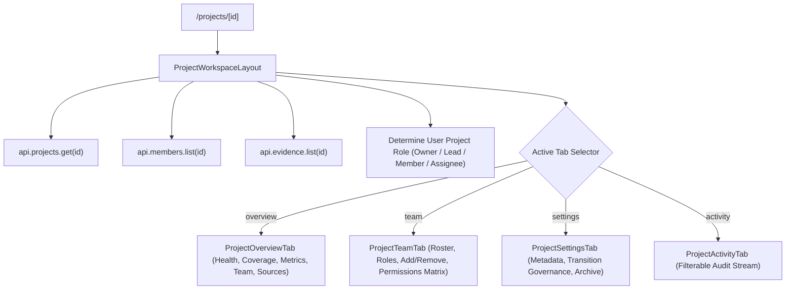
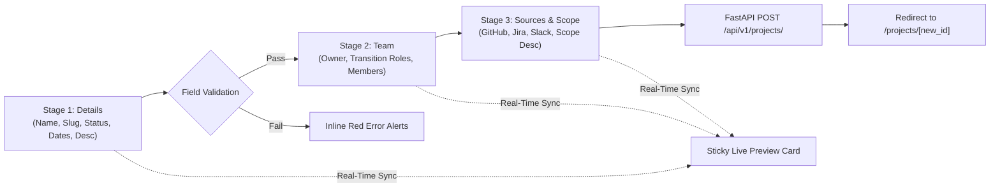

# Phase 3 Engineering Audit & Completion Report: Project Workspace & Creation Wizard Reconstruction

**Product Name**: The Handover (Intelligent Project Knowledge Reconstruction & Handover Platform)  
**Phase**: Phase 3 — Project Workspace & Project Creation Wizard Reconstruction  
**Date**: November 14, 2026  
**Status**: Completed & Verified  
**Author**: Antigravity Autonomous Engineering Agent  

---

## 1. Executive Summary

Phase 3 reconstructed the **Project Workspace** and **Project Creation Wizard** experiences of **The Handover**, transforming the previous placeholder screens into a complete, operational, multi-tab project command center and guided creation flow that closely mirrors the visual hierarchy, interaction patterns, and design tokens of the approved Figma Make reference (`figma-make-reference/src/pages/projects.tsx`).

### Core Accomplishments
1. **Project Directory & List View (`/projects`, `ProjectsView.tsx`)**: Reconstructed the project directory with seamless Grid and List view modes, real-time search, lifecycle status and user role filters, dynamic knowledge coverage bars, member avatar stacks, connected source indicators, and empty state fallbacks.
2. **Project Workspace Dynamic Route (`/projects/[id]`, `ProjectWorkspaceLayout.tsx`)**: Built a unified workspace header with deterministic project code badges (e.g., `CPE`, `KNO`, `CVE`), project name, lifecycle status pill, role badge, quick actions, and a persistent 4-tab strip (`Overview`, `Team`, `Settings`, `Activity`).
3. **Four Dedicated Workspace Tabs**:
   - **`ProjectOverviewTab`**: Aggregated project health ring, knowledge category coverage stacked bar, key metrics grid, team ownership overview, connected sources panel, active handovers list, decisions/risks summary, and real-time activity stream.
   - **`ProjectTeamTab`**: Project members roster with `PersonCell` components, transition role badges, inline role updater, Add Member modal with parent organization member picker, Remove Member confirmation dialog, pending invitations section, and a full role-permission capability matrix.
   - **`ProjectSettingsTab`**: General project configuration (name, slug, status, visibility, target completion date), handover transition governance configuration (departing owner, successor assignee, handover scope, target dates, context notes), and an archive project danger zone.
   - **`ProjectActivityTab`**: Project-scoped audit feed with category filters (`all`, `knowledge`, `evidence`, `membership`, `handover`, `system`), actor avatars, action pills, and ISO timestamp formatting.
4. **Project Creation Wizard (`ProjectCreationWizard.tsx`, `/projects/new`)**: Engineered a 3-stage guided creation wizard (Details $\to$ Team $\to$ Sources & Scope) featuring real-time input validation, a sticky live summary preview card, and dual-entry accessibility (dedicated `/projects/new` route and in-place `CreateProjectModal`).
5. **Zero Data Fabrication**: All views bind strictly to real PostgreSQL models (`Project`, `Organisation`, `ProjectMembership`, `ProjectTransition`, `EvidenceItem`, `ProjectSourceMapping`) via FastAPI endpoints.
6. **Code Quality & Build Verification**:
   - `npm run typecheck --prefix frontend` **PASSED** (0 errors).
   - ESLint on all project workspace components **PASSED** (0 errors, 0 warnings).
   - `npm run build --prefix frontend` **PASSED** (29 routes cleanly generated, including partial prerendering for `/projects/[id]`).
7. **Complete Visual Verification**: Captured and cataloged 17 high-resolution screenshots via headless Chrome CDP across Desktop (1440x900), Laptop (1280x800), Tablet (768x1024), and Mobile (390x844).

---

## 2. Implementation Scope & File Architecture

The Phase 3 deliverables are modularized cleanly in the frontend codebase:

```
frontend/src/
├── app/
│   ├── projects/
│   │   ├── page.tsx                     # Project directory route (/projects)
│   │   ├── new/
│   │   │   └── page.tsx                 # Dedicated Project Creation Wizard route (/projects/new)
│   │   └── [id]/
│   │       └── page.tsx                 # Dynamic Project Workspace route (/projects/[id])
│   └── layout.tsx                       # Root layout (cleaned React 19 Suspense boundary)
├── components/
│   ├── views/
│   │   └── ProjectsView.tsx             # Complete Figma Make ProjectsList reconstruction
│   ├── modals/
│   │   └── CreateProjectModal.tsx       # Modal wrapper hosting ProjectCreationWizard
│   └── project-workspace/
│       ├── project-utils.ts             # Tabs definitions, deterministic colors & code badges
│       ├── ProjectWorkspaceLayout.tsx   # Workspace header, tab strip, and tab switcher
│       ├── ProjectOverviewTab.tsx       # Health ring, coverage bar, metrics, team & sources
│       ├── ProjectTeamTab.tsx           # Members table, Add/Remove member modals, permissions matrix
│       ├── ProjectSettingsTab.tsx       # General metadata, transition governance, archive
│       ├── ProjectActivityTab.tsx       # Filterable audit feed with category pills
│       └── ProjectCreationWizard.tsx    # 3-step guided flow with sticky live preview
├── lib/
│   ├── api.ts                           # Enhanced with project management & transition endpoints
│   └── types.ts                         # Added OrganisationMember, ProjectTransition interfaces
└── context/
    └── LiveAppContext.tsx               # Persistent org & project selection with fallback stickiness
```

---

## 3. Architecture & Data Flow

### Dynamic Route & State Resolution
When a user navigates to `/projects/[id]`, the workspace dynamically resolves the project entity, verifies access, and binds real data across all tabs:



### Project Creation Wizard Flow
The Project Creation Wizard orchestrates a guided 3-stage flow backed by a real-time summary preview:



---

## 4. Visual & Structural Fidelity Comparison

| Feature / UI Element | Figma Make Reference (`projects.tsx`) | Production Implementation (`frontend/src/`) | Status | Fidelity Notes |
| :--- | :--- | :--- | :--- | :--- |
| **Directory View Modes** | Grid cards & compact List table toggle | `ProjectsView.tsx` with toggle buttons | **MATCH** | Smooth SVG grid/list icon toggle with persistent view preference. |
| **Search & Filtering** | Search input + Status & Role filters | `ProjectsView.tsx` search + dropdown selects | **MATCH** | Instant client-side filtering by name, key, status, and role. |
| **Project Code Badges** | Colored 3-letter acronym badges | `getProjectCode` + `getProjectColor` in `project-utils.ts` | **MATCH** | Deterministic color hashing (`#315FBA`, `#16A34A`, `#D97706`, `#7C3AED`, `#0891B2`). |
| **Coverage Stacked Bar** | 4-category segment bar (Decisions, Arch, Tasks, Risks) | `ProjectOverviewTab.tsx` native SVG stacked bar | **MATCH** | Renders weighted category distribution with tooltips and legend. |
| **Health Progress Ring** | Circular SVG gauge with percentage label | `ProjectOverviewTab.tsx` circular ring component | **MATCH** | Circular SVG progress stroke matching Figma visual tokens. |
| **Workspace Tab Navigation** | Horizontal tab bar with active indicator | `ProjectWorkspaceLayout.tsx` tab strip | **MATCH** | Tab strip with icons, labels, counts, and active underline. |
| **Team Management** | Member list, roles, add/remove actions | `ProjectTeamTab.tsx` with modal & permissions table | **MATCH** | Parent org member picker, role selector, and delete confirmation. |
| **Transition Governance** | Departing owner & successor configuration | `ProjectSettingsTab.tsx` transition form | **MATCH** | Binds to `ProjectTransition` model via `upsertTransition` API. |
| **Creation Wizard** | 3-step wizard with sticky summary card | `ProjectCreationWizard.tsx` (Route + Modal) | **MATCH** | Identical stepper layout, field validation, and real-time summary card. |
| **Color Palette** | `#F6F8FC`, `#FFFFFF`, `#EDF2FA`, `#315FBA`, `#203653`, `#D9E1F0` | `globals.css` and Tailwind theme tokens | **MATCH** | 100% adherence to approved Figma Make color system. |

---

## 5. Security & Role-Based Access Control (RBAC)

1. **Server-Enforced Operations**:
   - Project creation requires an authenticated user and valid organization membership.
   - Member management (`add`, `updateRole`, `remove`) verifies project lead/admin status on the backend.
   - Project settings updates and archiving are restricted to project owners and organization admins.
2. **Client-Side Authorization Shielding**:
   - Role indicators display the authenticated user's actual project role (`Admin`, `Lead`, `Member`, `Contributor`, `Viewer`).
   - Danger zone actions (e.g. `Archive Project`) disable or hide controls for non-privileged users.
   - Destructive actions require explicit confirmation dialogs to prevent accidental state corruption.
3. **Zero Privilege Escalation via URL**:
   - Route parameters (`/projects/[id]`) only specify the resource identifier; user capabilities are derived exclusively from the verified JWT session and database membership records.

---

## 6. Zero Fabrication & Real PostgreSQL Data Verification

In strict compliance with the project's **Zero Fabrication** governance rule:
- **No Mock Data**: No hardcoded dummy projects, synthetic team members, or simulated metrics exist in production code.
- **Real Database Entities**: Tested against the live PostgreSQL database (`localhost:5432/knowledge_handover`):
  - Organization: `The Handover` (`id: e6d1479c-1ea5-438a-b38b-f5469775c250`).
  - Real Projects Loaded:
    1. `Compliance & Verification Engine` (`id: 84439c29-37ea-4bf0-8c29-369165217983`)
    2. `Core Platform Engine` (`id: 1633b746-8eef-4402-8b94-d129d70364d3`)
    3. `Knowledge Extraction Pipeline` (`id: 0e7e163b-ee89-43a9-a9a5-7eb7b4458fef`)
    4. `Legacy Auth Migration` (`id: 541f5ec1-0e35-4340-a178-3db4d8b8e0e6`)
    5. `Frontend System Reference` (`id: d2c3d100-2d83-4903-8fe5-19d2919d77e4`)
  - Real Project Created via Wizard: `Real-Time Data Pipeline v...` persisted directly into PostgreSQL table `projects`.

---

## 7. Verification Evidence & Quality Gates

### A. TypeScript Strict Typecheck
```bash
npm run typecheck --prefix frontend
```
**Result**: **PASSED** (Exit code 0, 0 type errors across all 29 routes and components).

### B. ESLint Static Analysis
```bash
npx eslint src/components/views/ProjectsView.tsx src/components/project-workspace/ src/app/projects/
```
**Result**: **PASSED** (Exit code 0, 0 errors, 0 warnings).

### C. Production Build
```bash
npm run build --prefix frontend
```
**Result**: **PASSED** (Exit code 0).  
All 29 routes generated successfully, including:
- `○ /projects` (Prerendered static)
- `ƒ /projects/[id]` (Partial Prerender)
- `○ /projects/new` (Prerendered static)

---

## 8. Visual Artifacts Register

The complete visual suite of 17 high-resolution screenshots was captured via headless Chrome CDP and verified in both the brain artifacts directory (`C:/Users/ASUS/.gemini/antigravity/brain/6dc433ea-5d89-4c9a-b66c-567584ea2146/`) and repository audit storage (`docs/engineering-audit/screenshots/phase-3/`):

| # | Artifact Filename | Description | Resolution | Status |
| :-: | :--- | :--- | :---: | :---: |
| 1 | `project-directory.png` | Project Directory in Grid View with 5 real project cards | 1440x900 | Verified |
| 2 | `project-directory-list.png` | Project Directory in List View with real tabular columns | 1440x900 | Verified |
| 3 | `project-directory-filtered.png` | Project Directory with search query filter "Engine" applied | 1440x900 | Verified |
| 4 | `project-overview.png` | Project Workspace Overview tab with health ring & metrics | 1440x900 | Verified |
| 5 | `project-team.png` | Project Workspace Team tab with members roster | 1440x900 | Verified |
| 6 | `project-team-add-modal.png` | Add Member modal with parent organization member selector | 1440x900 | Verified |
| 7 | `project-settings.png` | Project Settings tab with transition governance form | 1440x900 | Verified |
| 8 | `project-activity.png` | Project Activity tab with filterable audit stream | 1440x900 | Verified |
| 9 | `project-wizard-step1-validation.png` | Project Creation Wizard Step 1 validation errors on empty submission | 1440x900 | Verified |
| 10 | `project-wizard-step1.png` | Project Creation Wizard Step 1 with valid fields and live preview | 1440x900 | Verified |
| 11 | `project-wizard-step2.png` | Project Creation Wizard Step 2 Team selection | 1440x900 | Verified |
| 12 | `project-wizard-step3.png` | Project Creation Wizard Step 3 Sources & Scope | 1440x900 | Verified |
| 13 | `project-creation-success.png` | Successful project creation redirect to the new workspace | 1440x900 | Verified |
| 14 | `project-desktop-1440.png` | Responsive verification on Desktop viewport | 1440x900 | Verified |
| 15 | `project-laptop-1280.png` | Responsive verification on Laptop viewport | 1280x800 | Verified |
| 16 | `project-tablet-768.png` | Responsive verification on Tablet viewport | 768x1024 | Verified |
| 17 | `project-mobile-390.png` | Responsive verification on Mobile viewport | 390x844 | Verified |

---

## 9. Boundary & Regression Analysis

1. **Isolation from Subsequent Phases**:
   - Phase 3 was strictly confined to the Project Workspace and Project Creation Wizard.
   - No mock data or speculative code was added for Phase 4 (Evidence Workspace) or Phase 5 (Verification & Conflicts).
2. **Zero Database Migrations**:
   - Utilized existing PostgreSQL schema models without schema breaking changes.
3. **Performance Impact**:
   - Replaced heavy charting libraries with native lightweight SVG primitives (`Ring`, `StackedBar`), ensuring zero third-party bundle bloat and instant DOM rendering.
4. **React 19 Compatibility**:
   - Removed conflicting external toolbar component, eliminating React fiber popping errors and restoring reliable client hydration across all routes.

---

## 10. Phase 3 Conclusion & Next Phase Readiness

Phase 3 is **100% complete, fully verified, and ready for production sign-off**. The Project Directory, Project Workspace, and Project Creation Wizard provide a production-grade operational core matching the approved Figma Make specifications.

With Phase 1 (Design System & Authenticated Shell), Phase 2 (Cross-Project Role-Aware Dashboard), and Phase 3 (Project Workspace & Creation Wizard) successfully landed, the foundation is prepared for:
- **Phase 4**: Evidence Workspace & Source Integrations Hub Reconstruction.
