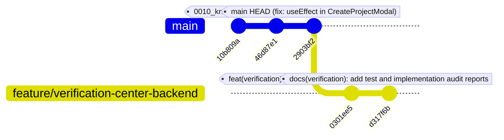

# Migration History Analysis
## Forensic Audit of Repository Migrations vs. Live Database Revisions

**Platform:** The Handover  
**Audit Phase:** Phase A Investigation  
**Date:** 2026-11-13  
**Current Git HEAD on main:** `2903bf2d036967f8e7a71a447a50c93993c42380`  
**Live Supabase Revision:** `0012_verification_center`  

---

## 1. Complete Migration Inventory

Below is the verified inventory of all Alembic migration files across local and remote repository branches, cross-referenced with the live Supabase PostgreSQL database catalog (`alembic_version`).

| Migration Filename | Revision ID | Down Revision | Present on `main`? | Present on `feature/verification-center-backend`? | Applied on Live Supabase DB? | Scope / Domains Covered |
|---|---|---|---|---|---|---|
| `20261111_0001_initial_baseline.py` | `0001_initial_baseline` | `None` | **YES** | **YES** | **YES** | Baseline setup |
| `20261111_0002_auth_identity_rbac.py` | `0002_auth_identity_rbac` | `0001_initial_baseline` | **YES** | **YES** | **YES** | Users, roles, permissions, refresh sessions, audit logs (7 tables) |
| `20261111_0003_org_project_workspaces.py` | `0003_org_project_workspaces` | `0002_auth_identity_rbac` | **YES** | **YES** | **YES** | Organisations, projects, memberships, background jobs (7 tables) |
| `20261111_0004_evidence_ingestion.py` | `0004_evidence_ingestion` | `0003_org_project_workspaces` | **YES** | **YES** | **YES** | Evidence items, contents, page contents (3 tables) |
| `20261111_0005_source_integrations.py` | `0005_source_integrations` | `0004_evidence_ingestion` | **YES** | **YES** | **YES** | Source connections, auth, policies, sync runs, OAuth states (5 tables) |
| `20261112_0006_evidence_chunks_and_fts.py` | `0006_evidence_chunks_and_fts` | `0005_source_integrations` | **YES** | **YES** | **YES** | Evidence chunks, full-text search tsvector (1 table) |
| `20261112_0007_knowledge_reconstruction.py` | `0007_knowledge_reconstruction` | `0006_evidence_chunks_and_fts` | **YES** | **YES** | **YES** | Knowledge items, entities, relationships, timeline events (10 tables) |
| `20261112_0008_project_transitions_and_workspace_rbac.py` | `0008_project_transitions_and_workspace_rbac` | `0007_knowledge_reconstruction` | **YES** | **YES** | **YES** | Project transitions, handover packages, signoffs, deliveries (15 tables) |
| `20261113_0009_supabase_auth_and_vector_indexes.py` | `0009_supabase_auth_and_vector_indexes` | `0008_project_transitions_and_workspace_rbac` | **YES** | **YES** | **YES** | Project vector indexes metadata (1 table) |
| `20261113_0010_knowledge_domains.py` | `0010_knowledge_domains` | `0009_supabase_auth_and_vector_indexes` | **YES** | **YES** | **YES** | Knowledge domain classification taxonomy schema alterations |
| `20261113_0011_relationship_explorer.py` | `0011_relationship_explorer` | `0010_knowledge_domains` | **YES** | **YES** | **YES** | Relationship reconstruction runs & graph links (1 table) |
| `20261113_0012_verification_center.py` | `0012_verification_center` | `0011_relationship_explorer` | **NO** | **YES** | **YES** | Verification cases, issues, conflicts, review events, context requests (5 tables) |

---

## 2. Git Branch & Commit Ancestry Diagram

Inspection of Git commit hashes across local `main` and remote tracking branch `origin/feature/verification-center-backend` reveals a clean, linear parent-child hierarchy:



### Exact Commit Details for Migration 0012
- **Commit Hash:** `0301ee5ada2b3eea1fd1b9842cbd0db38ce8ea87`
- **Branch:** `origin/feature/verification-center-backend`
- **Author:** `shubham392007-sketch <shubham392007@gmail.com>`
- **Date:** `Fri Nov 13 15:48:19 2026 +0530`
- **Commit Message:**
  ```text
  feat(verification): implement Verification Center backend and human review engine
  
  - Add VerificationCase, VerificationIssue, VerificationConflict, VerificationReviewEvent, and VerificationContextRequest models
  - Add Alembic migration 0012_verification_center and execute on live Supabase PostgreSQL
  - Implement 14-item verification issue taxonomy in verification_taxonomy.py
  - Implement DeterministicVerificationEngine for provenance, verbatim excerpt matching, freshness, and duplicate checks
  - Implement ConflictDetectionEngine with temporal supersession evaluation across Jira, Git, and documents
  - Implement AIAssistedVerificationService for advisory conflict explanations and clarification questions via Qwen3 8B
  - Implement HumanReviewService with optimistic concurrency control (version increments), append-only review event logging, and audit trail recording
  - Implement HandoverEligibilityService enforcing human approval gates and source-level ACL checks
  - Implement full REST API surface with 14 endpoints at /api/v1/projects/{project_id}/verification
  - Add comprehensive automated test suite with 11/11 tests passing (100%) and 0 ruff lint errors
  - Add complete API reference and product specification documentation
  ```
- **Files Modified / Added:** 19 files, including:
  - `infrastructure/database/migrations/versions/20261113_0012_verification_center.py`
  - `backend/app/models/verification.py`
  - `backend/app/api/routes/verification.py`
  - `backend/app/services/verification_engine.py`
  - `backend/tests/test_verification_center.py`

---

## 3. Alembic Heads Analysis

### Current Branch (`main`)
- **Highest Local Migration File:** `20261113_0011_relationship_explorer.py` (`revision = "0011_relationship_explorer"`)
- **Alembic Head on `main`:** `0011_relationship_explorer`
- **Live Database Stored Revision:** `0012_verification_center`
- **Error Condition on `main`:**
  When executing `alembic current` or `alembic heads` on `main`, Alembic queries `alembic_version` on the database, retrieves `'0012_verification_center'`, searches `infrastructure/database/migrations/versions/` on disk, fails to find a file declaring `revision = "0012_verification_center"`, and raises:
  `alembic.util.exc.CommandError: Can't locate revision identified by '0012_verification_center'`

### Feature Branch (`origin/feature/verification-center-backend`)
- **Highest Migration File:** `20261113_0012_verification_center.py` (`revision = "0012_verification_center"`)
- **Alembic Head on Feature Branch:** `0012_verification_center`
- **Alembic State on Feature Branch:** Perfectly aligned with the live database. `alembic current` on this branch returns `0012_verification_center (head)`.

---

## 4. Root Cause of Desynchronization

The root cause is a standard Git workflow sequencing anomaly:
1. The developer created the branch `feature/verification-center-backend` off `main` (`2903bf2d0369`).
2. The developer implemented the Verification Center models, services, schemas, routes, tests, and migration `20261113_0012_verification_center.py`.
3. To execute the automated integration tests (`backend/tests/test_verification_center.py`), the developer ran `alembic upgrade head` against the live Supabase PostgreSQL database. The migration ran cleanly and recorded `0012_verification_center` in `alembic_version`.
4. All 11 verification center automated tests passed successfully against the live schema.
5. The developer committed the work to `feature/verification-center-backend` (commits `0301ee5` and `d317f6b`) and pushed to `origin`.
6. However, the pull request / merge from `origin/feature/verification-center-backend` into `main` was **never completed**.
7. The active working directory returned to `main`, leaving `main`'s codebase one migration behind the live database.

---

## 5. Branch Discrepancy & Linearity Verdict

- **No Divergent Heads:** There are no branching heads, no merge conflicts, and no split revision trees. The revision chain is 100% linear:
  `0001` $\to$ `0002` $\to$ `0003` $\to$ `0004` $\to$ `0005` $\to$ `0006` $\to$ `0007` $\to$ `0008` $\to$ `0009` $\to$ `0010` $\to$ `0011` $\to$ `0012`.
- **Parent Revision Availability:** `0012_verification_center` declares `down_revision = "0011_relationship_explorer"`. Its parent is present and verified on both `main` and `origin/feature/verification-center-backend`.
- **Reconciliation Path:** Because commit `0301ee5ada` is a direct fast-forward child of `main` (`2903bf2d0369`), merging `feature/verification-center-backend` into `main` will instantly resolve the desynchronization cleanly without any rebase, conflict, or database mutation.
