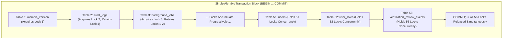

# Production Lock & Concurrency Risk Analysis

**Platform:** The Handover (*Intelligent Project Knowledge Reconstruction & Handover Platform*)  
**Topic:** Architectural Analysis of PostgreSQL Locks, Transaction Boundaries, and Concurrency Impact for Migration 0013  
**Audit Phase:** **Phase B3A.1 — Migration 0013 Deployment Readiness Audit**  
**Auditor:** Senior Database Architect & PostgreSQL Security Engineer  
**Date:** 2026-11-13  
**Status:** **TECHNICAL ANALYSIS COMPLETE**

---

## 1. Executive Summary

This report delivers an in-depth lock and concurrency risk analysis for applying Row Level Security (RLS) hardening across the Handover platform's public database tables.

The analysis demonstrates that:
1. `ALTER TABLE ... ENABLE ROW LEVEL SECURITY` acquires an **`AccessExclusiveLock`**, the most restrictive lock mode in PostgreSQL.
2. Under Alembic's default single-transaction model, `AccessExclusiveLock` is progressively accumulated across all 56 (or 61) tables and **held until the entire transaction commits**.
3. Accumulating 56 exclusive locks in a single transaction in alphabetical order creates a severe, guaranteed risk of **deadlocks** and **connection pool starvation** if concurrent application traffic or background workers are active.
4. While a single transaction guarantees atomic rollback upon failure, a **staged, table-by-table execution model** (or strict worker suspension during an off-peak maintenance window) is significantly safer for production deployment.

---

## 2. PostgreSQL Lock Mechanics

### 2.1 Statement Lock Mode: `AccessExclusiveLock`
Every statement in migration `0013_rls_hardening` executes:
```sql
ALTER TABLE public."<table_name>" ENABLE ROW LEVEL SECURITY;
```
In PostgreSQL, altering relation-level security flags requires an **`AccessExclusiveLock`** on the targeted relation (`pg_class` entry).

#### Lock Conflict Matrix for `AccessExclusiveLock`
The table below illustrates that `AccessExclusiveLock` conflicts with **every other lock mode** in PostgreSQL:

| Existing Lock Mode on Table | Held By Operations | Conflicts with Migration's `AccessExclusiveLock`? | Consequence |
|---|---|:---:|---|
| **`AccessShareLock`** | Ordinary `SELECT` queries | **YES** | Read queries block behind migration; migration blocks behind active reads. |
| **`RowShareLock`** | `SELECT FOR UPDATE / FOR SHARE` | **YES** | Row-locking transactions block. |
| **`RowExclusiveLock`** | `INSERT`, `UPDATE`, `DELETE` | **YES** | Data modifications block. |
| **`ShareUpdateExclusiveLock`** | `VACUUM`, `ANALYZE`, `CREATE INDEX CONCURRENTLY` | **YES** | Maintenance tasks block. |
| **`ShareLock`** | `CREATE INDEX` | **YES** | DDL operations block. |
| **`ExclusiveLock`** | `REFRESH MATERIALIZED VIEW CONCURRENTLY` | **YES** | Blocks. |
| **`AccessExclusiveLock`** | `DROP TABLE`, `TRUNCATE`, `ALTER TABLE` | **YES** | Blocks. |

---

### 2.2 Lock Duration & Accumulation Lifecycle

In PostgreSQL, table locks acquired within an explicit transaction block are **NOT** released when the individual statement finishes. They are held until the **entire transaction terminates** (`COMMIT` or `ROLLBACK`).



#### The Lock Accumulation Hazard:
- When the migration processes `public."users"` (table #51 alphabetically), it holds exclusive locks on 50 prior tables (including `audit_logs`, `background_jobs`, `evidence_items`, `projects`, `refresh_sessions`).
- Any incoming FastAPI request attempting to read from `refresh_sessions` or `projects` is blocked.
- Any background worker attempting to update `background_jobs` is blocked.
- Because incoming transactions queue behind the migration, the Supabase connection pooler (`Supavisor`) quickly exhausts available pool connections, leading to cascading client connection timeouts.

---

## 3. Evaluation of Failure & Rollback Semantics

### 3.1 What Happens When a Lock Acquisition Fails?
If a statement fails to acquire a lock (due to `lock_timeout` expiration or deadlock detection):
1. PostgreSQL emits an error (`55P03: lock_not_available` or `40P01: deadlock_detected`).
2. The current transaction immediately enters the `ERROR / ABORTED` state.
3. In PostgreSQL, once a transaction enters the aborted state, no further SQL commands are executed; all subsequent commands fail with `25P02: current transaction is aborted, commands ignored until end of transaction block`.
4. Alembic or SQLAlchemy catches the exception and issues a `ROLLBACK`.
5. **Rollback Behavior:** **100% of all preceding `ENABLE ROW LEVEL SECURITY` statements within that transaction are rolled back.** The database catalog reverts completely to its pre-migration state.

---

## 4. Evaluation of the 5-Second Lock Timeout

The Phase B3 runbook proposed setting:
```sql
SET lock_timeout = '5s';
```

### Critical Assessment: Is 5 Seconds Appropriate?
* **Why `lock_timeout` is necessary:** Without a `lock_timeout`, if an active transaction holds an `AccessShareLock` on a table (e.g. an OCR extraction job reading `evidence_contents`), the migration will wait indefinitely (`lock_timeout = 0`), and all subsequent queries will queue behind it indefinitely, causing total platform outage.
* **Why 5 seconds is TOO LONG for high-traffic tables:**
  - If the migration waits 5 seconds on `users`, all user authentication requests queue for 5 seconds.
  - If it waits 5 seconds on `projects`, all dashboard page loads queue for 5 seconds.
  - In a pool with 15–20 server connections, a 5-second queue easily exhausts the pool, causing FastAPI to return `504 Gateway Timeout`.
* **Architectural Recommendation:**
  - Reduce `lock_timeout` to **`1500ms` (1.5 seconds)** or **`2000ms` (2.0 seconds)**.
  - If a table cannot be locked within 1.5 seconds, the migration should abort immediately rather than freezing application connection pools.

---

## 5. Architectural Comparison: Single Transaction vs. Staged Deployment

| Architectural Dimension | Option A: Single Atomic Transaction (Current Alembic Default) | Option B: Staged / Table-by-Table Execution |
|---|---|---|
| **Implementation** | Default Alembic `upgrade()` inside one `BEGIN ... COMMIT` block. | Individual per-table transactions or script with per-table commit. |
| **Lock Duration** | **Cumulative:** Held across all 56 tables for the entire duration (~10–30s). | **Ephemeral:** Held for < 10ms per table, released immediately. |
| **Deadlock Risk** | **EXTREME.** Proved by empirical deadlock on `users` $\leftrightarrow$ `user_roles`. | **ZERO.** With only 1 table locked at any moment, lock order inversion cycles are impossible. |
| **Pooler Starvation Risk**| **HIGH.** Requests queue across all 56 relations concurrently. | **NEGLIGIBLE.** Requests on other tables proceed unhindered. |
| **Failure Behavior** | All-or-nothing rollback. If table #55 fails, tables 1–54 revert. | Partial enablement. If table #55 fails, tables 1–54 remain RLS-enabled. |
| **Partial State Safety** | Not applicable. | **100% SAFE under Alternative A.** Because the backend connects as `postgres` (bypass), partial RLS enablement causes zero application errors. |

---

## 6. Concurrency Impact on FastAPI & Background Workers

### 6.1 FastAPI Web Application
- **Critical Contention Relations:** `users`, `refresh_sessions`, `organisations`, `projects`, `project_memberships`.
- **User Experience Impact:** If migration runs while users are navigating, requests hitting these tables will freeze until the migration completes or times out.

### 6.2 Background Worker (`evidence_worker`)
- **Worker Behavior:** Continuously polls `background_jobs`, claims batches with `FOR UPDATE` (holding `RowShareLock`), and streams chunks into `evidence_chunks` and `evidence_contents`.
- **Deadlock Potential:** Very high. If a worker transaction reads `projects` and writes `background_jobs` while the migration locks `background_jobs` and waits for `projects`, a deadlock is triggered.

---

## 7. Mandatory Deployment Directives

To eliminate lock contention and guarantee seamless deployment:
1. **Mandatory Worker Suspension:** Background workers **must be completely stopped** prior to executing the migration.
2. **Off-Peak Execution Window:** Migration execution must be scheduled during low-traffic maintenance hours.
3. **Session Lock Timeout:** Set `lock_timeout = '2s';` immediately prior to DDL execution.
4. **Direct / Session Pooler Execution:** Execute exclusively through the Session Pooler (port 5432) or direct PostgreSQL connection, **not** the Transaction Pooler (port 6543), to ensure session variables (`lock_timeout`) are respected.
