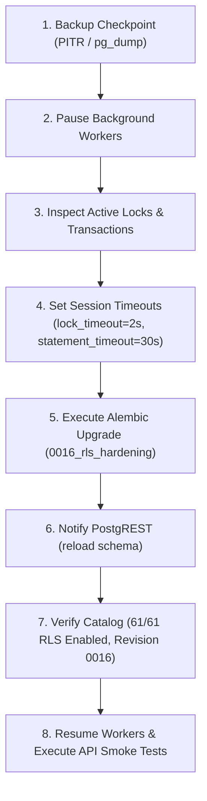

# Production Deployment Runbook & Strategy Reassessment

**Platform:** The Handover (*Intelligent Project Knowledge Reconstruction & Handover Platform*)  
**Topic:** Reassessed Production Deployment Strategy for Migration 0016  
**Target Revision:** `0016_rls_hardening` (Parent: `0015_assistant_workspace`)  
**Scope:** Enable Row Level Security (RLS) across all 61 public base tables  
**Audit Phase:** **Phase B3A.2 — Migration History Reconciliation & Production Safety Audit**  
**Auditor:** Senior Database Architect & PostgreSQL Security Engineer  
**Date:** 2026-11-13  
**Status:** **OPERATIONAL PROTOCOL REASSESSED & HARDENED**

---

## 1. Executive Summary

Following the reconciliation of the live database (`0015_assistant_workspace`) and the repository migration graph (`0016_rls_hardening`), this document details the definitive, controlled production deployment runbook.

The runbook mitigates all risks surfaced in the deadlock investigation through five mandatory operational controls:
1. **Mandatory Worker Suspension:** Pre-flight termination of background worker processes.
2. **Pre-Flight Concurrency Quiescence:** Active session and lock inspection via `pg_stat_activity` and `pg_locks`.
3. **Hardened 2000ms Lock Timeout:** Enforcing fast failure over connection pool starvation.
4. **Dedicated Session Pooler / Port 5432 Connection:** Ensuring session-scoped DDL controls are respected.
5. **PostgREST Schema Reload:** Invalidating stale API security definitions post-execution.

---

## 2. Reassessed Step-by-Step Deployment Protocol



### Step 1: Backup & Recovery Checkpoint
* Confirm that Supabase Point-in-Time Recovery (PITR) or a fresh automated snapshot is available.
* Alternatively, run manual custom-format schema + data dump:
  ```bash
  pg_dump --host=aws-1-ap-southeast-2.pooler.supabase.com --port=5432 --username=postgres \
    --format=custom --file="handover_pre_0016_$(date +%Y%m%d_%H%M%S).dump" postgres
  ```

---

### Step 2: Pause Background Workers
* Stop all running instances of `app.workers.evidence_worker`.
* Confirm termination by querying active sessions:
  ```sql
  SELECT pid, application_name, state, query 
  FROM pg_stat_activity 
  WHERE query ILIKE '%background_jobs%' 
     OR application_name ILIKE '%worker%';
  ```
  - **Acceptance Criteria:** Exactly 0 rows returned.

---

### Step 3: Inspect Active Locks & Long-Running Transactions
* Check for any transactions open longer than 10 seconds:
  ```sql
  SELECT pid, now() - xact_start AS duration, query, state 
  FROM pg_stat_activity 
  WHERE state != 'idle' 
    AND (now() - xact_start) > interval '10 seconds';
  ```
* Check for conflicting table locks:
  ```sql
  SELECT relname, mode, granted 
  FROM pg_locks l 
  JOIN pg_class c ON c.oid = l.relation 
  WHERE c.relnamespace = (SELECT oid FROM pg_namespace WHERE nspname = 'public');
  ```
  - **Acceptance Criteria:** Zero non-idle transactions holding locks on public tables.

---

### Step 4: Configure Session Timeouts
Before executing the DDL, enforce strict fail-fast timeout guards in the migration runner session:
```sql
SET lock_timeout = '2000ms';
SET statement_timeout = '30000ms';
```
* **Why 2000ms?** Prevents the migration's `AccessExclusiveLock` request from blocking active application queries and exhausting the pooler. If a lock cannot be obtained in 2 seconds, the migration aborts cleanly.

---

### Step 5: Execute Atomic Alembic Migration
Execute the upgrade against the target database via Port 5432:
```powershell
alembic upgrade 0016_rls_hardening
```
* **Execution Mechanics:**
  - Alembic wraps all 61 `ALTER TABLE public."{table}" ENABLE ROW LEVEL SECURITY;` statements in one `BEGIN ... COMMIT` block.
  - Updates `public.alembic_version` to `0016_rls_hardening`.

---

### Step 6: PostgREST Schema Cache Reload
Instruct PostgREST to reload its schema cache immediately:
```sql
NOTIFY pgrst, 'reload schema';
```

---

### Step 7: Post-Migration Catalog Verification
Run verification query:
```sql
SELECT 
    COUNT(*) AS total_tables,
    COUNT(*) FILTER (WHERE rowsecurity = true) AS rls_enabled,
    COUNT(*) FILTER (WHERE rowsecurity = false) AS rls_disabled
FROM pg_tables 
WHERE schemaname = 'public';
```
- **Acceptance Criteria:**
  - `total_tables`: 61
  - `rls_enabled`: 61
  - `rls_disabled`: 0

Verify `public.alembic_version`:
```sql
SELECT version_num FROM public.alembic_version;
```
- **Acceptance Criteria:** `0016_rls_hardening`

---

### Step 8: Resume Workers & Execute API Smoke Tests
* Restart background workers:
  ```powershell
  python -m app.workers.evidence_worker
  ```
* Run automated backend health and auth checks:
  ```powershell
  pytest backend/tests/test_health_endpoints.py backend/tests/test_auth_api.py -v
  ```
* Probe PostgREST endpoint with anonymous key:
  ```bash
  curl -i -X GET "https://rjntmboskzyrsqcetzil.supabase.co/rest/v1/users" -H "apikey: <ANON_KEY>"
  ```
  - **Acceptance Criteria:** HTTP 401 Unauthorized OR HTTP 200 OK with empty array `[]`.

---

## 3. Failure Midway & Rollback Analysis

### What Happens if Migration Fails Midway?
* **Scenario:** The migration successfully executes on tables 1 through 50, but at table 51 (`users`), a lock cannot be acquired within 2000ms.
* **Database Behavior:**
  1. PostgreSQL triggers `55P03: lock_not_available`.
  2. The transaction immediately enters the `ABORTED` state.
  3. Alembic catches the error and issues a `ROLLBACK;`.
  4. **PostgreSQL engine atomicity rolls back all preceding 50 `ENABLE ROW LEVEL SECURITY` statements.**
  5. The database reverts 100% to revision `0015_assistant_workspace` with `rowsecurity = false` on all 61 tables.
* **Data State:** Zero partial enablement, zero schema corruption, zero orphaned locks.
