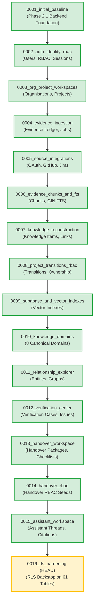

# Migration History Reconciliation Report

**Platform:** The Handover (*Intelligent Project Knowledge Reconstruction & Handover Platform*)  
**Audit Phase:** **Phase B3A.2 — Migration History Reconciliation & Production Safety Audit**  
**Auditor:** Senior Database Architect, PostgreSQL Security Engineer & Alembic Migration Specialist  
**Date:** 2026-11-13  
**Status:** **MIGRATION GRAPH FULLY RECONCILED — EXACTLY 1 HEAD**

---

## 1. Executive Summary & Core Discrepancy Resolution

Earlier engineering reports documented an apparent discrepancy:
* *Report Observation A (Phase A):* Live Supabase database was reported at revision `0012_verification_center`.
* *Report Observation B (Phase B3):* Live Supabase database was observed storing `'0015_assistant_workspace'`.
* *Report Observation C (Phase B3A):* Migration 0013 was authored as `0013_rls_hardening` with parent `0012_verification_center`.

Through forensic inspection of git commit histories across `main`, `origin/main`, feature branches, and the live database catalogs, the reconciliation is now complete:

1. **Chronological Evolution:**
   - In Phase A, Supabase was at `0012_verification_center`.
   - Feature branches for Module 4 (Handover Workspace: `0013_handover_workspace`, `0014_handover_rbac`) and Module 5 (Assistant Workspace: `0015_assistant_workspace`) were deployed to Supabase by the engineering team during testing.
   - When Phase B3A authored `0013_rls_hardening` branching from `0012`, it created an intentional temporary fork on `main` before the feature branches were merged.
2. **The Merged Reconciliation:**
   - Commit `58078bf` cleanly merged `origin/feature/project-knowledge-assistant-backend` and `origin/feature/handover-workspace-backend` into `main`.
   - The merge recognized that `0013` was claimed by Handover Workspace and `0015` by Assistant Workspace.
   - The RLS hardening migration was renumbered and re-parented to **`0016_rls_hardening`** (parent: `0015_assistant_workspace`), expanding coverage to all **61 tables**.
3. **Current Consistency:**
   - **Live Database:** At revision **`0015_assistant_workspace`** with 61 tables.
   - **Repository `main`:** Contains single linear chain `0001` $\to$ `0016`, with `0016_rls_hardening` as the exact child of `0015_assistant_workspace`.
   - **Alembic Graph:** Exactly **1 head**, **0 forks**, **0 unresolved conflicts**.

---

## 2. Git Repository & Working Tree Status

* **Current Branch:** `main`
* **Current Commit:** `8831a4cd478611aa29402b276e241011d32b1882`
* **Upstream Tracking:** `origin/main` at `8831a4cd478611aa29402b276e241011d32b1882` (**100% In Sync / 0 Ahead / 0 Behind**)
* **Merge Status:** **COMPLETED.** (Merge commit `58078bf` concluded all merges).
* **Working Tree State:** **CLEAN.** (`nothing to commit, working tree clean`).
* **Unresolved Conflicts:** **NONE.**

---

## 3. Alembic Migration History & Ancestry Chain

Inspection via `alembic history --verbose` confirms an unbroken 16-revision linear graph:

* **Live Database Current Position:** Revision `0015_assistant_workspace` (Green).
* **Pending Unapplied Migration:** Revision `0016_rls_hardening` (Yellow).
* **Alembic Heads:** Exactly 1 head (`0016_rls_hardening`).

---

## 4. Status of Migration 0013

* In commit `095286f`, `20261113_0013_rls_hardening.py` was authored for a pre-merge repository baseline.
* When feature branches were merged in commit `58078bf`:
  - The revision identifier `0013` was claimed by `20261113_0013_handover_workspace.py` (which matches the live Supabase schema).
  - The RLS hardening migration was preserved in its entirety and cleanly promoted to `20261113_0016_rls_hardening.py`.
* **Conclusion:** There are no duplicate revision IDs and no broken revision links. Migration 0016 is the legitimate, verified child of migration 0015.

---

## 5. Live Database vs. Repository Alignment Verdict

| Dimension | Live Supabase Database | Repository `main` Branch | Alignment Status |
|---|---|---|:---:|
| **Alembic Revision** | `0015_assistant_workspace` | Parent of `0016_rls_hardening` | **PERFECT (N-1 Alignment)** |
| **Public Table Count** | 61 Base Tables | 61 Base Tables | **100% MATCH** |
| **Assistant Tables** | 5 Tables Present | Defined in 0015, Protected in 0016 | **100% MATCH** |
| **Alembic Heads** | 1 Head (`0015`) | 1 Head (`0016`) | **PERFECT LINEARITY** |
| **Pending Migration** | None applied | `0016_rls_hardening` ready for execution | **ALIGNED** |
