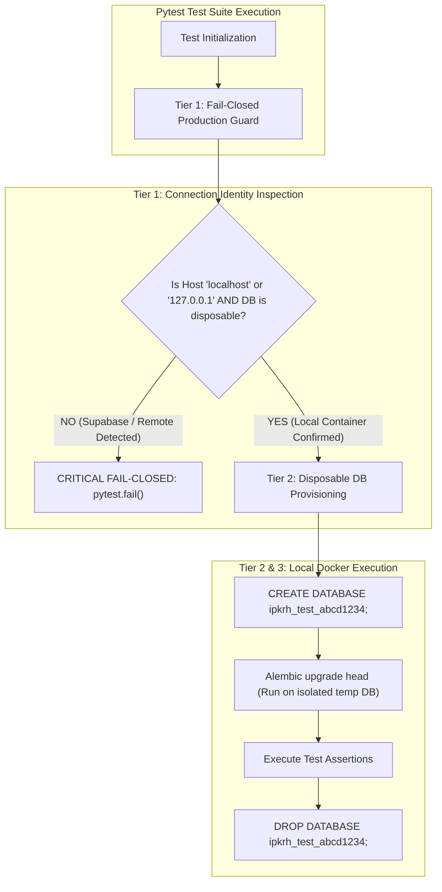

# Migration Test Isolation Architecture & Production Guard Design

**Platform:** The Handover (*Intelligent Project Knowledge Reconstruction & Handover Platform*)  
**Topic:** Architectural Specification for Strict Automated Test Isolation & Fail-Closed Connection Guards  
**Audit Phase:** **Phase B3A.2 — Migration History Reconciliation & Production Safety Audit**  
**Auditor:** Senior Database Architect & PostgreSQL Security Engineer  
**Date:** 2026-11-13  
**Status:** **ARCHITECTURAL DESIGN COMPLETE (PROPOSED SPECIFICATION)**

---

## 1. Executive Summary & Problem Statement

The incident audit in `previous-production-test-incident.md` established that automated test suites could inadvertently execute against the remote hosted database if environment variables in `.env` pointed to Supabase.

To prevent any recurrence of this catastrophic risk, this document specifies a **three-tier test isolation architecture**:
1. **Dedicated Local Container Target:** All DDL and migration tests must target the containerized PostgreSQL instance (`ipkrh-postgres` on `localhost:5432`).
2. **Disposable Dynamic Database Provisioning:** Tests must dynamically spin up isolated, uniquely named databases (`ipkrh_test_<uuid>`), execute migrations, run assertions, and drop them upon teardown.
3. **Fail-Closed Production Connection Guard:** A mandatory pytest fixture that inspects the connected host, IP address, and database metadata, immediately aborting if the target resolves to Supabase or any non-local endpoint.

---

## 2. Three-Tier Test Isolation Architecture



---

## 3. Tier 1: Fail-Closed Production Connection Guard Specification

The connection guard must be implemented as an `autouse=True` fixture in `backend/tests/conftest.py` for all database test suites.

### Algorithmic Guard Rules:
1. **Loopback IP Enforcement:** The server address `inet_server_addr()` must strictly be `127.0.0.1`, `::1`, or a Docker bridge network address (`172.17.*` / `172.18.*`).
2. **Hostname Blacklist:** If the connection URL hostname contains `supabase.co`, `supabase.com`, `pooler.supabase.com`, or any cloud domain, fail immediately.
3. **Project Reference Blacklist:** If the connection username contains `rjntmboskzyrsqcetzil` or any tenant project prefix, fail immediately.
4. **Database Name Whitelist:** Disallow running DDL on default databases named `postgres` or `production`. Require prefix `ipkrh_test_`.

### Proposed Fixture Implementation (For Post-Audit Implementation):
```python
# Proposed backend/tests/conftest.py guard fixture (Design Specification)

import pytest
import psycopg
from urllib.parse import urlparse
from app.core.config import get_settings

_FORBIDDEN_HOST_PATTERNS = ("supabase.com", "supabase.co", "aws-1-", "pooler")
_FORBIDDEN_PROJECT_REFS = ("rjntmboskzyrsqcetzil",)

@pytest.fixture(autouse=True, scope="function")
def enforce_test_database_isolation():
    """Fail-closed guard ensuring zero tests execute DDL against hosted Supabase."""
    settings = get_settings()
    raw_url = settings.database.url.get_secret_value()
    parsed = urlparse(raw_url)
    hostname = (parsed.hostname or "").lower()
    username = (parsed.username or "").lower()

    # Rule 1: Hostname pattern check
    for forbidden in _FORBIDDEN_HOST_PATTERNS:
        if forbidden in hostname:
            pytest.fail(
                f"CRITICAL SAFETY VIOLATION: Test target host '{hostname}' matches "
                f"forbidden production/hosted pattern '{forbidden}'. "
                f"Automated tests must run against local containerized PostgreSQL only!"
            )

    # Rule 2: Project ref in username check
    for proj in _FORBIDDEN_PROJECT_REFS:
        if proj in username:
            pytest.fail(
                f"CRITICAL SAFETY VIOLATION: Test connection username contains "
                f"Supabase project reference '{proj}'. Test aborted!"
            )

    # Rule 3: Remote IP inspection
    try:
        clean_url = raw_url.replace("postgresql+psycopg://", "postgresql://")
        with psycopg.connect(clean_url, connect_timeout=2) as conn:
            server_ip = conn.execute("SELECT inet_server_addr();").scalar()
            if server_ip and not (str(server_ip).startswith("127.") or str(server_ip).startswith("172.") or str(server_ip) == "::1"):
                pytest.fail(
                    f"CRITICAL SAFETY VIOLATION: Database server IP '{server_ip}' "
                    f"is not a local loopback or Docker bridge address!"
                )
    except psycopg.OperationalError as exc:
        pytest.skip(f"Local test database unreachable: {exc}")
```

---

## 4. Tier 2: Disposable Database Lifecycle Fixture

For migration tests that require executing `upgrade()` or `downgrade()`:
1. Connect to local `postgres` admin database on `127.0.0.1:5432`.
2. Generate temporary database name: `temp_db = f"ipkrh_test_{uuid.uuid4().hex[:8]}"`.
3. Issue `CREATE DATABASE "<temp_db>";`.
4. Point Alembic `Config.set_main_option("sqlalchemy.url", temp_url)`.
5. Execute migrations and test logic.
6. Dispose engine and execute `DROP DATABASE "<temp_db>" WITH (FORCE);`.

---

## 5. Summary of Governance Standards

| Requirement | Proposed Architecture Standard |
|---|---|
| **Host Target** | Strictly `127.0.0.1:5432` / Docker container `ipkrh-postgres`. |
| **Isolation Boundary** | Dynamically provisioned, disposable temporary databases. |
| **Production Defense** | Fail-closed pytest fixture intercepting host, IP, and project ref. |
| **Local Developer Setup** | Preserves `.env` stability without risk of remote DDL leakage. |
| **CI/CD Compatibility** | Native GitHub Actions / Docker Compose test runners. |
