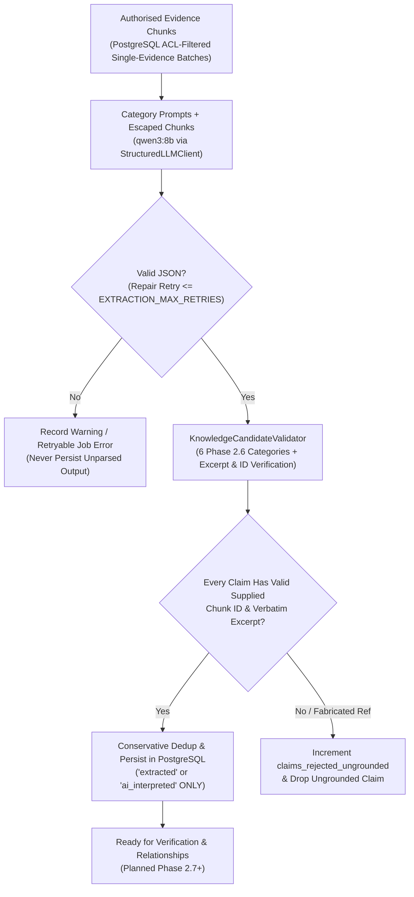
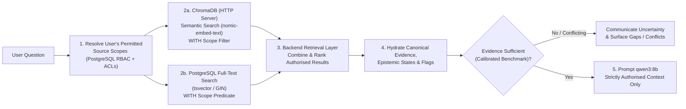

# AI & RAG Architecture

> **Classification Key:** **Confirmed Design Decisions** state non-negotiable AI governance rules, model selections, OCR runtime strategy, hybrid retrieval architecture, and RAG safeguards. **Proposed Implementation Details** cover prompt contracts, chunking parameters, and ranking mechanics subject to empirical benchmarking on realistic project evidence.

---

## 1. AI Governance & Authority Boundaries (Confirmed)

1. **LLM Is Not the Source of Truth**: Qwen3 8B acts strictly as an extraction, synthesis, and conversational grounding aid. Every important finding must trace back to supporting canonical evidence in PostgreSQL.
2. **Prohibited Autonomous Actions**: The LLM must **never** independently:
   - Approve handovers (nor substitute for designated reviewer approval)
   - Decide official task or project status
   - Override source-level permissions or RBAC decisions
   - Resolve conflicting facts without authoritative evidence
   - Invent project decisions, rationale, blockers, or ownership/responsibilities
3. **Mandatory Epistemic Transparency**: System outputs must distinguish **Original source evidence**, **Extracted information**, **AI-generated interpretation**, and **Human-verified knowledge**.
4. **Uncertainty Disclosure**: Whenever retrieved evidence is missing, partial, outdated, or contradictory, the system must explicitly state uncertainty and expose the gap rather than fabricating a confident narrative.

---

## 2. Confirmed AI, Embedding & OCR Stack

| Component | Confirmed Choice | Role & Runtime Boundary |
| :--- | :--- | :--- |
| **Local AI Runtime** | Existing local Ollama installation | Hosts LLM, embeddings, and initial OCR locally without leaking restricted organisational content externally |
| **Initial Benchmark LLM** | `qwen3:8b` | Structured extraction, synthesis, conflict flagging, and RAG answer generation |
| **Embedding Model** | `nomic-embed-text` | **Must** be used identically for both ingestion indexing and query retrieval |
| **Scanned Document OCR** | `glm-ocr:latest` via Ollama | Runs behind a **replaceable backend OCR service abstraction**; do **not** introduce vLLM or another OCR runtime at this stage |
| **Digital PDF Parser** | PyMuPDF | Text, layout, and page metadata extraction from native PDFs |
| **Word Parser** | `python-docx` | Paragraph, heading, and table extraction from `.docx` documents |

---

## 3. Document Processing, OCR Abstraction & Chunking Pipeline

### 3.1 Replaceable Backend OCR Abstraction (Confirmed & Implemented Phase 2.4A)

- Document extraction invokes the protocol-based `OCRService` interface (`app/services/ocr.py`) rather than binding extraction pipelines directly to Ollama HTTP payloads.
- The implemented adapter, `OllamaGLMOCRService`, calls local Ollama `/api/generate` with `OLLAMA_OCR_MODEL=glm-ocr:latest`, configurable `OLLAMA_OCR_NUM_CTX` (default `8192`), `OLLAMA_OCR_NUM_PREDICT` (`4096`), `OLLAMA_OCR_TIMEOUT_SECONDS` (`120.0`), bounded page rendering (`OCR_RENDER_DPI=150`, `OCR_MAX_IMAGE_DIMENSION=2048`), sequential inference locking (`_OLLAMA_INFERENCE_LOCK`) to avoid competing GPU memory pressure, and explicit truncation checks (`done`, `done_reason == "length"`, `eval_count >= num_predict`).
- Any page experiencing OCR truncation or hitting `OCR_MAX_PAGES_PER_DOCUMENT` marks that page `ocr_truncated` / `skipped_limit` and transitions the parent document to `partially_extracted`—truncated OCR output is **never** silently labelled `extracted`.
- If future benchmarking warrants swapping `glm-ocr:latest`, a new `OCRService` implementation can replace `OllamaGLMOCRService` without refactoring document validation, worker orchestration, or downstream pipelines. No vLLM or alternative OCR runtime is introduced at this stage.

### 3.2 Hybrid Document Ingestion & Async Worker Execution

1. **Worker Execution (Confirmed & Implemented Phase 2.4A)**: Document decryption, parsing, OCR, and status persistence execute inside the **lightweight Python background worker process** (`python -m app.worker` / `IngestionWorkerService`) backed by PostgreSQL `background_jobs` (`SELECT ... FOR UPDATE SKIP LOCKED`, stale-lease recovery, exponential backoff retries, preserving encrypted payloads on failure — no Redis or Celery).
2. **Format Triage & Structural Extraction (Implemented Phase 2.4A — `app/services/document_extraction.py`)**:
   - `.docx` → `python-docx` iterates `document.element.body.iterchildren()` to extract headings, paragraphs, and pipe-formatted tables in exact sequence, grouped into bounded logical sections (`evidence_page_contents`).
   - `.pdf` → `pymupdf` evaluates embedded text vs raster images/drawings per page against `OCR_MIN_TEXT_CHARS_PER_PAGE`. Digital text pages use PyMuPDF directly (`digital_text`); sparse-text pages with images/drawings invoke `OCRService` up to `OCR_MAX_PAGES_PER_DOCUMENT` (`glm_ocr` or `pymupdf_and_ocr`). Separated document and page text reside in `evidence_contents` and `evidence_page_contents`.
3. **Traceable Chunking *(Implemented Phase 2.5 — `app/services/chunking.py`)***:
   - Structure-aware `ChunkingService` segments extracted evidence across document headings and pipe-formatted tables (`PDF`/`DOCX`), GitHub PR descriptions/reviews/discussions/commits/diffs, and Jira issue descriptions/comments/changelogs (`ChunkDraft` with `chunk_index`, `chunk_type`, `section_title`, `page_number`, `char_start`, `char_end`, `char_count`, `token_estimate` ~3.2 chars/token, `chunk_content_hash` SHA-256, `source_author_identity`, `source_created_at`, and expanded `search_identifier_text` covering ticket keys `NEX-142`, file paths, 8/12-char commit SHA prefixes, PR refs, and snake/camel tokens).
   - Bounded by configurable defaults (`CHUNK_TARGET_CHARS=1100`, `CHUNK_MAX_CHARS=1400`, `CHUNK_OVERLAP_CHARS=150`, `CHUNK_MIN_CHARS=120`) and persisted in PostgreSQL `evidence_chunks` (`0006_evidence_chunks_and_fts`) with weighted `TSVECTOR` (`A`: identifiers/titles, `B`: section titles, `C`: chunk body) + `GIN` index (`ix_evidence_chunks_search_vector`) prior to secondary ChromaDB indexing.

### 3.3 Embedding Consistency Check *(Confirmed Rule & Implemented Guard — `app/services/embedding.py`, `app/services/vector_store.py`)*

- Both `IndexingWorkerService` and `HybridRetrievalService` resolve `OLLAMA_EMBEDDING_MODEL` (`nomic-embed-text`) through `OllamaEmbeddingService` (`batch_size=8` via `/api/embed` during indexing, single query embedding at retrieval time), enforcing exact `EMBEDDING_EXPECTED_DIMENSIONS=768` and rejecting `NaN`/`Inf` vectors.
- Collection names bind both model and index version (`${CHROMA_COLLECTION_PREFIX}_evidence_chunks_${OLLAMA_EMBEDDING_MODEL}_${CHROMA_INDEX_VERSION}`), persist compatibility metadata (`embedding_model`, `index_version`, `expected_dimensions`, `hnsw:space=cosine`), record per-chunk/item `embedding_model` and `embedding_dimensions` in PostgreSQL, and fail compatibility checks (`VECTOR_COLLECTION_*`) if the configured model or dimension diverges.

---

## 4. Evidence-Grounded Knowledge Extraction (`RECONSTRUCT`) *(Implemented Phase 2.6)*

1. **Replaceable LLM Abstraction (`app/services/llm.py`)**:
   - Extraction depends strictly on the `StructuredLLMClient` protocol (`generate_json(LLMGenerationRequest) -> LLMGenerationResult`).
   - `OllamaLLMClient` integrates native local Ollama `/api/chat` with `OLLAMA_LLM_MODEL=qwen3:8b`, `OLLAMA_LLM_THINK=false` (eliminating hidden reasoning overhead on structured extraction), `format="json"` (with `<think>` / fence-tolerant `parse_llm_json_object` fallback), bounded `OLLAMA_LLM_NUM_CTX=8192`, `OLLAMA_LLM_NUM_PREDICT=2048`, `OLLAMA_LLM_TEMPERATURE=0.1`, `OLLAMA_LLM_TIMEOUT_SECONDS=120.0`, and shared `_OLLAMA_INFERENCE_LOCK` serialising GPU access alongside `OllamaGLMOCRService`.
2. **Scope & Categories Implemented vs Platform Target**:
   - **8-Category Platform Target *(Confirmed)***: Decisions & rationale, technical/architectural knowledge, completed & unfinished work, responsibilities & ownership, dependencies, bugs/blockers/risks, operational procedures, and historical discussions/context.
   - **6 Core Categories Implemented *(Phase 2.6 — `app/services/extraction_prompts.py`)***: `decisions_rationale`, `work_items`, `responsibilities_ownership`, `technical_architecture`, `bugs_blockers_risks`, and `dependencies` (`operational_procedures` and `historical_context` remain schema-deferred to follow-on extraction/handover refinement).
   - **Single-Evidence Bounded Batching**: `ReconstructionWorkerService` (`background_jobs` type `knowledge_reconstruction`) claims queued jobs and partitions each permitted evidence item's canonical `evidence_chunks` independently into bounded batches (`EXTRACTION_MAX_CHUNKS_PER_BATCH=6`, `EXTRACTION_MAX_CHARS_PER_BATCH=5500`) so restricted/public items never co-mingle in one prompt. Chunk text escapes literal `</evidence_chunk>` tags, and system instructions treat all evidence strictly as untrusted data. Invalid JSON or Pydantic candidate failures trigger up to `EXTRACTION_MAX_RETRIES=2` structured repair prompts before failing safely.
3. **Strict `NO EVIDENCE -> NO CLAIM` Validation (`app/services/knowledge_validator.py`)**:
   - Every candidate claim is validated against strict category Pydantic schemas and verified against supplied `ChunkPromptInput` records: non-empty `evidence_refs`, exact supplied `chunk_id` membership, and verbatim or whitespace/punctuation-normalised substring presence (`verify_excerpt_in_chunk`). Unverifiable candidates increment `claims_rejected_ungrounded` and are discarded before persistence.
   - **Honest Severity & Uncertainty Caps**: Bug/blocker/risk severity downgrades to `"unspecified"` unless explicit severity/priority cues appear in the supporting evidence excerpts or source text. The validator enforces `epistemic_status` ∈ `{extracted, ai_interpreted}` (LLM output can **never** emit `human_verified`), preserves unmerged `person_identity` labels, records structured `confidence_metadata` (`missing_fields`, `attribution_certainty`, `temporal_certainty`), and enforces `is_synthetic` isolation (`include_synthetic=false` on API queries).
4. **Conservative Deduplication, Corroboration & Staleness (`app/repositories/knowledge.py`)**:
   - Claims hash into deterministic `fingerprint` keys preserving category, status, dependencies, and unmerged `person_or_owner_label` strings. Exact same-project/same-fingerprint matches append supporting `knowledge_evidence_links` and upgrade `support_classification` to `corroborated` when corroborated across distinct evidence items without silently merging distinct statuses or person representations.
   - Modifying (`update_source_content`) or soft-deleting (`soft_delete_evidence`) supporting `EvidenceItem` rows automatically marks linked `KnowledgeItem` rows `is_stale=true` with explicit `stale_reason` (`supporting_evidence_updated` / `supporting_evidence_deleted`), and read APIs hide items lacking any active ACL-permitted evidence link.

---

## 5. Verification Safeguards (`VERIFY`)

1. **Conflict Detection**: Flag cross-source and temporal contradictions in PostgreSQL `verification_flags` (`conflict`) citing all competing evidence items for human review in **Verification Center**. Never resolve conflicts autonomously.
2. **Missing-Information Detection**: Identify absent owners, missing operational runbooks, or undocumented rationales across the 8 categories (`missing_information`).
3. **Uncertainty Handling**: Record explicit `confidence_score` and `uncertainty_reason` when evidence is ambiguous, informal, or stale.

---

## 6. Hybrid Permission-Filtered Retrieval (`Project Knowledge Assistant`)

### 6.1 Confirmed Hybrid Retrieval Architecture

1. **Pre-Retrieval Permission Filtering *(Confirmed Security Invariant; Implemented Phase 2.4B + Phase 2.5)***:
   - Phase 2.4B implemented `source_access_policies`, `user_source_authorisations`, `evidence_items.source_access_policy_id`, and `EvidenceRepository.list_for_project` / `SourceAccessPolicyService` fail-closed PostgreSQL enforcement across uploads, GitHub repos, Jira projects, and Jira `fields.security` sub-policies.
   - Phase 2.5 extends two-phase fail-closed ACL enforcement across hybrid chunk retrieval (`EvidenceChunkRepository` + `HybridRetrievalService`): resolving allowed/revoked `source_access_policy_id` sets from PostgreSQL **before** querying ChromaDB (`where` filters) or PostgreSQL FTS (`WHERE`), **and** re-validating every returned chunk against live canonical `SourceAccessPolicyService` rules in PostgreSQL before any citation or chunk text returns (or reaches future Ollama prompts). `include_synthetic=false` is enforced by default in both stores.
2. **Dual Search Execution *(Confirmed & Implemented Phase 2.5)***:
   - **ChromaDB (HTTP v2 Server Mode)**: Dense cosine vector retrieval using `nomic-embed-text` (`768` dims) with non-secret metadata `where` filters (`organisation_id`, `project_id`, `permission_scope_key` / legacy uploader scope, `is_synthetic`, `source_type`, `category`, `chunk_type`, `evidence_id`, UTC `source_created_ts`).
   - **PostgreSQL Full-Text Search**: Lexical keyword and exact identifier matching (`websearch_to_tsquery('simple', ...)` + weighted `TSVECTOR` + `GIN` index + `ts_rank_cd` with SQLite portable test fallback) for ticket IDs (`NEX-142`), PR numbers, file paths, and commit SHA prefixes, filtered in SQL by the identical allowed scope predicate.
3. **Backend Fusion, Degraded Fallback & Rebuild *(Confirmed & Implemented Phase 2.5)***:
   - `HybridRetrievalService` merges overfetched keyword and semantic candidates via weighted Reciprocal Rank Fusion (`weight / (RETRIEVAL_RRF_K + rank)`, `k=60`, default `semantic_weight=1.0`, `keyword_weight=1.0`), deduplicates by `chunk_id`, hydrates canonical parent evidence metadata and bounded excerpts from PostgreSQL, and preserves full provenance (`SearchCitation`).
   - **Degraded Availability**: When ChromaDB or Ollama embeddings are unreachable or incompatible, `mode="hybrid"` degrades cleanly to PostgreSQL keyword search (`mode_executed="keyword"`, `degraded=true`, structured `degraded_reason` and warning), whereas explicit `mode="semantic"` returns `503 Service Unavailable`. `POST /indexing/reindex` (`full`, `fts_only`, `vectors_only`) rebuilds secondary Chroma vectors or chunks deterministically from PostgreSQL.
4. **Evidence-Grounded Response & Abstention *(Planned Phase 3+ Assistant)***:
   - Explicitly separates **Human-Verified Knowledge** from **Extracted** / **AI-Interpreted** items, cites source identifiers/URLs/timestamps, surfaces active conflicts, and communicates uncertainty when evidence is absent or insufficient.

---

## 7. Empirical Benchmarking & Calibration Policy (Confirmed)

1. **Benchmark Before Setting Numerical Thresholds (Confirmed)**:
   - Do **not** hardcode arbitrary similarity cutoffs, FTS/vector fusion weights, or abstention confidence thresholds upfront.
   - Retrieval quality, fusion weights, top-K limits, and abstention cutoffs must be **benchmarked using realistic project evidence** (code PRs, Jira issues, technical documents, and scanned PDFs) before locking numerical thresholds.
2. **Benchmark Dimensions & Observed Development Fixture Check**:
   - **Phase 2.5 Synthetic Development Fixture Retrieval Check** (`backend/tests/test_pg_fts_and_live_evaluation.py` — **6 synthetic fixture items (`is_synthetic: true`) / 6 mixed exact-identifier & conceptual queries** executed against live PostgreSQL 16 `GIN`, Ollama `nomic-embed-text` 768-dim, and ChromaDB v2 on local Windows host):
     - `keyword` (PG FTS): `precision_at_3 = 0.5000`, `recall_at_5 = 0.5000`, `mrr = 0.5000`, `mean_latency_ms = 15.5`
     - `semantic` (Chroma + `nomic-embed-text`): `precision_at_3 = 0.3333`, `recall_at_5 = 0.8333`, `mrr = 0.7500`, `mean_latency_ms = 7071.17`
     - `hybrid` (weighted RRF, `k=60`): `precision_at_3 = 0.3889`, `recall_at_5 = 1.0000`, `mrr = 0.9167`, `mean_latency_ms = 6096.33`
     - *Notice*: These figures are **synthetic development fixture regression measurements** (reflecting local Ollama embedding latency and a tiny 6-item corpus), **not** a realistic organisational benchmark or fixed production threshold. Phase 8 remains responsible for calibrating retrieval weights and similarity/abstention thresholds (`RETRIEVAL_MIN_*`) on realistic multi-document/repo/Jira evidence.
   - **Phase 2.6 Synthetic Development Fixture Extraction Check (`qwen3:8b`)** (`backend/tests/test_live_qwen3_knowledge_evaluation.py` — **3 synthetic evidence items (`is_synthetic: true`: ADR PDF, GitHub PR, Jira Bug)** evaluated across **all 6 implemented Phase 2.6 categories** on live PostgreSQL 16 + native Windows Ollama `qwen3:8b` with `think=false`, `format="json"`, `num_ctx=8192`):
     - `batches_executed = 6`, `candidates_generated = 11`, `claims_persisted = 11`, `claims_rejected_ungrounded = 0`, `duplicates_merged = 0`, `warnings = []`
     - `categories_seen`: `decisions_rationale: 1`, `work_items: 2`, `responsibilities_ownership: 2`, `technical_architecture: 3`, `bugs_blockers_risks: 1`, `dependencies: 2`
     - `all_excerpts_verified = true`, `epistemic_status = "extracted"` (zero AI-emitted `human_verified`), `owners_seen = ["@achen", "Alex Chen", "Priya Nair"]` (distinct identities preserved unmerged), and `GET /knowledge/items` default isolation (`include_synthetic=false`) returned `0` items.
     - `prompt_tokens = 5833`, `completion_tokens = 2962`, `runs_duration_ms = 416345`, `wall_ms = 416527` (~`69.4 s` mean per batch at `num_ctx=8192`; earlier single-batch probe at `num_ctx=4096` measured `47,147 ms` for `864` prompt / `293` completion tokens).
     - **Observed Hardware & Async Boundary Finding**: On the development host (`NVIDIA GeForce RTX 4050 Laptop GPU`, `6141 MiB` VRAM), `qwen3:8b` at `num_ctx=8192` allocates ~`6.6 GB` across ~`37% CPU / 63% GPU` offload via `llamacpp`. Multi-category reconstruction latency (`~45–70 s` per batch, `~7 min` across 6 focused calls) confirms that running extraction exclusively via asynchronous PostgreSQL `background_jobs` + the standalone worker (rather than synchronous HTTP request handlers) is an operational requirement on 6 GB VRAM hardware, and full 18-call default single-item sweeps require `JWT_ACCESS_TOKEN_EXPIRE_MINUTES` / client token refresh handling across long polling windows.
     - *Notice*: As with Phase 2.5, this is a **synthetic development fixture smoke & grounding evaluation**, **not** the Phase 8 realistic multi-project organisational benchmark across full repositories, Jira boards, and scanned PDFs.
   - **OCR Fidelity & Latency (`glm-ocr:latest` on Ollama)**: Text/table extraction accuracy and runtime latency on realistic scanned engineering documents (to validate whether local Ollama remains sufficient or warrants swapping the OCR adapter in a future phase).
   - **Permission Isolation & Abstention**: Zero cross-scope leakage and calibrated refusal when supporting evidence is withheld or contradictory.
