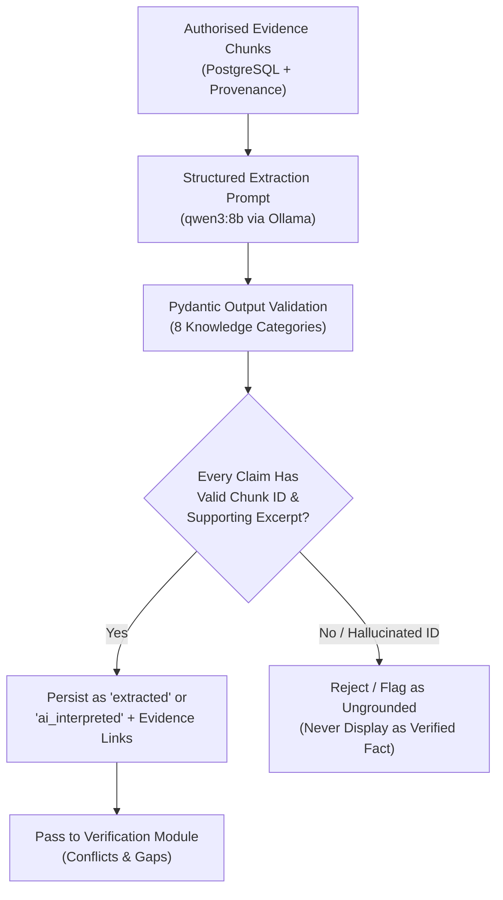
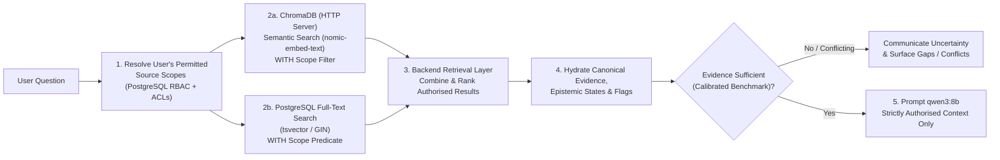

# AI & RAG Architecture

> **Classification Key:** **Confirmed Design Decisions** state non-negotiable AI governance rules, model selections, OCR runtime strategy, hybrid retrieval architecture, and RAG safeguards. **Proposed Implementation Details** cover prompt contracts, chunking parameters, and ranking mechanics subject to empirical benchmarking on realistic project evidence.

---

## 1. AI Governance & Authority Boundaries (Confirmed)

1. **LLM Is Not the Source of Truth**: Qwen3 8B acts strictly as an extraction, synthesis, and conversational grounding aid. Every important finding must trace back to supporting canonical evidence in PostgreSQL.
2. **Prohibited Autonomous Actions**: The LLM must **never** independently:
   - Approve handovers (nor substitute for designated reviewer approval)
   - Decide official task or project status
   - Override source-level permissions or RBAC decisions
   - Resolve conflicting facts without authoritative evidence
   - Invent project decisions, rationale, blockers, or ownership/responsibilities
3. **Mandatory Epistemic Transparency**: System outputs must distinguish **Original source evidence**, **Extracted information**, **AI-generated interpretation**, and **Human-verified knowledge**.
4. **Uncertainty Disclosure**: Whenever retrieved evidence is missing, partial, outdated, or contradictory, the system must explicitly state uncertainty and expose the gap rather than fabricating a confident narrative.

---

## 2. Confirmed AI, Embedding & OCR Stack

| Component | Confirmed Choice | Role & Runtime Boundary |
| :--- | :--- | :--- |
| **Local AI Runtime** | Existing local Ollama installation | Hosts LLM, embeddings, and initial OCR locally without leaking restricted organisational content externally |
| **Initial Benchmark LLM** | `qwen3:8b` | Structured extraction, synthesis, conflict flagging, and RAG answer generation |
| **Embedding Model** | `nomic-embed-text` | **Must** be used identically for both ingestion indexing and query retrieval |
| **Scanned Document OCR** | `glm-ocr:latest` via Ollama | Runs behind a **replaceable backend OCR service abstraction**; do **not** introduce vLLM or another OCR runtime at this stage |
| **Digital PDF Parser** | PyMuPDF | Text, layout, and page metadata extraction from native PDFs |
| **Word Parser** | `python-docx` | Paragraph, heading, and table extraction from `.docx` documents |

---

## 3. Document Processing, OCR Abstraction & Chunking Pipeline

### 3.1 Replaceable Backend OCR Abstraction (Confirmed)

- Document ingestion invokes an abstract `OCRService` interface rather than binding extraction workflows directly to Ollama HTTP payloads.
- The initial concrete adapter calls the existing local Ollama service (`OLLAMA_OCR_MODEL=glm-ocr:latest`).
- If future benchmarking demonstrates that `glm-ocr:latest` on Ollama lacks throughput or accuracy for specific document layouts, the backend adapter can be replaced independently without refactoring ingestion, chunking, or downstream pipelines. No vLLM or alternative OCR server is introduced at this stage.

### 3.2 Hybrid Document Ingestion & Async Worker Execution

1. **Worker Execution (Confirmed)**: File parsing, OCR, chunking, full-text vector preparation, and embedding indexing execute inside the **separate lightweight Python worker process** driven by PostgreSQL `background_jobs` records (no Redis or Celery).
2. **Format Triage (Proposed)**:
   - `.docx` → `python-docx` extracts structured sections, tables, and author properties.
   - `.pdf` → PyMuPDF inspects text density per page. Native text pages use PyMuPDF directly; image-only or low-text-density pages route through the backend OCR abstraction (`glm-ocr:latest`), retaining page-level provenance.
3. **Traceable Chunking (Proposed)**:
   - Structure-aware chunking preserving document headings, PR threads, Jira issue/comment boundaries, or optional Slack thread boundaries.
   - Exact `page_number`, `char_start`, `char_end`, `content_hash`, `permission_scope_id`, and PostgreSQL `tsvector` full-text index fields are persisted in `evidence_chunks` before ChromaDB indexing.

### 3.3 Embedding Consistency Check (Confirmed Rule, Proposed Guard)

- Both Python worker indexing and backend RAG query retrieval use `OLLAMA_EMBEDDING_MODEL=nomic-embed-text`.
- **Proposed Safeguard**: Store `embedding_model` on every `evidence_chunks` row and ChromaDB collection metadata; fail loudly if configured model diverges from collection metadata.

---

## 4. Evidence-Grounded Knowledge Extraction (`RECONSTRUCT`)

- **Categories Extracted**: Decisions & rationale, technical/architectural knowledge, completed & unfinished work, responsibilities & ownership, dependencies, bugs/blockers/risks, operational procedures, historical discussions & context.
- **Strict Grounding Rule**: Every extracted record must cite valid `chunk_id`s and verbatim evidence spans. Unverifiable citations are rejected by backend Pydantic/post-processing validation.

---

## 5. Verification Safeguards (`VERIFY`)

1. **Conflict Detection**: Flag cross-source and temporal contradictions in PostgreSQL `verification_flags` (`conflict`) citing all competing evidence items for human review in **Verification Center**. Never resolve conflicts autonomously.
2. **Missing-Information Detection**: Identify absent owners, missing operational runbooks, or undocumented rationales across the 8 categories (`missing_information`).
3. **Uncertainty Handling**: Record explicit `confidence_score` and `uncertainty_reason` when evidence is ambiguous, informal, or stale.

---

## 6. Hybrid Permission-Filtered Retrieval (`Project Knowledge Assistant`)

### 6.1 Confirmed Hybrid Retrieval Architecture

1. **Pre-Retrieval Permission Filtering (Confirmed Security Invariant)**:
   - Backend resolves the requesting user's exact permitted `permission_scope_id` set from PostgreSQL (`project_memberships` + `source_access_policies` / `user_source_authorisations`) **before** querying either store.
   - Connecting one user's GitHub/Jira/Slack account never exposes restricted evidence to unauthorised project members.
   - Unauthorised content **never** enters the retrieval candidate pool or reaches Ollama.
2. **Dual Search Execution (Confirmed)**:
   - **ChromaDB (HTTP Server Mode)**: Dense semantic vector retrieval using `nomic-embed-text` with metadata `where` filters (`project_id`, `permission_scope_id IN allowed_scopes`, `is_synthetic == false`).
   - **PostgreSQL Full-Text Search**: Lexical keyword and exact identifier matching (`tsvector` + `GIN` index on `evidence_chunks`) for ticket IDs (`PROJ-123`), PR numbers, file paths, and error codes, filtered in SQL by the identical allowed scope predicate.
3. **Backend Fusion & Ranking (Confirmed Layer, Proposed Fusion)**:
   - A dedicated backend retrieval layer merges semantic and lexical candidates (e.g., Reciprocal Rank Fusion / normalised weighted combination), deduplicates by `chunk_id`, and hydrates canonical evidence, epistemic status, and open verification flags from PostgreSQL.
4. **Evidence-Grounded Response & Abstention**:
   - Explicitly separates **Human-Verified Knowledge** from **Extracted** / **AI-Interpreted** items, cites source identifiers/URLs/timestamps, surfaces active conflicts, and communicates uncertainty when evidence is absent or insufficient.

---

## 7. Empirical Benchmarking & Calibration Policy (Confirmed)

1. **Benchmark Before Setting Numerical Thresholds (Confirmed)**:
   - Do **not** hardcode arbitrary similarity cutoffs, FTS/vector fusion weights, or abstention confidence thresholds upfront.
   - Retrieval quality, fusion weights, top-K limits, and abstention cutoffs must be **benchmarked using realistic project evidence** (code PRs, Jira issues, technical documents, and scanned PDFs) before locking numerical thresholds.
2. **Benchmark Dimensions (Proposed Evaluation Suite)**:
   - **Hybrid Retrieval Recall & Precision**: Comparing vector-only vs FTS-only vs hybrid fusion across conceptual queries and exact identifier lookups.
   - **Structured Extraction Quality (`qwen3:8b`)**: Pydantic schema validity, citation faithfulness, and false-claim rejection rate across the 8 knowledge categories.
   - **OCR Fidelity & Latency (`glm-ocr:latest` on Ollama)**: Text/table extraction accuracy and runtime latency on realistic scanned engineering documents (to validate whether local Ollama remains sufficient or warrants swapping the OCR adapter in a future phase).
   - **Permission Isolation & Abstention**: Zero cross-scope leakage and calibrated refusal when supporting evidence is withheld or contradictory.
