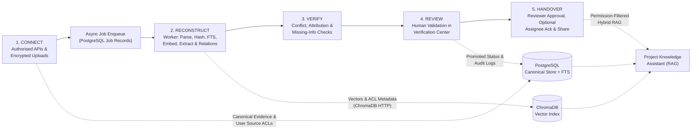
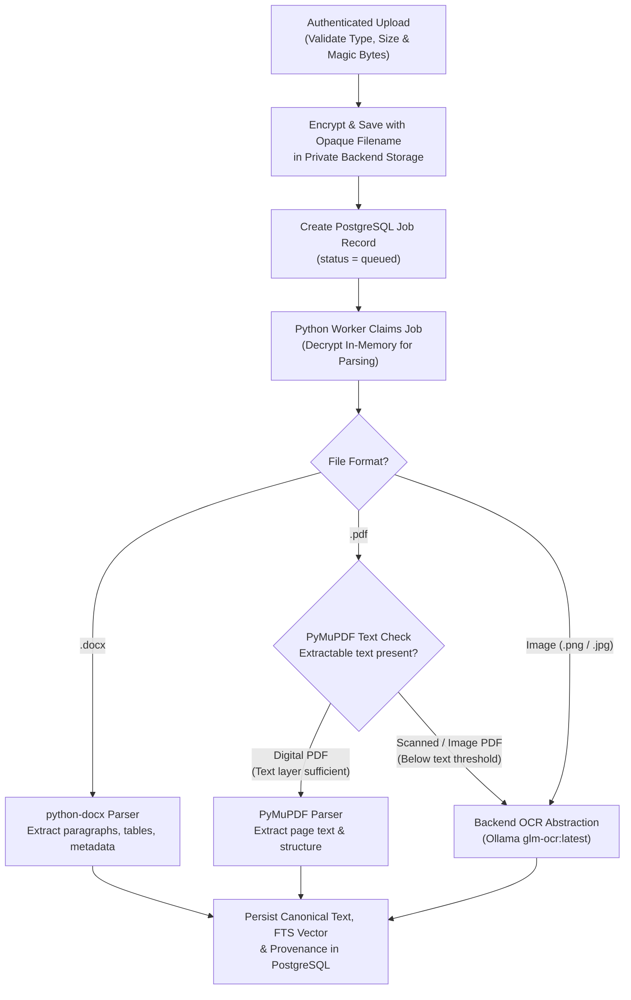
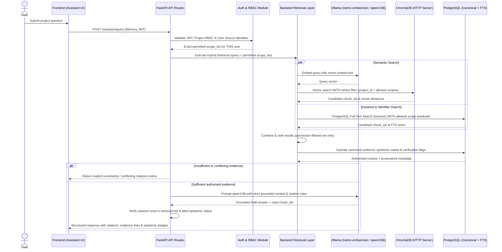

# Data Flow Architecture

> **Classification Key:** **Confirmed Design Decisions** define mandatory invariants across the `CONNECT → RECONSTRUCT → VERIFY → REVIEW → HANDOVER` lifecycle. **Proposed Implementation Details** describe recommended execution flows and chunking parameters subject to realistic-evidence benchmarking.

---

## 1. End-to-End Platform Lifecycle (Confirmed)

The platform enforces a five-stage knowledge lifecycle, ensuring raw source data is never conflated with AI interpretations or human-approved handover records:

---

## 2. Stage 1: CONNECT (Source Authorisation & Ingestion)

### 2.1 Authorised Source Connectors & Priorities *(Confirmed; GitHub, Jira & Uploads Implemented Phase 2.4A–2.4B)*

- **Initial Priority Connectors *(Implemented Backend Phase 2.4A–2.4B)***:
  - **Uploaded Documents (`Evidence Workspace`, Phase 2.4A)**: Manual encrypted uploads of digital PDFs, `.docx` files, and scanned PDFs (`PyMuPDF`, `python-docx`, replaceable `OCRService` backed by Ollama `glm-ocr:latest`).
  - **GitHub API (`GitHubClient` / `GitHubSyncOrchestrator`, Phase 2.4B)**: Delegated read-only REST connector ingesting repository metadata, issues + comments, pull requests + reviews/inline comments/changed-file summaries, bounded commits, README/Markdown docs/ADRs, and optional discussions using `ETag` (`If-None-Match`) + `since` incremental cursors and complete-snapshot disappeared-item reconciliation.
  - **Jira API (`JiraClient` / `JiraSyncOrchestrator`, Phase 2.4B)**: Delegated Atlassian Cloud 3LO REST v3 connector resolving authorised sites (`/oauth/token/accessible-resources`), project search, bounded project-scoped JQL + `updated >=` incremental cursors, Atlassian Document Format (ADF)-to-text normalisation, comments, worklogs, changelogs, issue links/parent hierarchy, and fail-closed `fields.security` sub-policies.
- **Optional MVP Integration *(Strictly Gated)***:
  - **Slack API**: Retained as an optional MVP connector; strictly blocked (`SLACK_ENABLED=false` -> `409 SLACK_INTEGRATION_DISABLED`) until workspace authorisation, API scope review, and data-retention requirements are confirmed.

### 2.2 Delegated Per-User Source Authorisation *(Confirmed & Implemented Phase 2.4B)*

- Platform login (FastAPI-managed credentials) is **strictly separate** from connecting third-party sources via OAuth 2.0.
- GitHub and Jira integrations enforce **delegated, per-user OAuth 2.0 authorisation** (`SourceOAuthService` with PKCE `S256`, single-use `oauth_states`, `TOKEN_ENCRYPTION_KEY` AES-256-GCM storage, and atomic `FOR UPDATE` single-use refresh rotation).
- Each connected user's external source identity (`external_user_id` / handle) and granted scopes are recorded in PostgreSQL (`user_source_authorisations`), `project_source_mappings` binds explicitly verified external resources to platform projects, and `source_access_policies` governs which project members hold verified access to each repository, Jira project, or Jira issue security level.
- **Critical Isolation Rule**: Connecting one user's GitHub/Jira account **never** exposes restricted repositories, Jira projects, or Jira security-restricted issues to unauthorised project members (`EvidenceRepository.list_for_project` SQL predicate + `SourceAccessPolicyService.enforce_evidence_access`).

### 2.3 Ingestion & Provenance Capture Rules *(Confirmed & Implemented Phase 2.4A–2.4B)*

Every ingested upload or external GitHub/Jira record (`SourceEvidenceIngestor`) is persisted idempotently in PostgreSQL (`evidence_items`, `evidence_contents`, `evidence_page_contents`, indexed by `uq_evidence_active_project_source_external_id`) as **Original Source Evidence** retaining all seven mandatory fields:

1. `source_platform` (`document_upload` | `github` | `jira` | future gated `slack`)
2. `original_source_id` (`source_external_id`: e.g. `upload:<evidence_uuid>`, `github:<repo_id>:pr:<n>`, `jira:<cloud_id>:issue:<key>`)
3. `source_url` (canonical permalink where available)
4. `author_or_owner` (`source_author_identity` where available)
5. `timestamp` (`source_created_at` / `source_updated_at` original timestamps from source)
6. `extraction_timestamp` (`extracted_at` / `last_synced_at` UTC timestamps)
7. `content_hash` / `version_info` (SHA-256 `content_hash`, HTTP `ETag` / `sync_cursor_json`, commit SHA / file version)

### 2.4 Private Upload Storage & Document Routing (Confirmed)

1. Uploaded files undergo extension, MIME, magic-byte, and size validation on the backend API *(implemented for `.pdf` and `.docx` in Phase 2.4A)*.
2. Accepted files receive opaque storage keys (`<organisation_id>/<project_id>/<object_uuid>.enc`), are **encrypted at rest** (`AES-256-GCM` via `LocalPrivateStorageBackend`), and are written exclusively to **private backend storage** (`UPLOAD_STORAGE_PATH`) completely outside publicly served Next.js directories.
3. The API persists `evidence_items` + a PostgreSQL `background_jobs` record and returns immediately; the **lightweight Python worker process** (`python -m app.worker`) claims the job (`SELECT ... FOR UPDATE SKIP LOCKED`), executes PDF/DOCX/OCR extraction, stores separated full text and ordered pages in `evidence_contents` and `evidence_page_contents`, and immediately queues `evidence_indexing` for `IndexingWorkerService` *(implemented in Phase 2.5)*:

---

## 3. Stage 2: RECONSTRUCT (Worker Processing, Hybrid Indexing, Extraction & Relationships)

### 3.1 Canonical Persistence, Full-Text & Vector Indexing *(Confirmed; Implemented Phase 2.5)*

Executed asynchronously by `IndexingWorkerService` inside the separate Python `CompositeWorkerService` process (tracked with retry/failure state in PostgreSQL `background_jobs` and `evidence_items.indexing_status`):

1. **Structure-Aware Chunking & Full-Text Indexing (PostgreSQL)**: `ChunkingService` segments extracted evidence into traceable chunks (`evidence_chunks`) preserving parent `evidence_id`, `chunk_index`, `chunk_type`, `section_title`, `page_number`, `char_start`/`char_end`, `chunk_content_hash`, expanded `search_identifier_text`, `acl_scope`, and weighted `TSVECTOR` (`GIN`-indexed via `0006_evidence_chunks_and_fts`). Unchanged chunks during content updates keep existing embeddings cleanly, while trailing stale vectors are pruned.
2. **Embedding Generation**: Chunks are batched (`EMBEDDING_BATCH_SIZE=8`) through `OllamaEmbeddingService` (`nomic-embed-text`, enforcing exact `EMBEDDING_EXPECTED_DIMENSIONS=768`).
3. **ChromaDB HTTP v2 Secondary Indexing**: Vectors and allowlisted non-secret ACL/filter metadata (`organisation_id`, `project_id`, `evidence_id`, `chunk_id`, `chunk_index`, `chunk_type`, `source_type`, `category`, `acl_scope`, `permission_scope_key`, `source_access_policy_id`, `uploaded_by_user_id`, `is_synthetic`, `source_created_ts`) are written via `ChromaV2HttpVectorStore` to `${CHROMA_COLLECTION_PREFIX}_evidence_chunks_${OLLAMA_EMBEDDING_MODEL}_${CHROMA_INDEX_VERSION}`. If ChromaDB is unreachable during worker execution, PostgreSQL FTS chunks still persist (`indexing_status = 'partially_indexed'`) so keyword search remains operational until vector retries or `POST /indexing/reindex` complete.
4. **Rebuild & Cleanup Guarantees**: Calling `POST /api/v1/projects/{project_id}/indexing/reindex` (`full`, `fts_only`, or `vectors_only`) rebuilds PostgreSQL FTS or ChromaDB deterministically from canonical PostgreSQL records. Logical deletion (`DELETE /evidence/{id}`) wipes PostgreSQL chunks immediately in the same transaction and enqueues `evidence_index_cleanup` to remove ChromaDB vectors cleanly.

### 3.2 Evidence-Grounded Extraction & Knowledge Synthesis *(Implemented Backend Phase 2.6 across 6 Core Categories)*

1. **Permission-Scoped Single-Item Batching**: Trigger endpoints validate caller permissions upfront (`KnowledgeReconstructionService`), `ReconstructionWorkerService` re-verifies actor and source ACLs immediately prior to inference, and `partition_chunks_into_batches` groups chunks strictly within one `evidence_id` (never mixing ACL scopes inside an Ollama `qwen3:8b` prompt).
2. **Structured Extraction (`OllamaLLMClient` + `KnowledgeCandidateValidator`)**: Bounded prompts (`EXTRACTION_PROMPT_VERSION="p2.6-v1"`, `OLLAMA_LLM_THINK=false`, `format="json"`, `</evidence_chunk>` injection escaping) extract Pydantic-validated candidates across the six core Phase 2.6 categories:
   - `decisions_rationale` (Decisions and their rationale)
   - `technical_architecture` (Technical and architectural knowledge)
   - `work_items` (Completed and unfinished work)
   - `responsibilities_ownership` (Responsibilities and ownership — preserving unmerged source identities)
   - `dependencies` (Dependencies)
   - `bugs_blockers_risks` (Bugs, blockers and risks — downgrading unsupported severities to `"unspecified"`)
   *(Future phases extend extraction/views for operational procedures and historical discussions.)*
3. **Mandatory Attribution & Epistemic Tagging *(Confirmed & Implemented Phase 2.6)***:
   - Every candidate claim MUST cite at least one batch `chunk_id` and a `supporting_excerpt` verified verbatim or under normalized whitespace against canonical PostgreSQL chunk text (`NO EVIDENCE -> NO CLAIM`); ungrounded candidates are rejected and counted under `claims_rejected_ungrounded`.
   - Direct factual records persist with `epistemic_status="extracted"`; interpretive claims or syntheses persist with `epistemic_status="ai_interpreted"` and `uncertainty_reason`; worker outputs can **never** produce `"human_verified"` and always enter `review_status="pending_review"`.
   - Conservative deduplication upgrades repeated compatible claims across accessible/same-scope items to `support_classification="corroborated"` while preserving distinct identities, conflicting states, and synthetic vs real isolation. Re-chunking or soft-deleting supporting evidence marks derived `knowledge_items` stale (`is_stale=true`) cleanly.
4. **Relationship Persistence *(Planned Phase 2.7)***: Candidate relationships (`knowledge_relationships`) will be persisted as structured PostgreSQL records and visualised in **Relationship Explorer**.

---

## 4. Stage 3: VERIFY (Automated Verification, Conflict & Gap Checks)

Before human review, the **Verification** module executes automated diagnostic passes (via worker jobs):

1. **Attribution Check**: Reject or quarantine any extracted claim lacking valid `evidence_id` / `chunk_id` links.
2. **Conflict Detection**: Flag contradictions across sources (e.g., Jira marks task `Done` while a newer GitHub issue reports an unresolved blocker; two documents name different owners). **Rule**: The AI must surface both citations and never pick a winner autonomously.
3. **Missing-Information Detection**: Evaluate extracted project knowledge against handover completeness criteria across all eight categories.
4. **Uncertainty & Staleness Flagging**: Surface low-confidence extractions or outdated evidence items whose source hashes/timestamps lag behind newer activity.

---

## 5. Stage 4: REVIEW (Human Validation in Verification Center)

1. Authorised reviewers inspect queued items in the **Verification Center** with side-by-side lineage (**Original Source Evidence** ↔ **Extracted Information** ↔ **AI-Generated Interpretation**).
2. Reviewer actions (enforced by backend RBAC, logged to `audit_logs`):
   - **Verify**: Promotes item to **Human-Verified Knowledge**.
   - **Edit & Verify**: Corrects summary/ownership/category while preserving provenance links and reviewer rationale.
   - **Mark Disputed / Needs Evidence**: Flags gap for outgoing owner follow-up.
   - **Reject**: Marks false extraction invalid (retained for auditability, excluded from handovers).
3. **Hard Guardrail (Confirmed)**: The LLM cannot promote any item to Human-Verified Knowledge or override an official status.

---

## 6. Stage 5: HANDOVER (Assembly, Reviewer Approval & Assignee Acknowledgment)

1. **Compilation (`Handover Workspace`)**: Aggregates verified knowledge (and explicitly lists unresolved risks, open blockers, and known unknowns) into structured handover sections.
2. **Readiness Evaluation**: Computes coverage across the eight knowledge categories and highlights remaining unverified critical items or open verification flags.
3. **Mandatory Designated Reviewer Approval Gate (Confirmed)**:
   - A **designated human reviewer** must review and explicitly approve the handover package before it transitions to `approved` and becomes eligible for final sharing.
   - AI cannot approve handovers.
4. **Incoming Assignee Receipt Acknowledgment (Confirmed)**:
   - Once approved/shared, the **incoming assignee** may record an explicit receipt acknowledgment (`acknowledged_by_id`, `acknowledged_at`) confirming they received and reviewed the package.
   - **Strict Non-Substitution Rule**: Incoming assignee acknowledgment **cannot** substitute for designated reviewer approval.
5. **Snapshot & Audit**: Approved handover packages record an immutable timestamped snapshot and emit audit logs for both reviewer approval and assignee acknowledgment.

---

## 7. Query Flow: Project Knowledge Assistant (Hybrid Permission-Filtered RAG)

---

## 8. Confirmed vs. Proposed Summary & Remaining Calibration Items

- **Confirmed & Implemented (Phases 2.1–2.6)**: Five-stage workflow; all 7 provenance fields; async PostgreSQL-backed Python `CompositeWorkerService` (`document_ingestion` + `source_sync` + `evidence_indexing`/`reindexing`/`cleanup` + `knowledge_reconstruction`); private encrypted upload storage (`FILE_ENCRYPTION_KEY`); Ollama `glm-ocr:latest` behind replaceable `OCRService`; delegated per-user GitHub & Jira OAuth (`TOKEN_ENCRYPTION_KEY`, PKCE `S256`, `oauth_states`, `source_access_policies`, fail-closed SQL/item ACL filtering, manual/incremental sync runs); structure-aware chunking, weighted PG `TSVECTOR` + `GIN` search, `nomic-embed-text` (768-dim) ChromaDB v2 vector indexing, two-phase ACL retrieval + `hybrid -> keyword` degraded fallback (`HybridRetrievalService`); Phase 2.6 `StructuredLLMClient` (`OllamaLLMClient` / `qwen3:8b`), strict `NO EVIDENCE -> NO CLAIM` excerpt validation, 6-category epistemic extraction (`extracted`/`ai_interpreted`, `pending_review`), conservative corroboration deduplication, staleness invalidation, and ACL-enforced `/knowledge/*` APIs (`0007_knowledge_reconstruction`); designated reviewer approval required before sharing; incoming assignee acknowledgment non-substitution.
- **Proposed**: Knowledge relationship graph (`knowledge_relationships`), verification/conflict engines, assistant synthesis & abstention calibration (Phase 2.7+), and exact handover export formats (Markdown/PDF/JSON).
- **Remaining Calibration Items**:
  1. Calibrate hybrid retrieval weights (`RETRIEVAL_SEMANTIC_WEIGHT`, `RETRIEVAL_KEYWORD_WEIGHT`), similarity thresholds, and assistant abstention cutoffs on **realistic organisational project evidence** before locking numerical thresholds in Phase 8 *(Phase 2.5 benchmarked synthetic development fixtures only)*.
  2. Add optional scheduled background ACL re-verification and scheduled polling/webhook sync triggers on top of the implemented Phase 2.4B manual/incremental `source_sync` pipeline in subsequent phases if required.
