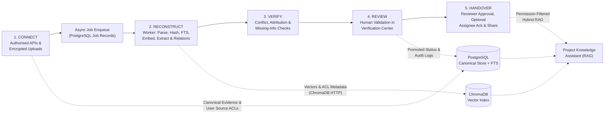
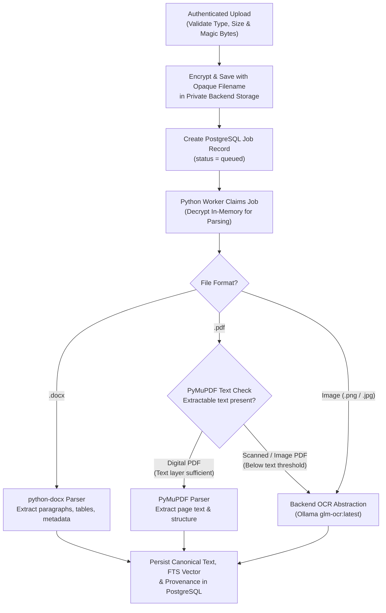
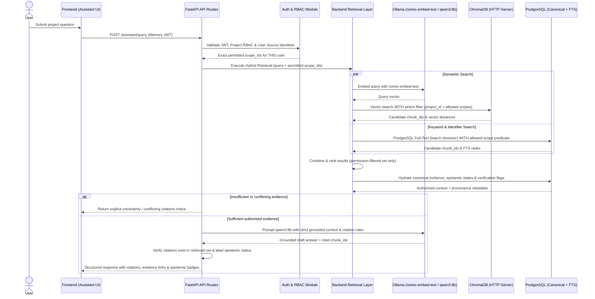

# Data Flow Architecture

> **Classification Key:** **Confirmed Design Decisions** define mandatory invariants across the `CONNECT → RECONSTRUCT → VERIFY → REVIEW → HANDOVER` lifecycle. **Proposed Implementation Details** describe recommended execution flows and chunking parameters subject to realistic-evidence benchmarking.

---

## 1. End-to-End Platform Lifecycle (Confirmed)

The platform enforces a five-stage knowledge lifecycle, ensuring raw source data is never conflated with AI interpretations or human-approved handover records:

---

## 2. Stage 1: CONNECT (Source Authorisation & Ingestion)

### 2.1 Authorised Source Connectors & Priorities (Confirmed)

- **Initial Priority Connectors**:
  - **GitHub API**: Repositories, commits, pull requests, PR review comments, issues, repository docs.
  - **Jira API**: Epics, stories, tasks, bugs, status transitions, comments, linked issues, assignees.
  - **Uploaded Documents (`Evidence Workspace`)**: Manual uploads of digital PDFs, `.docx` files, and scanned PDFs/images.
- **Optional MVP Integration**:
  - **Slack API**: Retained as an optional MVP connector; implementation proceeds **only** after workspace authorisation, API scope review, and data-retention requirements are confirmed.

### 2.2 Delegated Per-User Source Authorisation (Confirmed)

- Platform login (FastAPI-managed credentials) is **strictly separate** from connecting third-party sources via OAuth 2.0.
- Where supported by GitHub, Jira (and optional Slack), the system prefers **delegated, per-user OAuth 2.0 authorisation** rather than relying solely on a single shared token.
- Each connected user's external source identity (`external_user_id` / handle) and granted scopes are recorded in PostgreSQL (`user_source_authorisations`), and source access policies (`source_access_policies`) map which project members hold verified access to each repository, Jira project, channel, or uploaded document.
- **Critical Isolation Rule**: Connecting one user's GitHub/Jira/Slack account **never** automatically grants access to every member of the project.

### 2.3 Ingestion & Provenance Capture Rules (Confirmed)

Every ingested record or document **must** be persisted in PostgreSQL as **Original Source Evidence** retaining all seven mandatory fields:

1. `source_platform` (`github` | `jira` | `slack` | `uploaded_document`)
2. `original_source_id` (immutable platform ID or uploaded document UUID)
3. `source_url` (canonical permalink where available)
4. `author_or_owner` (source author handle/ID where available)
5. `timestamp` (original creation/event timestamp from source)
6. `extraction_timestamp` (UTC timestamp when ingested by this platform)
7. `content_hash` / `version_info` (SHA-256 content hash and/or source ETag/commit SHA/file version)

### 2.4 Private Upload Storage & Document Routing (Confirmed)

1. Uploaded files undergo extension, MIME, magic-byte, and size validation on the backend API.
2. Accepted files receive opaque server-generated UUID filenames, are **encrypted at rest**, and are written exclusively to **private backend storage** (`UPLOAD_STORAGE_PATH`) completely outside publicly served Next.js directories.
3. The API enqueues a PostgreSQL `background_jobs` record and returns immediately; the **lightweight Python worker process** claims the job and executes parsing:

---

## 3. Stage 2: RECONSTRUCT (Worker Processing, Hybrid Indexing, Extraction & Relationships)

### 3.1 Canonical Persistence, Full-Text & Vector Indexing (Confirmed)

Executed asynchronously by the separate Python worker process (tracked with retry/failure state in PostgreSQL `background_jobs`):

1. **Chunking & Full-Text Indexing (PostgreSQL)**: Normalised text is segmented into traceable chunks (`evidence_chunks`) in PostgreSQL, preserving parent `evidence_id`, chunk index, character/page spans, `permission_scope_id`, and `tsvector` full-text search tokens.
2. **Embedding Generation**: Each chunk is embedded using **`nomic-embed-text`** via Ollama.
3. **ChromaDB HTTP Indexing**: Vectors, chunk text, and filterable permission/source metadata (`project_id`, `evidence_id`, `chunk_id`, `source_platform`, `permission_scope_id`, `content_hash`, `is_synthetic`) are written to the **ChromaDB HTTP server** container.
4. **Rebuild Guarantee**: If ChromaDB becomes stale or corrupted, all vectors are deterministically rebuilt from PostgreSQL `evidence_chunks`.

### 3.2 Evidence-Grounded Extraction & Knowledge Synthesis

1. **Permission-Scoped Extraction**: Only evidence chunks belonging to the target project scope (and permitted under the triggering/authorising scope) are passed to Ollama (`qwen3:8b`).
2. **Structured Extraction**: Pydantic-validated LLM outputs classify findings into the **eight confirmed knowledge categories**:
   - Decisions and their rationale
   - Technical and architectural knowledge
   - Completed and unfinished work
   - Responsibilities and ownership
   - Dependencies
   - Bugs, blockers and risks
   - Operational procedures
   - Historical discussions and context
3. **Epistemic Tagging (Confirmed)**:
   - Direct factual records anchored to verbatim spans are stored as **Extracted Information**.
   - Cross-chunk summaries, inferred rationale, or candidate connections are stored as **AI-Generated Interpretation** with explicit confidence and uncertainty markers.
4. **Relationship Persistence (Confirmed)**: Candidate relationships are persisted as structured PostgreSQL records and visualised in **Relationship Explorer**.

---

## 4. Stage 3: VERIFY (Automated Verification, Conflict & Gap Checks)

Before human review, the **Verification** module executes automated diagnostic passes (via worker jobs):

1. **Attribution Check**: Reject or quarantine any extracted claim lacking valid `evidence_id` / `chunk_id` links.
2. **Conflict Detection**: Flag contradictions across sources (e.g., Jira marks task `Done` while a newer GitHub issue reports an unresolved blocker; two documents name different owners). **Rule**: The AI must surface both citations and never pick a winner autonomously.
3. **Missing-Information Detection**: Evaluate extracted project knowledge against handover completeness criteria across all eight categories.
4. **Uncertainty & Staleness Flagging**: Surface low-confidence extractions or outdated evidence items whose source hashes/timestamps lag behind newer activity.

---

## 5. Stage 4: REVIEW (Human Validation in Verification Center)

1. Authorised reviewers inspect queued items in the **Verification Center** with side-by-side lineage (**Original Source Evidence** ↔ **Extracted Information** ↔ **AI-Generated Interpretation**).
2. Reviewer actions (enforced by backend RBAC, logged to `audit_logs`):
   - **Verify**: Promotes item to **Human-Verified Knowledge**.
   - **Edit & Verify**: Corrects summary/ownership/category while preserving provenance links and reviewer rationale.
   - **Mark Disputed / Needs Evidence**: Flags gap for outgoing owner follow-up.
   - **Reject**: Marks false extraction invalid (retained for auditability, excluded from handovers).
3. **Hard Guardrail (Confirmed)**: The LLM cannot promote any item to Human-Verified Knowledge or override an official status.

---

## 6. Stage 5: HANDOVER (Assembly, Reviewer Approval & Assignee Acknowledgment)

1. **Compilation (`Handover Workspace`)**: Aggregates verified knowledge (and explicitly lists unresolved risks, open blockers, and known unknowns) into structured handover sections.
2. **Readiness Evaluation**: Computes coverage across the eight knowledge categories and highlights remaining unverified critical items or open verification flags.
3. **Mandatory Designated Reviewer Approval Gate (Confirmed)**:
   - A **designated human reviewer** must review and explicitly approve the handover package before it transitions to `approved` and becomes eligible for final sharing.
   - AI cannot approve handovers.
4. **Incoming Assignee Receipt Acknowledgment (Confirmed)**:
   - Once approved/shared, the **incoming assignee** may record an explicit receipt acknowledgment (`acknowledged_by_id`, `acknowledged_at`) confirming they received and reviewed the package.
   - **Strict Non-Substitution Rule**: Incoming assignee acknowledgment **cannot** substitute for designated reviewer approval.
5. **Snapshot & Audit**: Approved handover packages record an immutable timestamped snapshot and emit audit logs for both reviewer approval and assignee acknowledgment.

---

## 7. Query Flow: Project Knowledge Assistant (Hybrid Permission-Filtered RAG)

---

## 8. Confirmed vs. Proposed Summary & Remaining Calibration Items

- **Confirmed**: Five-stage workflow; all 7 evidence fields; async PostgreSQL-backed Python worker; private encrypted upload storage; Ollama `glm-ocr:latest` behind replaceable OCR abstraction; delegated per-user source permissions; hybrid ChromaDB + PostgreSQL FTS retrieval with pre-retrieval permission enforcement; designated reviewer approval required before sharing; incoming assignee acknowledgment non-substitution.
- **Proposed**: Hybrid per-page PDF triage details, initial chunking window/overlap parameters, Reciprocal Rank Fusion merging details, and exact handover export formats (Markdown/PDF/JSON).
- **Remaining Calibration Items**:
  1. Benchmark hybrid retrieval quality (dense vector vs PostgreSQL FTS fusion weights and sufficiency thresholds) on realistic project evidence before fixing numerical cutoffs.
  2. Confirm incremental connector sync cadence (manual trigger vs scheduled polling vs webhooks) during Phase 4 connector implementation.
