# Database Design

> **Classification Key:** **Confirmed Design Decisions** reflect mandatory storage rules, tooling choices (**SQLAlchemy 2.x**, **Alembic**, **Psycopg 3**, **ChromaDB HTTP server mode**), PostgreSQL full-text search, PostgreSQL-backed background jobs, relational knowledge graph storage, and handover/permission invariants. **Implemented Schema** (`0001`–`0007`) reflects live PostgreSQL tables migrated by Alembic. **Proposed Implementation Details** define concrete table names, column types, and index layouts reserved for Phase 2.7+ migrations.

---

## 1. Storage Architecture & Tooling Rules (Confirmed)

1. **PostgreSQL as Canonical Source of Truth**: All structured application data, platform users, RBAC memberships, delegated user source authorisations, source access policies, canonical evidence records, chunk text and FTS indexes, extracted items, AI interpretations, knowledge relationships, verification reviews, handover packages, background job records, and immutable audit logs live in PostgreSQL.
2. **PostgreSQL Connectivity & Migrations**: Use **SQLAlchemy 2.x**, **Alembic** for schema migrations, and **Psycopg 3** (`psycopg`) for PostgreSQL connectivity.
3. **ChromaDB Strictly Secondary (HTTP Server Mode)**: ChromaDB runs in dedicated HTTP server mode via Docker Compose and stores vector embeddings (`nomic-embed-text`) and strictly allowlisted filterable permission/source metadata (`organisation_id`, `project_id`, `evidence_id`, `chunk_id`, `chunk_index`, `chunk_type`, `source_type`, `category`, `acl_scope`, `permission_scope_key`, `source_access_policy_id`, `uploaded_by_user_id`, `is_synthetic`, `source_created_ts`). ChromaDB is **never** the sole storage location for any evidence or project record and remains rebuildable from PostgreSQL.
4. **Hybrid Search Storage**: `evidence_chunks` in PostgreSQL maintains a `tsvector` full-text search index alongside ChromaDB vectors so the backend retrieval layer combines semantic and exact keyword/identifier matches.
5. **Structured PostgreSQL Relationships (No Graph Database)**: Knowledge relationships are represented via relational tables and indexed foreign keys in PostgreSQL. No separate graph database is permitted.
6. **PostgreSQL-Backed Background Jobs**: Long-running ingestion, OCR, embedding, and AI jobs are persisted in PostgreSQL (`background_jobs`) for status, retry tracking, and failure reporting (no Redis, Celery, or message broker in initial infrastructure).
7. **Mandatory Evidence Retention Fields**: Every evidence record must persist:
   - `source_platform`
   - `original_source_id`
   - `source_url` (nullable when unavailable, e.g. local upload)
   - `author_or_owner` (nullable when unavailable)
   - `source_timestamp` (original event/creation timestamp)
   - `extraction_timestamp` (ingestion timestamp)
   - `content_hash` and `version_info` (where appropriate)
8. **Four-Tier Epistemic Separation**: Data design must unambiguously separate **Original source evidence**, **Extracted information**, **AI-generated interpretation**, and **Human-verified knowledge**.
9. **Synthetic Data Isolation**: Any synthetic test records must be explicitly tagged (`is_synthetic = true`) and never surfaced as real organisational evidence.

---

## 2. Proposed PostgreSQL Logical Schema

### 2.1 Entity-Relationship Overview

```mermaid
erDiagram
    USERS ||--o{ REFRESH_SESSIONS : "holds"
    USERS ||--o{ USER_ROLES : "holds platform roles"
    ROLES ||--o{ ROLE_PERMISSIONS : "grants"
    PERMISSIONS ||--o{ ROLE_PERMISSIONS : "mapped via"
    ROLES ||--o{ USER_ROLES : "platform role"

    ORGANISATIONS ||--o{ ORGANISATION_MEMBERSHIPS : "has members"
    USERS ||--o{ ORGANISATION_MEMBERSHIPS : "belongs to"
    ROLES ||--o{ ORGANISATION_MEMBERSHIPS : "organisation role"
    ORGANISATIONS ||--o{ ORGANISATION_INVITATIONS : "issues hashed tokens"

    ORGANISATIONS ||--o{ PROJECTS : "scopes workspaces"
    USERS ||--o{ PROJECT_MEMBERSHIPS : "assigned to"
    PROJECTS ||--o{ PROJECT_MEMBERSHIPS : "has members"
    ROLES ||--o{ PROJECT_MEMBERSHIPS : "project role"

    ORGANISATIONS ||--o{ AUDIT_LOGS : "tenant audit trail"
    PROJECTS ||--o{ AUDIT_LOGS : "project audit trail"
    USERS ||--o{ AUDIT_LOGS : "recorded actor"

    ORGANISATIONS ||--o{ SOURCE_CONNECTIONS : "configures"
    SOURCE_CONNECTIONS ||--o{ USER_SOURCE_AUTHORISATIONS : "delegates per user"
    USERS ||--o{ USER_SOURCE_AUTHORISATIONS : "authorises"
    SOURCE_CONNECTIONS ||--o{ OAUTH_STATES : "handshakes"
    USERS ||--o{ OAUTH_STATES : "initiates"
    PROJECTS ||--o{ SOURCE_ACCESS_POLICIES : "scopes ACLs"
    SOURCE_CONNECTIONS ||--o{ SOURCE_ACCESS_POLICIES : "defines scopes"
    PROJECTS ||--o{ PROJECT_SOURCE_MAPPINGS : "maps sources"
    SOURCE_CONNECTIONS ||--o{ PROJECT_SOURCE_MAPPINGS : "binds"
    SOURCE_ACCESS_POLICIES ||--o{ PROJECT_SOURCE_MAPPINGS : "governs"
    PROJECT_SOURCE_MAPPINGS ||--o{ SOURCE_SYNC_RUNS : "tracks syncs"
    BACKGROUND_JOBS ||--o| SOURCE_SYNC_RUNS : "executes"

    PROJECTS ||--o{ EVIDENCE_ITEMS : "owns"
    SOURCE_CONNECTIONS ||--o{ EVIDENCE_ITEMS : "ingests"
    SOURCE_ACCESS_POLICIES ||--o{ EVIDENCE_ITEMS : "scopes access"
    EVIDENCE_ITEMS ||--o| EVIDENCE_CONTENTS : "extracted text"
    EVIDENCE_ITEMS ||--o{ EVIDENCE_PAGE_CONTENTS : "extracted pages"
    EVIDENCE_ITEMS ||--o{ EVIDENCE_CHUNKS : "split into"

    PROJECTS ||--o{ KNOWLEDGE_EXTRACTION_RUNS : "tracks extraction"
    EVIDENCE_ITEMS ||--o{ KNOWLEDGE_EXTRACTION_RUNS : "optional target"
    BACKGROUND_JOBS ||--o| KNOWLEDGE_EXTRACTION_RUNS : "executes"
    PROJECTS ||--o{ KNOWLEDGE_ITEMS : "contains"
    KNOWLEDGE_EXTRACTION_RUNS ||--o{ KNOWLEDGE_ITEMS : "produced by"
    KNOWLEDGE_ITEMS ||--o{ KNOWLEDGE_EVIDENCE_LINKS : "attributed to"
    EVIDENCE_ITEMS ||--o{ KNOWLEDGE_EVIDENCE_LINKS : "supports"
    EVIDENCE_CHUNKS ||--o{ KNOWLEDGE_EVIDENCE_LINKS : "cited span"

    PROJECTS ||--o{ KNOWLEDGE_RELATIONSHIPS : "maps graph"
    KNOWLEDGE_ITEMS ||--o{ KNOWLEDGE_RELATIONSHIPS : "source or target"

    KNOWLEDGE_ITEMS ||--o{ VERIFICATION_FLAGS : "flagged by"
    KNOWLEDGE_ITEMS ||--o{ VERIFICATION_REVIEWS : "reviewed in"
    USERS ||--o{ VERIFICATION_REVIEWS : "performs"

    PROJECTS ||--o{ HANDOVER_PACKAGES : "produces"
    HANDOVER_PACKAGES ||--o{ HANDOVER_ITEMS : "includes"
    KNOWLEDGE_ITEMS ||--o{ HANDOVER_ITEMS : "referenced in"

    PROJECTS ||--o{ BACKGROUND_JOBS : "tracks async work"
```

### 2.2 Domain Table Groups (Implemented & Proposed)

#### A. Platform Authentication, RBAC, Organisations & Project Workspaces
*(Implemented across Phase 2.2 migration `0002_auth_identity_rbac` and Phase 2.3 migration `0003_org_project_workspaces`: `users`, `refresh_sessions`, `roles`, `permissions`, `role_permissions`, `user_roles`, `organisations`, `organisation_memberships`, `organisation_invitations`, `projects`, `project_memberships`.)*
- **`users`** *(Implemented Phase 2.2)*: `id` (UUID PK), `full_name` (VARCHAR 255), `email` (unique normalised lowercase with CHECK constraint), `password_hash` (Argon2id via `pwdlib`), `status` (`active` | `disabled` | `locked` | `pending`), `is_email_verified` (BOOLEAN), `email_verified_at` (TIMESTAMPTZ NULL), `created_at`, `updated_at`, `last_login_at`.
  - *Separation Rule*: No external GitHub/Jira/Slack OAuth credentials live on `users` for platform login bypasses.
- **`refresh_sessions`** *(Implemented Phase 2.2)*: `id` (UUID PK), `user_id` (FK → `users` CASCADE), `token_family_id` (UUID — enables rotation & reuse detection), `token_hash` (unique 64-char SHA-256 hex digest with CHECK constraint), `replaced_by_session_id` (nullable self-FK), `created_at`, `expires_at`, `revoked_at`, `revoked_reason`, `last_used_at`, `session_metadata` (nullable JSON, privacy-conscious defaults without raw IPs/secrets).
- **`roles`, `permissions`, `role_permissions`, `user_roles`** *(Implemented Phase 2.2; extended Phase 2.3)*: Explicit `scope_type` (`platform` | `organisation` | `project`) separating platform roles (`standard_user`, `platform_admin`), organisation roles (`org_owner`, `org_admin`, `org_member`), and project roles (`project_manager`, `project_member`, `reviewer`). Current catalog seeds **8 roles**, **23 permissions**, and **49 role-permission mappings**. Platform `user_roles` assignments enforce `scope_type = 'platform'` in backend authorisation services.
- **`organisations`** *(Implemented Phase 2.3)*: `id` (UUID PK), `name` (VARCHAR 200, min-length CHECK), `slug` (unique normalised lowercase VARCHAR 120), `description` (TEXT NULL), `status` (`active` | `suspended` | `archived`), `created_by_id` (FK → `users` RESTRICT), `created_at`, `updated_at`, `archived_at` (TIMESTAMPTZ NULL).
- **`organisation_memberships`** *(Implemented Phase 2.3)*: `id` (UUID PK), `organisation_id` (FK → `organisations` CASCADE), `user_id` (FK → `users` CASCADE), `role_id` (FK → `roles` RESTRICT, `scope_type = 'organisation'`), `status` (`active` | `suspended` | `removed`), `joined_at`, `invited_by_id` (FK → `users` SET NULL), `created_at`, `updated_at`. Partial unique index `uq_org_memberships_active_org_user` enforces one active membership per `(organisation_id, user_id)` while preserving historical removed records.
- **`organisation_invitations`** *(Implemented Phase 2.3)*: `id` (UUID PK), `organisation_id` (FK → `organisations` CASCADE), `email` (normalised lowercase VARCHAR 254), `role_id` (FK → `roles` RESTRICT, `scope_type = 'organisation'`), `token_hash` (unique 64-char SHA-256 hex digest with CHECK constraint), `invited_by_id` (FK → `users` RESTRICT), `status` (`pending` | `accepted` | `revoked` | `expired`), `expires_at`, `accepted_at`, `accepted_by_user_id` (FK → `users` SET NULL), `revoked_at`, `revoked_by_id` (FK → `users` SET NULL), `created_at`. Partial unique index `uq_org_invitations_pending_org_email` restricts active pending invitations per `(organisation_id, email)`.
- **`projects`** *(Implemented Phase 2.3)*: `id` (UUID PK), `organisation_id` (FK → `organisations` CASCADE), `name` (VARCHAR 200, min-length CHECK), `slug` (lowercase VARCHAR 120), `description` (TEXT NULL), `status` (`planning` | `active` | `on_hold` | `completed` | `archived`), `visibility` (`private` | `organisation`), `created_by_id` (FK → `users` RESTRICT), `owner_id` (FK → `users` RESTRICT), `start_date` (DATE NULL), `target_completion_date` (DATE NULL, date-order CHECK), `created_at`, `updated_at`, `archived_at` (TIMESTAMPTZ NULL). Unique constraint `uq_projects_organisation_slug` scopes slug uniqueness per `(organisation_id, slug)`.
- **`project_memberships`** *(Implemented Phase 2.3)*: `id` (UUID PK), `project_id` (FK → `projects` CASCADE), `user_id` (FK → `users` CASCADE), `role_id` (FK → `roles` RESTRICT, `scope_type = 'project'`), `status` (`active` | `removed`), `assigned_by_id` (FK → `users` SET NULL), `joined_at`, `created_at`, `updated_at`. Partial unique index `uq_project_memberships_active_project_user` enforces one active membership per `(project_id, user_id)`.

#### B. Authorised Sources, Delegated Identities, Source Mappings & Sync Runs *(Implemented Phase 2.4B via `0005_source_integrations`)*
*(Implemented in Phase 2.4B via Alembic revision `0005_source_integrations`: `source_connections`, `user_source_authorisations`, `oauth_states`, `source_access_policies`, `project_source_mappings`, and `source_sync_runs`, wired to `evidence_items` foreign keys. Slack remains excluded behind `SLACK_ENABLED=false`.)*
- **`source_connections`** *(Implemented Phase 2.4B)*: `id` (UUID PK), `organisation_id` (FK → `organisations` CASCADE — tenant-scoped so verified connections can map selectively to projects), `provider` (`github` | `jira`), `display_name` (VARCHAR 200, non-empty CHECK), `authorisation_mode` (`delegated_per_user`), `external_workspace_id`, `external_workspace_name`, `external_workspace_url`, `status` (`pending_auth` | `active` | `reauth_required` | `disconnected` | `error`), `created_by_user_id` (FK → `users` RESTRICT), `last_synced_at`, `last_error_code`, `last_error_summary`, `metadata_json` (JSONB), `disconnected_at`, `disconnected_by_user_id` (FK → `users` SET NULL), `created_at`, `updated_at`; indexed on `(organisation_id, provider, status)`.
- **`user_source_authorisations`** *(Implemented Phase 2.4B)*:
  - Stores **per-user delegated OAuth 2.0 credentials** and external source identities strictly separated from platform login:
  - `id` (UUID PK), `source_connection_id` (FK → `source_connections` CASCADE), `organisation_id` (FK → `organisations` CASCADE), `user_id` (FK → `users` CASCADE), `provider` (`github` | `jira`), `external_user_id` (VARCHAR 255 NOT NULL), `external_username`, `external_email`, `encrypted_access_token` (TEXT NOT NULL — AES-256-GCM via `TOKEN_ENCRYPTION_KEY`), `encrypted_refresh_token` (TEXT NULL), `token_encryption_algorithm` (`AES-256-GCM`), `token_key_id` (`token-local-v1`), `token_type`, `granted_scopes` (JSONB), `token_expires_at`, `status` (`active` | `expired` | `revoked` | `error`), `last_refreshed_at`, `last_verified_at`, `revoked_at`, `last_error_code`, `last_error_summary`, `metadata_json` (JSONB), `created_at`, `updated_at`.
  - Partial unique index `uq_user_source_auth_active` on `(source_connection_id, user_id)` filtered to `status = 'active' AND revoked_at IS NULL`.
- **`oauth_states`** *(Implemented Phase 2.4B)*:
  - Single-use CSRF/PKCE state store: `id` (UUID PK), `state_hash` (unique 64-char SHA-256 hex digest with CHECK constraint), `organisation_id` (FK → `organisations` CASCADE), `user_id` (FK → `users` CASCADE — prevents cross-user callback hijack), `source_connection_id` (nullable FK → `source_connections` CASCADE), `provider` (`github` | `jira`), `encrypted_code_verifier` (TEXT NULL), `code_verifier_key_id`, `redirect_after`, `expires_at`, `consumed_at`, `created_at`.
- **`source_access_policies`** *(Implemented Phase 2.4B)*:
  - `id` (UUID PK), `organisation_id` (FK → `organisations` CASCADE), `project_id` (FK → `projects` CASCADE), `source_connection_id` (FK → `source_connections` CASCADE), `provider` (`github` | `jira`), `scope_identifier` (e.g. `github.com:<repo_id>`, `<cloud_id>:<project_key>`, or `<cloud_id>:<project_key>:security:<sec_id>`), `visibility_policy` (`restricted_fail_closed` | `explicit_user_grants` | `verified_source_acl` | `project_members_verified`), `sync_permission_status` (`verified` | `unverified` | `revoked` | `failed`), `authorised_by_user_id` (FK → `users` SET NULL), `allowed_user_ids` (JSONB), `allowed_external_identities` (JSONB), `provider_visibility`, `last_acl_verified_at`, `metadata_json` (JSONB), `created_at`, `updated_at`. Unique constraint `uq_source_access_policy_project_scope` on `(project_id, source_connection_id, scope_identifier)`.
  - *Invariant*: Private GitHub repositories, Jira projects (`verified_source_acl`), and Jira issue security levels (`restricted_fail_closed`) never default to project-wide exposure; only verified public GitHub repositories (`restrict_to_verified_users = false`) resolve `project_members_verified`.
- **`project_source_mappings`** *(Implemented Phase 2.4B)*:
  - Explicit binding between a platform project and an authorised GitHub repository or Jira Cloud project: `id` (UUID PK), `organisation_id`, `project_id`, `source_connection_id`, `source_access_policy_id` (FK → `source_access_policies` CASCADE), `created_by_user_id` (FK → `users` SET NULL), `provider` (`github` | `jira`), `resource_type` (`github_repository` | `jira_project`), `external_site_id` (`github.com` or Atlassian `cloud_id`), `external_resource_id`, `external_resource_key`, `external_resource_name`, `external_resource_url`, `default_branch`, `provider_visibility`, `status` (`active` | `disabled` | `disconnected` | `error`), `sync_config_json` (JSONB), `sync_cursor_json` (JSONB), `last_synced_at`, `last_sync_status`, `last_error_code`, `last_error_summary`, `disabled_at`, `created_at`, `updated_at`. Partial unique index `uq_project_source_mapping_active` on `(project_id, provider, external_site_id, external_resource_id)` filtered to `status IN ('active', 'error')`.
- **`source_sync_runs`** *(Implemented Phase 2.4B)*:
  - Durable sync telemetry: `id` (UUID PK), `organisation_id`, `project_id`, `project_source_mapping_id` (FK → `project_source_mappings` CASCADE), `source_connection_id`, `background_job_id` (FK → `background_jobs` SET NULL), `triggered_by_user_id` (FK → `users` SET NULL), `provider` (`github` | `jira`), `sync_mode` (`initial` | `incremental` | `manual`), `status` (`queued` | `running` | `succeeded` | `partial` | `failed` | `cancelled`), non-negative counters (`items_discovered`, `items_created`, `items_updated`, `items_unchanged`, `items_inaccessible`, `items_failed`), `cursor_before_json`, `cursor_after_json`, `warnings_json`, `error_code`, `error_message`, `started_at`, `completed_at`, `duration_ms`, `created_at`, `updated_at`.

#### C. Canonical Evidence, Separated Extraction Storage & Hybrid Search (`Evidence Workspace`)
*(Core evidence ledger and document extraction tables implemented in Phase 2.4A via `0004_evidence_ingestion`; `evidence_items` connector FKs wired in Phase 2.4B via `0005_source_integrations`; `evidence_chunks`, weighted `TSVECTOR` + `GIN` index, and `evidence_items` indexing columns implemented in Phase 2.5 via `0006_evidence_chunks_and_fts`.)*
- **`evidence_items`** *(Implemented Phase 2.4A; extended Phase 2.4B & Phase 2.5)*:
  - **Tenant & Project Ownership**: `id` (UUID PK), `organisation_id` (FK → `organisations` CASCADE), `project_id` (FK → `projects` CASCADE), `uploaded_by_user_id` (FK → `users` SET NULL).
  - **Provenance & Source Fields (Confirmed)**:
    - `source_type` (`document_upload` | `github` | `jira` | `slack` | `manual_note`)
    - `source_provider` (VARCHAR 64 NOT NULL, e.g. `local_upload`, `github`, `jira_cloud`)
    - `category` (`pdf_document` | `docx_document` | `issue` | `pull_request` | `commit` | `discussion_thread` | `design_document` | `other`)
    - `source_external_id` (VARCHAR 255 NOT NULL — e.g. `upload:<evidence_uuid>`, `github:<repo_id>:issue:<n>`, `jira:<cloud_id>:issue:<key>`)
    - `source_url` (VARCHAR 1024 NULL)
    - `source_author_identity` (VARCHAR 255 NULL)
    - `title` (VARCHAR 500 NOT NULL), `original_filename` (VARCHAR 255 NULL), `mime_type` (VARCHAR 128 NULL), `file_size_bytes` (BIGINT NULL >= 0), `content_hash` (VARCHAR 64 NOT NULL — SHA-256 hex digest with CHECK length 64)
    - `source_created_at`, `source_updated_at`, `extracted_at`, `last_synced_at` (all TIMESTAMPTZ NULL)
  - **Private Encrypted Storage References** *(internal only — never returned by public APIs; `NULL` for API-ingested records)*: `storage_provider` (`local_encrypted` | `supabase_storage` NULL), `storage_object_key` (`<organisation_id>/<project_id>/<object_uuid>.enc` NULL), `encryption_algorithm` (`AES-256-GCM` NULL), `encryption_key_id` (`local-v1` | `supabase-v1` NULL).
  - **Delegated Source ACL Foreign Keys *(Wired Phase 2.4B)***: `source_connection_id` (UUID NULL FK → `source_connections` SET NULL), `source_access_policy_id` (UUID NULL FK → `source_access_policies` SET NULL), `acl_scope` (`project_members` | `source_restricted`, default `project_members`).
  - **Processing State, Metrics, Indexing State & Logical Deletion**: `processing_status` (`pending` | `queued` | `processing` | `extracted` | `partially_extracted` | `failed` | `deleted`), `extraction_method` (`pymupdf_text` | `glm_ocr` | `pymupdf_and_ocr` | `python_docx` | `github_api` | `jira_api` NULL), `page_count` (INT NULL >= 0), `ocr_pages_count` (INT >= 0), `truncated_pages_count` (INT >= 0), `error_code` (VARCHAR 64 NULL), `error_message` (VARCHAR 500 NULL), **Phase 2.5 indexing columns** (`indexing_status` IN `'not_indexed' | 'queued' | 'processing' | 'indexed' | 'partially_indexed' | 'failed' | 'deleted'`, `chunk_count` INT >= 0, `indexed_at` TIMESTAMPTZ NULL, `embedding_model` VARCHAR 128 NULL, `index_version` VARCHAR 32 NULL, `index_error_code` VARCHAR 64 NULL, `index_error_message` VARCHAR 500 NULL; indexed on `(project_id, indexing_status)`), `metadata_json` (JSON/JSONB small structural attributes & `mapping_id` references — large extracted text lives in separated tables), `deleted_at`, `deleted_by_user_id` (FK → `users` SET NULL), `created_at`, `updated_at`.
  - **Project-Scoped Active Deduplication & Idempotency Indexes**: Partial unique index `uq_evidence_active_project_hash` on `(project_id, content_hash)` for deduplicating manual document uploads cleanly, plus partial unique index `uq_evidence_active_project_source_external_id` *(Added Phase 2.4B)* on `(project_id, source_type, source_external_id)` filtered to `deleted_at IS NULL AND processing_status != 'deleted'` for idempotent external sync upserts.
- **`evidence_contents`** *(Implemented Phase 2.4A)*:
  - Separates extracted full-document text from raw evidence metadata: `evidence_id` (UUID PK & FK → `evidence_items` CASCADE), `extracted_text` (TEXT NOT NULL), `char_count` (INT >= 0), `word_count` (INT >= 0), `extraction_warnings` (JSON/JSONB array of non-fatal warnings), `created_at`, `updated_at`.
- **`evidence_page_contents`** *(Implemented Phase 2.4A)*:
  - Ordered per-page (PDF) or per-section (DOCX) extraction records: `id` (UUID PK), `evidence_id` (FK → `evidence_items` CASCADE), `page_number` (INT >= 1), `extraction_outcome` (`digital_text` | `ocr_succeeded` | `ocr_truncated` | `ocr_failed` | `empty` | `skipped_limit`), `ocr_applied` (BOOLEAN), `ocr_truncated` (BOOLEAN), `text_content` (TEXT NOT NULL), `char_count` (INT >= 0), `structured_metadata` (JSON/JSONB — page/OCR telemetry such as `ocr_model`, `done_reason`, `eval_count`, dimensions), `created_at`. Unique constraint `uq_evidence_page_number` on `(evidence_id, page_number)`.
- **`evidence_chunks`** *(Implemented Phase 2.5 via `0006_evidence_chunks_and_fts`)*:
  - `id` (UUID PK), `organisation_id` (FK → `organisations` CASCADE), `project_id` (FK → `projects` CASCADE), `evidence_id` (FK → `evidence_items` CASCADE), `chunk_index` (INT >= 0, unique `(evidence_id, chunk_index)` via `uq_evidence_chunk_order`), `chunk_type` (VARCHAR 48: e.g. `document_section`, `document_table`, `github_pr_summary`, `github_pr_review`, `github_commit`, `jira_issue_summary`, `jira_comment`, `text_segment`), `section_title` (VARCHAR 500 NULL), `page_number` (INT NULL >= 1), `char_start` (INT >= 0), `char_end` (INT >= `char_start`), `char_count` (INT >= 0), `token_estimate` (INT >= 0), `chunk_text` (TEXT NOT NULL), `chunk_content_hash` (VARCHAR 64 CHECK length 64), `search_identifier_text` (TEXT NOT NULL — expanded ticket IDs, paths, SHAs, PR refs, snake/camel tokens), `search_vector` (`TSVECTOR` NULL on PG populated with weighted `setweight(..., 'A'|'B'|'C')` + `GIN` index `ix_evidence_chunks_search_vector`), `source_type` (VARCHAR 32), `source_author_identity` (VARCHAR 255 NULL), `source_created_at` (TIMESTAMPTZ NULL), `acl_scope` (`project_members` | `source_restricted`), `metadata_json` (JSON/JSONB), `indexing_status` (`chunked` | `embedded` | `indexed` | `partially_indexed` | `failed`), `chroma_collection_name` (VARCHAR 160 NULL), `chroma_vector_id` (VARCHAR 128 NULL), `embedding_model` (VARCHAR 128 NULL), `embedding_dimensions` (INT NULL > 0), `embedded_at` (TIMESTAMPTZ NULL), `error_code` (VARCHAR 64 NULL), `error_message` (VARCHAR 500 NULL), `created_at`, `updated_at`; indexed on `(organisation_id, project_id, evidence_id)`, `(project_id, indexing_status)`, and `(project_id, source_type)`.

#### D. Knowledge Intelligence & Epistemic Layering (`Knowledge Intelligence`) *(Implemented Phase 2.6 via `0007_knowledge_reconstruction`)*
- **`knowledge_extraction_runs`** *(Implemented Phase 2.6)*:
  - `id` (UUID PK), `organisation_id` (FK → `organisations` CASCADE), `project_id` (FK → `projects` CASCADE), `background_job_id` (FK → `background_jobs` SET NULL NULL), `evidence_id` (FK → `evidence_items` CASCADE NULL), `triggered_by_user_id` (FK → `users` SET NULL NULL).
  - `scope_type` (`evidence` | `project`), `target_categories` (JSONB list), `model_name` (VARCHAR 128 — e.g. `qwen3:8b`), `prompt_version` (VARCHAR 64 — e.g. `p2.6-v1`), `status` (`queued` | `running` | `completed` | `partially_completed` | `failed` | `cancelled`), `is_synthetic` (BOOLEAN DEFAULT `false`).
  - Non-negative telemetry counters: `total_evidence_items`, `processed_evidence_items`, `failed_evidence_items`, `skipped_evidence_items`, `total_chunks_evaluated`, `batches_executed`, `candidates_generated`, `claims_persisted`, `claims_rejected_ungrounded`, `duplicates_merged`, `prompt_tokens`, `completion_tokens`, plus `warnings_json` (JSONB), `error_code`, `error_message`, `started_at`, `completed_at`, `duration_ms`, `created_at`, `updated_at`.
  - Indexed on `(project_id, created_at)`, `(project_id, status)`, `(evidence_id)`, and `(background_job_id)`.
- **`knowledge_items`** *(Implemented Phase 2.6; extends seamlessly in later phases)*:
  - `id` (UUID PK), `organisation_id` (FK → `organisations` CASCADE), `project_id` (FK → `projects` CASCADE), `extraction_run_id` (FK → `knowledge_extraction_runs` SET NULL NULL).
  - `category` (`decisions_rationale` | `work_items` | `responsibilities_ownership` | `technical_architecture` | `bugs_blockers_risks` | `dependencies`; future phases extend if needed for operational procedures & historical discussions).
  - `epistemic_status` (`extracted` | `ai_interpreted` | `human_verified` — worker/LLM extraction is strictly capped to `extracted` or `ai_interpreted`), `review_status` (`pending_review` | `approved` | `rejected` | `needs_clarification`, defaults to `pending_review`), `support_classification` (`direct` | `corroborated` | `interpretation` | `uncertain`).
  - `title` (VARCHAR 500 NOT NULL), `structured_summary` (TEXT NOT NULL), `structured_payload` (JSONB NOT NULL), `normalised_status` (VARCHAR 64 NULL), `person_or_owner_label` (VARCHAR 255 NULL — preserves unmerged source identity), `source_attribution_json` (JSONB), `extraction_model` (VARCHAR 128), `prompt_version` (VARCHAR 64), `fingerprint` (VARCHAR 64 — SHA-256 deduplication key), `confidence_metadata_json` (JSONB), `uncertainty_reason` (TEXT NULL).
  - **Staleness & Synthetic Isolation**: `is_stale` (BOOLEAN DEFAULT `false`), `stale_reason` (VARCHAR 255 NULL), `stale_detected_at` (TIMESTAMPTZ NULL), `superseded_by_id` (self-FK SET NULL), `is_synthetic` (BOOLEAN DEFAULT `false`), `source_observed_at` (TIMESTAMPTZ NULL), `is_deleted` (BOOLEAN DEFAULT `false`), `deleted_at` (TIMESTAMPTZ NULL), `created_at`, `updated_at`. Indexed on `(project_id, category, fingerprint)`, `(project_id, is_deleted, is_stale, category, review_status)`, `(extraction_run_id)`, and `(organisation_id, project_id)`.
- **`knowledge_evidence_links`** *(Implemented Phase 2.6)*:
  - `id` (UUID PK), `organisation_id` (FK → `organisations` CASCADE), `project_id` (FK → `projects` CASCADE), `knowledge_item_id` (FK → `knowledge_items` CASCADE), `evidence_id` (FK → `evidence_items` CASCADE), `evidence_chunk_id` (FK → `evidence_chunks` SET NULL — preserves supporting excerpt & location even when chunks re-index), `support_type` (`direct` | `corroborated` | `interpretation` | `uncertain`), `source_location_json` (JSONB), `supporting_excerpt` (TEXT NOT NULL), `excerpt_verified` (BOOLEAN DEFAULT `true`), `excerpt_match_mode` (`exact` | `normalized_whitespace`), `source_metadata_json` (JSONB), `created_at`. Indexed on `(knowledge_item_id, evidence_id)`, `(evidence_id, knowledge_item_id)`, and `(evidence_chunk_id)`.

#### E. Relationship Management (`Relationship Explorer`)
- **`knowledge_relationships`**:
  - `id` (UUID PK), `project_id` (FK → `projects`)
  - `source_node_type` (`knowledge_item` | `evidence_item` | `actor` | `system_component`), `source_node_id` (VARCHAR/UUID), `source_label` (TEXT)
  - `target_node_type`, `target_node_id`, `target_label` (TEXT)
  - `relationship_type` (`depends_on` | `blocks` | `owned_by` | `decided_in` | `implements` | `contradicts` | `relates_to`)
  - `epistemic_status` (`extracted` | `ai_interpreted` | `human_verified` | `rejected`)
  - `evidence_id` (FK → `evidence_items` NULL), `confidence_score` (NUMERIC NULL), `notes` (TEXT NULL), `created_at`, `updated_at`.
  - Indexes on `(project_id, source_node_id)`, `(project_id, target_node_id)`, and `(project_id, relationship_type)`.

#### F. Verification & Human Review (`Verification Center`)
- **`verification_flags`**: `id` (UUID PK), `project_id` (FK → `projects`), `knowledge_item_id` (FK → `knowledge_items` NULL), `flag_type` (`conflict` | `missing_information` | `low_confidence` | `unattributed` | `stale_evidence`), `severity` (`high` | `medium` | `low`), `summary` (TEXT), `details` (JSONB), `status` (`open` | `acknowledged` | `resolved` | `dismissed`), `resolved_by_id` (FK → `users` NULL), `resolved_at`, `created_at`.
- **`verification_reviews`**: `id` (UUID PK), `knowledge_item_id` (FK → `knowledge_items`), `reviewer_id` (FK → `users` NOT NULL), `previous_epistemic_status`, `new_epistemic_status`, `decision` (`verified` | `edited_and_verified` | `disputed` | `rejected`), `review_comment` (TEXT), `created_at`.

#### G. Handover Workspace (`Handover Workspace`)
- **`handover_packages`**:
  - `id` (UUID PK), `project_id` (FK → `projects`), `version` (INT), `title`
  - `outgoing_owner_id` (FK → `users` NULL), `designated_reviewer_id` (FK → `users` NOT NULL), `incoming_owner_id` (FK → `users` NULL)
  - `status` (`draft` | `in_review` | `approved` | `superseded`), `readiness_summary` (JSONB)
  - **Designated Reviewer Approval Gate (Confirmed)**: `approved_by_id` (FK → `users` NULL — must match designated human `Reviewer`, never AI and never incoming assignee alone), `approved_at` (TIMESTAMPTZ NULL), `is_shareable` (BOOLEAN NOT NULL DEFAULT false — true only after designated reviewer approval)
  - **Incoming Assignee Receipt Acknowledgment (Confirmed)**: `acknowledged_by_id` (FK → `users` NULL), `acknowledged_at` (TIMESTAMPTZ NULL — records receipt only; cannot substitute for reviewer approval)
  - `created_at`, `updated_at`.
- **`handover_items`**: `id` (UUID PK), `handover_package_id` (FK → `handover_packages`), `knowledge_item_id` (FK → `knowledge_items` NULL), `verification_flag_id` (FK → `verification_flags` NULL), `section_category`, `snapshot_content` (JSONB), `display_order` (INT).

#### H. Background Processing Jobs (`background_jobs`) *(Implemented Phase 2.4A; Extended Phase 2.4B & Phase 2.5)*
- **`background_jobs`** *(Implemented Phase 2.4A via `0004_evidence_ingestion`; extended Phase 2.4B & Phase 2.5 `0006_evidence_chunks_and_fts`)*:
  - `id` (UUID PK), `organisation_id` (FK → `organisations` CASCADE), `project_id` (FK → `projects` CASCADE), `evidence_id` (FK → `evidence_items` CASCADE NULL), `triggered_by_user_id` (FK → `users` SET NULL NULL), `job_type` (`document_ingestion` | `source_sync` | `evidence_chunking` | `evidence_embedding` | `evidence_indexing` | `evidence_reindexing` | `evidence_index_cleanup` | `knowledge_reconstruction`), `status` (`queued` | `running` | `succeeded` | `failed` | `cancelled`), `priority` (INT default 100), `attempt_count` (INT >= 0), `max_attempts` (INT >= 1, `attempt_count <= max_attempts`), `payload_json` (JSON/JSONB), `result_json` (JSON/JSONB NULL), `error_code` (VARCHAR 64 NULL), `error_message` (VARCHAR 500 NULL), `locked_by` (VARCHAR 128 NULL), `locked_at` (TIMESTAMPTZ NULL), `lease_expires_at` (TIMESTAMPTZ NULL), `next_retry_at` (TIMESTAMPTZ NULL), `started_at`, `completed_at`, `duration_ms` (INT >= 0 NULL), `created_at`, `updated_at`.
  - Partial index `ix_background_jobs_claimable` on `(priority, next_retry_at, created_at)` filtered to `status = 'queued'` for lightweight `CompositeWorkerService` claiming (`IngestionWorkerService` + `SourceSyncWorkerService` + `IndexingWorkerService`) via `SELECT ... FOR UPDATE SKIP LOCKED` and stale-lease recovery (`status = 'running'` & `lease_expires_at <= now()`).

#### I. Assistant History & Immutable Audit Logging
- **`assistant_conversations`** & **`assistant_messages`** *(Planned)*: Stores user queries, retrieved `evidence_chunk_ids`, cited `evidence_ids`, retrieval mode diagnostics, uncertainty flags, model used, and timestamp.
- **`audit_logs`** *(Implemented Phase 2.3 via `0003_org_project_workspaces`; extended Phase 2.4A & Phase 2.4B)*: Append-only table: `id` (UUID PK), `actor_user_id` (FK → `users` SET NULL), `organisation_id` (FK → `organisations` SET NULL), `project_id` (FK → `projects` SET NULL), `event_type` (VARCHAR 96 NOT NULL), `resource_type` (VARCHAR 64 NOT NULL), `resource_id` (VARCHAR 64 NULL), `outcome` (`success` | `denied` | `error`), `request_id` (VARCHAR 64 NULL — correlation ID), `event_metadata` (JSON NULL — sanitised, never secrets/tokens), `created_at` (TIMESTAMPTZ NOT NULL), indexed on `(organisation_id, created_at)` and `(project_id, created_at)`. Covers auth/org/project actions, document ingestion/deletion/ACL denials, and Phase 2.4B OAuth connection/refresh/revocation, mapping creation/disabling, delegated access checks, and `source_sync` lifecycle events.

---

## 3. ChromaDB Design (Dedicated HTTP Server Mode)

- **Deployment Mode (Confirmed)**: Dedicated ChromaDB HTTP server container in Docker Compose, reachable over internal network by both the FastAPI API container and the Python worker container.
- **Embedding Model Constraint (Confirmed)**: All vectors in the collection **must** be generated by **`nomic-embed-text`**. Mixing embedding models within a collection is forbidden; changing models requires full re-embedding from PostgreSQL `evidence_chunks`.
- **Collection Naming & Metadata Schema *(Implemented Phase 2.5 — `app/services/vector_store.py`)***:
  - Collection name: `${CHROMA_COLLECTION_PREFIX}_evidence_chunks_${sanitised(OLLAMA_EMBEDDING_MODEL)}_${CHROMA_INDEX_VERSION}` (e.g. `ipkrh_evidence_chunks_nomic-embed-text_v1`), storing cosine metric (`hnsw:space = cosine`) and compatibility metadata (`embedding_model`, `index_version`, `expected_dimensions`).
  - Deterministic vector ID: `${evidence_id}:${chunk_index}` so re-upserts remain idempotent and stale trailing chunk IDs on updated documents are explicitly deleted.
  - Strict non-secret allowlisted metadata (`_ALLOWED_CHROMA_METADATA_KEYS`): `organisation_id`, `project_id`, `evidence_id`, `chunk_id`, `chunk_index`, `chunk_type`, `source_type`, `category`, `acl_scope`, `permission_scope_key` (`project_members` | `public:<policy_id>` | `policy:<policy_id>` | `legacy_restricted`), `source_access_policy_id`, `uploaded_by_user_id`, `is_synthetic`, `source_created_ts`. Canonical text and provenance remain in PostgreSQL `evidence_chunks` / `evidence_items`.

---

## 4. Confirmed vs. Proposed Summary & Remaining Implementation Decisions

- **Confirmed & Implemented**: PostgreSQL canonical store; SQLAlchemy 2.x (synchronous engine with Psycopg 3 `postgresql+psycopg://` + Alembic up to `0007_knowledge_reconstruction`); ChromaDB HTTP v2 dedicated server mode (`ChromaV2HttpVectorStore`); PostgreSQL weighted `TSVECTOR` + `GIN` full-text search on `evidence_chunks`; `nomic-embed-text` (768-dim) embeddings via `OllamaEmbeddingService`; PostgreSQL-backed `background_jobs` table (`0004`–`0007`) and `SELECT ... FOR UPDATE SKIP LOCKED` `CompositeWorkerService` claiming (`document_ingestion` + `source_sync` + `evidence_indexing`/`reindexing`/`cleanup` + `knowledge_reconstruction`); PostgreSQL relational graph constraint (no graph DB); separated `evidence_items` / `evidence_contents` / `evidence_page_contents` / `evidence_chunks` ledger; delegated integration schema (`source_connections`, `user_source_authorisations`, `oauth_states`, `source_access_policies`, `project_source_mappings`, `source_sync_runs`); Phase 2.6 knowledge schema (`knowledge_extraction_runs`, `knowledge_items`, `knowledge_evidence_links`) enforcing strict epistemic separation, verified excerpt attribution (`ON DELETE SET NULL` on chunk replacement), staleness tracking, and synthetic isolation; designated reviewer approval vs incoming assignee receipt acknowledgment policy; private AES-256-GCM upload (`local-v1`) and OAuth token (`token-local-v1`) encryption metadata.
- **Remaining Proposed / Pending Implementation**: Polymorphic `knowledge_relationships` graph table (Phase 2.7+), `verification_flags` & `verification_reviews` tables, `handover_packages` & `handover_items`, and `assistant_conversations`/`assistant_messages` (`qwen3:8b` / subsequent migrations).
