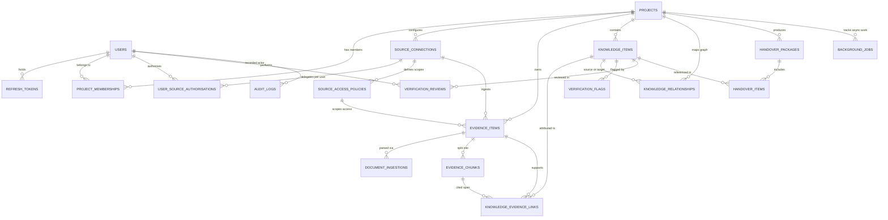

# Database Design

> **Classification Key:** **Confirmed Design Decisions** reflect mandatory storage rules, tooling choices (**SQLAlchemy 2.x**, **Alembic**, **Psycopg 3**, **ChromaDB HTTP server mode**), PostgreSQL full-text search, PostgreSQL-backed background jobs, relational knowledge graph storage, and handover/permission invariants. **Proposed Implementation Details** define concrete table names, column types, and index layouts proposed for Phase 1 Alembic migrations.

---

## 1. Storage Architecture & Tooling Rules (Confirmed)

1. **PostgreSQL as Canonical Source of Truth**: All structured application data, platform users, RBAC memberships, delegated user source authorisations, source access policies, canonical evidence records, chunk text and FTS indexes, extracted items, AI interpretations, knowledge relationships, verification reviews, handover packages, background job records, and immutable audit logs live in PostgreSQL.
2. **PostgreSQL Connectivity & Migrations**: Use **SQLAlchemy 2.x**, **Alembic** for schema migrations, and **Psycopg 3** (`psycopg`) for PostgreSQL connectivity.
3. **ChromaDB Strictly Secondary (HTTP Server Mode)**: ChromaDB runs in dedicated HTTP server mode via Docker Compose and stores vector embeddings (`nomic-embed-text`), text snippets needed for semantic matching, and filterable permission/source metadata (`project_id`, `evidence_id`, `chunk_id`, `source_platform`, `permission_scope_id`, `is_synthetic`). ChromaDB is **never** the sole storage location for any evidence or project record and remains rebuildable from PostgreSQL.
4. **Hybrid Search Storage**: `evidence_chunks` in PostgreSQL maintains a `tsvector` full-text search index alongside ChromaDB vectors so the backend retrieval layer combines semantic and exact keyword/identifier matches.
5. **Structured PostgreSQL Relationships (No Graph Database)**: Knowledge relationships are represented via relational tables and indexed foreign keys in PostgreSQL. No separate graph database is permitted.
6. **PostgreSQL-Backed Background Jobs**: Long-running ingestion, OCR, embedding, and AI jobs are persisted in PostgreSQL (`background_jobs`) for status, retry tracking, and failure reporting (no Redis, Celery, or message broker in initial infrastructure).
7. **Mandatory Evidence Retention Fields**: Every evidence record must persist:
   - `source_platform`
   - `original_source_id`
   - `source_url` (nullable when unavailable, e.g. local upload)
   - `author_or_owner` (nullable when unavailable)
   - `source_timestamp` (original event/creation timestamp)
   - `extraction_timestamp` (ingestion timestamp)
   - `content_hash` and `version_info` (where appropriate)
8. **Four-Tier Epistemic Separation**: Data design must unambiguously separate **Original source evidence**, **Extracted information**, **AI-generated interpretation**, and **Human-verified knowledge**.
9. **Synthetic Data Isolation**: Any synthetic test records must be explicitly tagged (`is_synthetic = true`) and never surfaced as real organisational evidence.

---

## 2. Proposed PostgreSQL Logical Schema

### 2.1 Entity-Relationship Overview

### 2.2 Proposed Domain Table Groups

#### A. Platform Authentication, RBAC & Project Workspace
*(Implemented in Phase 2.2 via migration `0002_auth_identity_rbac`: `users`, `refresh_sessions`, `roles`, `permissions`, `role_permissions`, `user_roles`. `projects` and `project_memberships` / organisation tables remain planned for Phase 2.3.)*
- **`users`** *(Implemented)*: `id` (UUID PK), `full_name` (VARCHAR 255), `email` (unique normalised lowercase with CHECK constraint), `password_hash` (Argon2id via `pwdlib`), `status` (`active` | `disabled` | `locked` | `pending`), `is_email_verified` (BOOLEAN), `email_verified_at` (TIMESTAMPTZ NULL), `created_at`, `updated_at`, `last_login_at`.
  - *Separation Rule*: No external GitHub/Jira/Slack OAuth credentials live on `users` for platform login bypasses.
- **`refresh_sessions`** *(Implemented)*: `id` (UUID PK), `user_id` (FK → `users` CASCADE), `token_family_id` (UUID — enables rotation & reuse detection), `token_hash` (unique 64-char SHA-256 hex digest with CHECK constraint), `replaced_by_session_id` (nullable self-FK), `created_at`, `expires_at`, `revoked_at`, `revoked_reason`, `last_used_at`, `session_metadata` (nullable JSON, privacy-conscious defaults without raw IPs/secrets).
- **`roles`, `permissions`, `role_permissions`, `user_roles`** *(Implemented)*: Explicit `scope_type` (`platform` | `organisation` | `project`) separating platform roles (`standard_user`, `platform_admin`) from extensible scoped role definitions (`org_owner`, `org_admin`, `project_manager`, `project_member`, `reviewer`). Platform `user_roles` assignments enforce `scope_type = 'platform'` in backend authorisation services.
- **`projects`** *(Planned Phase 2.3)*: `id` (UUID PK), `name`, `slug` (unique), `description`, `status` (`active` | `handover_in_progress` | `handed_over` | `archived`), `created_by_id` (FK → `users`), `created_at`, `updated_at`.
- **`project_memberships`** *(Planned Phase 2.3)*: `id` (UUID PK), `project_id` (FK → `projects`), `user_id` (FK → `users`), `role` (`admin` | `project_owner` | `contributor` | `reviewer` | `viewer`), `created_at`. Unique `(project_id, user_id)`.

#### B. Authorised Sources, Delegated Identities & Source-Level Permissions
- **`source_connections`**: `id` (UUID PK), `project_id` (FK → `projects`), `platform` (`github` | `jira` | `slack` | `manual_upload`), `display_name`, `external_workspace_id`, `authorisation_mode` (`delegated_per_user` | `manual_upload`), `sync_status`, `last_synced_at`, `created_by_id` (FK → `users`), `created_at`.
- **`user_source_authorisations`**:
  - Stores **per-user delegated OAuth 2.0 authorisations** and external source identities separately from platform login:
  - `id` (UUID PK), `project_id` (FK → `projects`), `user_id` (FK → `users`), `source_connection_id` (FK → `source_connections`), `platform` (`github` | `jira` | `slack`), `external_user_id` (VARCHAR NOT NULL), `external_username` (VARCHAR NULL), `encrypted_access_token` (TEXT NOT NULL — encrypted with `TOKEN_ENCRYPTION_KEY`), `encrypted_refresh_token` (TEXT NULL), `granted_scopes` (JSONB), `token_expires_at` (TIMESTAMPTZ NULL), `revoked_at` (TIMESTAMPTZ NULL), `created_at`, `updated_at`.
  - Unique active constraint on `(source_connection_id, user_id)`.
- **`source_access_policies`**:
  - `id` (UUID PK), `project_id` (FK → `projects`), `source_connection_id` (FK → `source_connections`), `scope_identifier` (e.g. `repo:org/private-repo`, `jira:PROJ`, `slack:C12345`, `doc:<upload_uuid>`), `visibility_mode` (`explicit_user_grants` | `verified_source_acl` | `project_members`), `allowed_user_ids` (JSONB/array), `allowed_external_identities` (JSONB/array), `allowed_roles` (JSONB/array), `last_acl_verified_at` (TIMESTAMPTZ NULL), `created_at`.
  - *Invariant*: Connecting one user's account never defaults `visibility_mode` to blanket project-wide exposure for restricted sources; backend permission resolution verifies per-user source grants/ACL parity before retrieval or LLM prompt assembly.

#### C. Canonical Evidence, Private Uploads & Hybrid Search (`Evidence Workspace`)
- **`evidence_items`**:
  - Identity & Project: `id` (UUID PK), `project_id` (FK → `projects`), `source_connection_id` (FK → `source_connections`, nullable for manual upload), `permission_scope_id` (FK → `source_access_policies` NOT NULL).
  - **Mandatory Provenance Fields (Confirmed)**:
    - `source_platform` (`github` | `jira` | `slack` | `uploaded_document`)
    - `original_source_id` (VARCHAR NOT NULL)
    - `source_url` (TEXT NULL)
    - `author_or_owner` (VARCHAR NULL)
    - `source_timestamp` (TIMESTAMPTZ NOT NULL)
    - `extraction_timestamp` (TIMESTAMPTZ NOT NULL)
    - `content_hash` (VARCHAR(64) NOT NULL — SHA-256)
    - `version_info` (VARCHAR NULL)
  - Payload & Integrity: `title`, `content_type`, `raw_metadata` (JSONB), `canonical_text` (TEXT), `epistemic_layer` (constant `'original_source_evidence'`), `is_synthetic` (BOOLEAN NOT NULL DEFAULT false).
  - Uniqueness / Idempotency Index: `(project_id, source_platform, original_source_id, content_hash)`.
- **`document_ingestions`**:
  - `id` (UUID PK), `evidence_id` (FK → `evidence_items`), `original_filename` (sanitised display metadata only), `opaque_storage_filename` (UUID-based disk name), `storage_relative_path` (inside private backend `UPLOAD_STORAGE_PATH`, outside frontend), `mime_type`, `file_size_bytes`, `sha256_plaintext_hash` (VARCHAR(64)), `is_encrypted_at_rest` (BOOLEAN NOT NULL DEFAULT true), `encryption_key_id` (VARCHAR NOT NULL DEFAULT `'local-v1'`), `extraction_engine` (`pymupdf` | `python_docx` | `ollama_glm_ocr` | `hybrid_pymupdf_glm_ocr`), `page_count`, `ocr_applied` (BOOLEAN), `ingestion_status` (`pending` | `processing` | `completed` | `failed`), `error_detail`, `uploaded_by_id` (FK → `users`), `created_at`.
- **`evidence_chunks`**:
  - `id` (UUID PK), `evidence_id` (FK → `evidence_items`), `project_id` (FK → `projects`), `permission_scope_id` (FK → `source_access_policies`), `chunk_index` (INT), `page_number` (INT NULL), `char_start` (INT), `char_end` (INT), `chunk_text` (TEXT NOT NULL), `search_vector` (`TSVECTOR` maintained via generated column/trigger + `GIN` index for PostgreSQL full-text search), `content_hash` (VARCHAR(64)), `embedding_model` (VARCHAR NOT NULL — `'nomic-embed-text'`), `chroma_vector_id` (VARCHAR UNIQUE), `indexed_at` (TIMESTAMPTZ NULL).

#### D. Knowledge Intelligence & Epistemic Layering (`Knowledge Intelligence`)
- **`knowledge_items`**:
  - `id` (UUID PK), `project_id` (FK → `projects`)
  - `category` (ENUM/CHECK covering the 8 confirmed domains: `decisions_rationale`, `technical_architecture`, `work_status`, `responsibilities_ownership`, `dependencies`, `bugs_blockers_risks`, `operational_procedures`, `historical_discussions`)
  - `epistemic_status` (ENUM/CHECK: `extracted` | `ai_interpreted` | `human_verified` | `disputed` | `rejected`)
  - `title` (TEXT NOT NULL), `structured_summary` (TEXT NOT NULL), `structured_attributes` (JSONB)
  - `confidence_score` (NUMERIC NULL), `uncertainty_reason` (TEXT NULL)
  - `generated_by_model` (VARCHAR NULL — e.g. `qwen3:8b`), `verified_by_id` (FK → `users` NULL), `verified_at` (TIMESTAMPTZ NULL)
  - `is_synthetic` (BOOLEAN NOT NULL DEFAULT false), `created_at`, `updated_at`.
- **`knowledge_evidence_links`**:
  - `id` (UUID PK), `knowledge_item_id` (FK → `knowledge_items`), `evidence_id` (FK → `evidence_items`), `evidence_chunk_id` (FK → `evidence_chunks` NULL), `supporting_excerpt` (TEXT), `attribution_type` (`direct_extraction` | `supporting_context` | `conflicting_evidence`), `created_at`.

#### E. Relationship Management (`Relationship Explorer`)
- **`knowledge_relationships`**:
  - `id` (UUID PK), `project_id` (FK → `projects`)
  - `source_node_type` (`knowledge_item` | `evidence_item` | `actor` | `system_component`), `source_node_id` (VARCHAR/UUID), `source_label` (TEXT)
  - `target_node_type`, `target_node_id`, `target_label` (TEXT)
  - `relationship_type` (`depends_on` | `blocks` | `owned_by` | `decided_in` | `implements` | `contradicts` | `relates_to`)
  - `epistemic_status` (`extracted` | `ai_interpreted` | `human_verified` | `rejected`)
  - `evidence_id` (FK → `evidence_items` NULL), `confidence_score` (NUMERIC NULL), `notes` (TEXT NULL), `created_at`, `updated_at`.
  - Indexes on `(project_id, source_node_id)`, `(project_id, target_node_id)`, and `(project_id, relationship_type)`.

#### F. Verification & Human Review (`Verification Center`)
- **`verification_flags`**: `id` (UUID PK), `project_id` (FK → `projects`), `knowledge_item_id` (FK → `knowledge_items` NULL), `flag_type` (`conflict` | `missing_information` | `low_confidence` | `unattributed` | `stale_evidence`), `severity` (`high` | `medium` | `low`), `summary` (TEXT), `details` (JSONB), `status` (`open` | `acknowledged` | `resolved` | `dismissed`), `resolved_by_id` (FK → `users` NULL), `resolved_at`, `created_at`.
- **`verification_reviews`**: `id` (UUID PK), `knowledge_item_id` (FK → `knowledge_items`), `reviewer_id` (FK → `users` NOT NULL), `previous_epistemic_status`, `new_epistemic_status`, `decision` (`verified` | `edited_and_verified` | `disputed` | `rejected`), `review_comment` (TEXT), `created_at`.

#### G. Handover Workspace (`Handover Workspace`)
- **`handover_packages`**:
  - `id` (UUID PK), `project_id` (FK → `projects`), `version` (INT), `title`
  - `outgoing_owner_id` (FK → `users` NULL), `designated_reviewer_id` (FK → `users` NOT NULL), `incoming_owner_id` (FK → `users` NULL)
  - `status` (`draft` | `in_review` | `approved` | `superseded`), `readiness_summary` (JSONB)
  - **Designated Reviewer Approval Gate (Confirmed)**: `approved_by_id` (FK → `users` NULL — must match designated human `Reviewer`, never AI and never incoming assignee alone), `approved_at` (TIMESTAMPTZ NULL), `is_shareable` (BOOLEAN NOT NULL DEFAULT false — true only after designated reviewer approval)
  - **Incoming Assignee Receipt Acknowledgment (Confirmed)**: `acknowledged_by_id` (FK → `users` NULL), `acknowledged_at` (TIMESTAMPTZ NULL — records receipt only; cannot substitute for reviewer approval)
  - `created_at`, `updated_at`.
- **`handover_items`**: `id` (UUID PK), `handover_package_id` (FK → `handover_packages`), `knowledge_item_id` (FK → `knowledge_items` NULL), `verification_flag_id` (FK → `verification_flags` NULL), `section_category`, `snapshot_content` (JSONB), `display_order` (INT).

#### H. Background Processing Jobs (`background_jobs`)
- **`background_jobs`**:
  - `id` (UUID PK), `project_id` (FK → `projects` NULL), `job_type` (`document_ingestion` | `source_sync` | `embedding_index` | `knowledge_reconstruction` | `verification_check`), `status` (`queued` | `running` | `succeeded` | `failed` | `dead_letter`), `payload` (JSONB), `attempt_count` (INT NOT NULL DEFAULT 0), `max_attempts` (INT NOT NULL DEFAULT 3), `next_retry_at` (TIMESTAMPTZ NULL), `locked_by` (VARCHAR NULL), `locked_at` (TIMESTAMPTZ NULL), `error_message` (TEXT NULL), `error_detail` (JSONB NULL), `created_by_id` (FK → `users` NULL), `started_at`, `completed_at`, `created_at`, `updated_at`.
  - Partial index on `(status, next_retry_at, created_at)` for efficient worker polling via `SELECT ... FOR UPDATE SKIP LOCKED`.

#### I. Assistant History & Immutable Audit Logging
- **`assistant_conversations`** & **`assistant_messages`**: Stores user queries, retrieved `evidence_chunk_ids`, cited `evidence_ids`, retrieval mode diagnostics, uncertainty flags, model used, and timestamp.
- **`audit_logs`**: Append-only table: `id` (UUID PK), `project_id` (FK → `projects` NULL), `actor_user_id` (FK → `users` NULL), `action` (VARCHAR NOT NULL), `resource_type` (VARCHAR), `resource_id` (VARCHAR), `outcome` (`success` | `denied` | `error`), `details` (JSONB — sanitised, never secrets), `created_at` (TIMESTAMPTZ NOT NULL).

---

## 3. ChromaDB Design (Dedicated HTTP Server Mode)

- **Deployment Mode (Confirmed)**: Dedicated ChromaDB HTTP server container in Docker Compose, reachable over internal network by both the FastAPI API container and the Python worker container.
- **Embedding Model Constraint (Confirmed)**: All vectors in the collection **must** be generated by **`nomic-embed-text`**. Mixing embedding models within a collection is forbidden; changing models requires full re-embedding from PostgreSQL `evidence_chunks`.
- **Collection Partitioning & Metadata Schema (Proposed)**:
  - Collection name `${CHROMA_COLLECTION_PREFIX}_evidence_chunks`.
  - Metadata per vector: `project_id`, `evidence_id`, `chunk_id`, `permission_scope_id`, `source_platform`, `epistemic_layer`, `content_hash`, `is_synthetic`.

---

## 4. Confirmed vs. Proposed Summary & Remaining Implementation Decisions

- **Confirmed**: PostgreSQL canonical store; SQLAlchemy 2.x + Alembic + Psycopg 3; ChromaDB dedicated HTTP server mode; PostgreSQL `tsvector` full-text search for hybrid retrieval; PostgreSQL-backed `background_jobs` table; PostgreSQL relational graph (no graph DB); delegated per-user source authorisations; designated reviewer approval vs incoming assignee receipt acknowledgment; private encrypted upload metadata.
- **Proposed**: Specific UUID column layout, partial worker polling index, `GIN` full-text search index on `evidence_chunks`, and single-collection ChromaDB metadata partitioning.
- **Remaining Minor Implementation Decisions (Phase 1 Migration Authoring)**:
  1. **Psycopg 3 Execution Style**: Confirm synchronous vs async SQLAlchemy 2.x engine configuration over `psycopg` (both are supported natively by Psycopg 3).
  2. **Polymorphic Relationships vs Entity Registry Table**: Confirm whether `knowledge_relationships` retains `(source_node_type, source_node_id)` polymorphic references or adds a lightweight `graph_entities` registry table for strict FK constraints.
