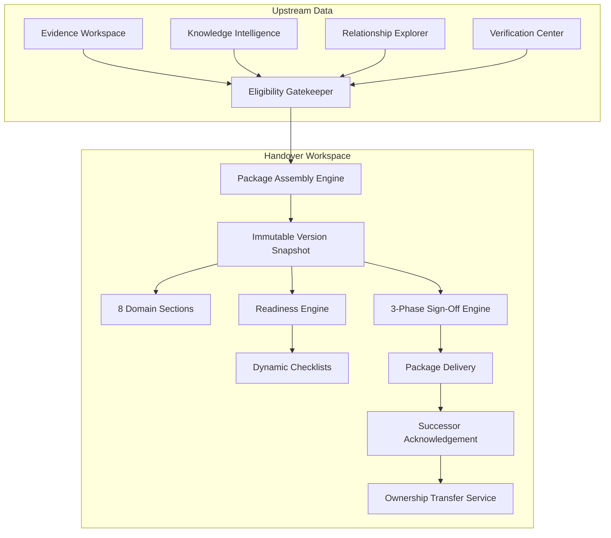
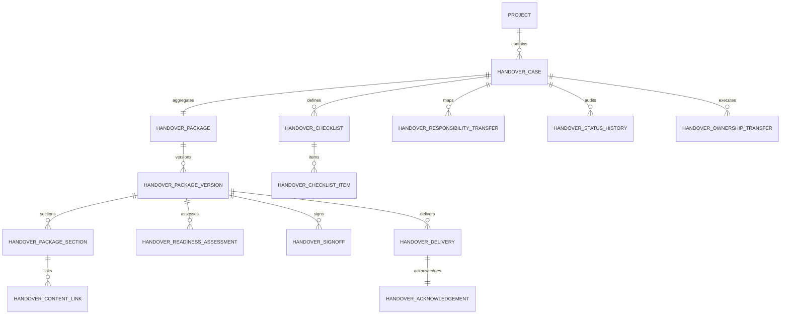

# Handover Package Architecture & Technical Specification

**Platform**: The Handover  
**Formal Description**: Intelligent Project Knowledge Reconstruction & Handover Platform  
**Document**: Architecture & Technical Design  
**Module**: Handover Workspace (Module 4)  
**Status**: Implemented  
**Date**: 2026-11-13  

---

## 1. Architectural System Overview

The **Handover Workspace** connects upstream reconstructed knowledge with downstream recipients through an evidence-grounded, cryptographically verifiable compilation pipeline.

---

## 2. Core Architectural Decoupling: Package vs. Ownership

A central tenet of the platform design:
> **Generating a handover package and executing an ownership transfer are two separate, asynchronous operations.**

| Dimension | Package Compilation | Ownership Transfer |
| :--- | :--- | :--- |
| **Primary Artifact** | `HandoverPackageVersion` (Snapshot) | `HandoverOwnershipTransfer` (Event) |
| **Mutations** | Read-only knowledge compilation | Database role and membership updates |
| **Prerequisites** | Active project knowledge items | Approved package, delivered, and acknowledged |
| **Reversibility** | Superseded by newer version assembly | Explicit rollback with documented reason |
| **Actor** | Assembled by system / editor | Executed by authorized manager / org admin |

---

## 3. Cryptographic Provenance & Immutability

1. **Version Content Hash**:
   - Each section calculates `SHA-256(section_title + section_content + content_links)`.
   - The package version calculates `SHA-256(section_hash_1 + ... + section_hash_8)`.
   - This fingerprint ensures that released packages cannot be retroactively modified without invalidating the snapshot.
2. **Signature Hashes**:
   - `SHA-256(version_id + signoff_type + decision + signer_user_id + timestamp + comments)`.
   - Preserves tamper-evident human accountability.
3. **Receipt Acknowledgement Hash**:
   - `SHA-256(delivery_id + user_id + timestamp + notes)`.

---

## 4. Entity-Relationship Model

---

## 5. Security & Boundary Enforcement

- **Tenant Isolation**: Every SQL query and repository method strictly checks `project_id == project_ctx.project.id` and verifies parent organisation membership.
- **Fail-Closed Evidence Access**: Inaccessible private evidence sources under the current user's ACLs are excluded from package compilation and flagged in readiness assessments.
- **Separation of Duties**: System prevents departing members from approving their own handover packages as reviewers.
- **Immutable Audit Logging**: Every case creation, assembly, readiness check, sign-off, delivery, and ownership transfer generates an immutable `audit_logs` entry in PostgreSQL.
