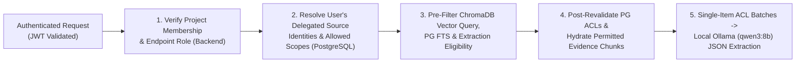

# Security Architecture

> **Classification Key:** **Confirmed Design Decisions** state mandatory security controls across FastAPI-managed platform authentication, non-JS refresh token security, separate source OAuth 2.0 authorisation, delegated per-user source permissions, private encrypted upload storage, handover separation of duties, and auditing. **Proposed Implementation Details** and **Local vs. Production Assumptions** clarify initial implementation baselines and future hardening requirements.

---

## 1. Security Objectives & Threat Boundaries (Confirmed)

The platform aggregates sensitive internal engineering and operational context (source code discussions, bug/vulnerability blockers, Jira roadmaps, internal documents, optional Slack threads, and staff handover responsibilities). Security enforces five foundational guarantees:

1. **Separated Platform & Source Auth**: Platform login uses FastAPI-managed authentication, strictly separated from third-party GitHub/Jira/Slack OAuth 2.0 integrations.
2. **No Unauthorised Access**: Users see only projects, uploaded documents, and external source records permitted by backend RBAC and source-level access policies. Connecting one user's external account never grants access to every project member.
3. **No Unauthorised LLM Exposure**: Source content the requesting user is not authorised to read must **never** be retrieved into hybrid search context or transmitted to Ollama.
4. **Zero Credential or Refresh Token Exposure**: External OAuth tokens, JWT signing secrets, encryption keys, and database credentials stay strictly on the backend; refresh tokens are never exposed to browser JavaScript.
5. **Full Accountability**: Security-relevant and state-changing actions generate immutable audit logs.

---

## 2. Platform Authentication & Token Transport Security (Confirmed)

### 2.1 Separation from Third-Party Source Authorisation

- **Platform Login (FastAPI-Managed)**: Users authenticate to the platform using FastAPI-managed accounts backed by **Argon2id** (`pwdlib[argon2]`, stored in `users.password_hash`) with normalised lowercase emails and minimum password strength enforcement.
- **Source Connections (OAuth 2.0)**: OAuth 2.0 integrations for GitHub, Jira, and optional Slack are triggered **only after** a user is authenticated to the platform and explicitly authorises external source access. Third-party OAuth tokens never substitute for platform session authentication.

### 2.2 Token Lifecycle, Transport & Cookie Security Requirements (Confirmed & Implemented Phase 2.2)

| Token / Secret | Storage & Transport Requirement | Security Rule |
| :--- | :--- | :--- |
| **Access Token (JWT)** | Short-lived signed JWT (`JWT_ACCESS_TOKEN_EXPIRE_MINUTES=15`, `HS256`/`HS384`/`HS512`), held strictly in client memory (or handled server-side in Next.js BFF requests) | Sent via `Authorization: Bearer <token>` over HTTPS/localhost; **never** persisted in `localStorage` or `sessionStorage`; contains `sub`, `sid` (session family ID), `jti`, `type="access"`, `iat`, `exp`, plus `iss`/`aud` when configured—never passwords, refresh tokens, or external OAuth tokens |
| **Refresh Token** | Opaque high-entropy token (`secrets.token_urlsafe(48)`) hashed (SHA-256) in PostgreSQL `refresh_sessions` with rotation (`token_family_id`) & reuse detection | Delivered **exclusively** in an **`HttpOnly` cookie** (`ipkrh_refresh_token`) — **MUST NEVER be exposed to browser JavaScript** |

#### Mandatory Cookie Security Attributes
- **`HttpOnly=True`**: Blocks `document.cookie` / XSS access to refresh tokens.
- **`Secure`**: Set via `COOKIE_SECURE=true` in all staging/production HTTPS deployments (`COOKIE_SECURE=false` permitted only for `http://localhost` local development).
- **`SameSite=Lax`** (or `Strict` where compatible with navigation flow; configured via `COOKIE_SAMESITE`): Protects refresh/logout cookie endpoints against cross-site request forgery.
- **`Path=/api/v1/auth`**: Restricts cookie transmission strictly to authentication endpoints rather than every API call.
- **CSRF Protection (Implemented Phase 2.2)**: Refresh and logout endpoints strictly validate `Origin`/`Referer` against trusted origins (`CORS_ALLOWED_ORIGINS`, plus configured local dev host port in non-production) alongside `SameSite` cookie attributes, rejecting missing, `"null"`, or foreign origins with `403 CSRF_VALIDATION_FAILED`.
- **Rate Limiting Hook (Implemented Phase 2.2)**: `app/core/rate_limit.py` enforces configurable `AUTH_RATE_LIMIT_*` sliding-window limits behind `RateLimiterProtocol` (in-process default for single-node local/MVP; designed to swap cleanly at reverse-proxy/gateway or shared DB store in multi-worker production).

---

## 3. Authorisation, RBAC & Handover Governance

### 3.1 Backend RBAC Enforcement (Confirmed)

- Authorisation is enforced **strictly on the backend** (`Authentication and authorisation` module invoked by FastAPI dependencies). Frontend route guards/disabled buttons are UI conveniences only.

### 3.2 Project-Scoped Roles & Handover Separation of Duties (Confirmed Policy, Proposed Role Matrix)

| Role | Capabilities & Boundaries |
| :--- | :--- |
| **Admin** | System configuration, user/role administration, global audit log inspection |
| **Project Owner** | Create/configure project, link source connections, manage memberships, configure upload visibility policies, initiate handover packages |
| **Designated Reviewer** | Inspect evidence, validate/edit/reject extractions in **Verification Center**, and **issue mandatory handover approval prior to final sharing** |
| **Contributor** | Upload documents, trigger permitted source syncs, curate draft knowledge and handover notes |
| **Viewer / Incoming Assignee** | Read permitted evidence, knowledge, relationships, and shared handovers; query **Project Knowledge Assistant** within permitted scopes; **may record receipt acknowledgment on a handover package** |

- **Confirmed Handover Approval Invariant**:
  - A **designated reviewer** must explicitly approve a handover package before final sharing (`approved_by_id`, `is_shareable = true`).
  - The **incoming assignee** may acknowledge receipt (`acknowledged_by_id`, `acknowledged_at`), which records receipt only and **cannot substitute for designated reviewer approval**.
  - The LLM must never approve handovers or set official status.

### 3.3 Multi-Tenant Organisation & Project Isolation (Implemented Phase 2.3)

- **Scope Separation Across Three Levels**: `roles` and `permissions` enforce strict `scope_type` boundaries across `platform`, `organisation` (`org_owner`, `org_admin`, `org_member`), and `project` (`project_manager`, `project_member`, `reviewer`). Services reject cross-scope role assignments (`400 INVALID_ROLE_SCOPE`) before database persistence.
- **Anti-Enumeration Disclosure Policy (`404` vs `403`)**:
  - Requests for organisations where the caller lacks an active `organisation_memberships` record return `404 ORGANISATION_NOT_FOUND` rather than revealing tenant existence.
  - Requests for projects where the caller lacks an active parent-organisation membership, or targets a `private` project without active project membership or organisation governance (`project.read`), return `404 PROJECT_NOT_FOUND`.
  - Only verified tenant members with discovery access who lack an endpoint permission, attempt rank escalation (`org_admin` managing `org_owner`), or lack explicit project membership (`require_project_membership`) receive `403 FORBIDDEN` / `INSUFFICIENT_ROLE_AUTHORITY`.
- **Dynamic Parent-Organisation Enforcement & Cascading Revocation**: Every project dependency (`resolve_project_context`, `resolve_project_read_context`, `require_project_membership`, `require_project_permission`) verifies active parent-organisation membership on the request path. Removing an organisation member revokes all their active `project_memberships` within the same PostgreSQL transaction (`status = 'removed'`), and suspended/removed org members lose project access immediately even if a stale `project_memberships` row exists.
- **Governance Continuity & Privilege Escalation Guards**:
  - Rank checks (`ORG_ROLE_RANK`) block `org_admin` from inviting, promoting to, demoting, or removing `org_owner`.
  - The last active `org_owner` cannot be demoted or removed (`409 LAST_ORG_OWNER_FORBIDDEN`).
  - Current `project.owner_id` cannot be demoted below `project_manager` (`409 PROJECT_OWNER_ROLE_LOCKED`) or removed (`409 PROJECT_OWNER_REMOVAL_FORBIDDEN`) until project ownership is transferred.
- **Hashed Single-Use Invitations (`organisation_invitations`)**:
  - Tokens (`secrets.token_urlsafe(48)`) are stored strictly as 64-character SHA-256 hex digests (`token_hash`) and never emitted to logs or audit metadata.
  - Acceptance requires active Bearer authentication matching the invited lowercase email (`403 INVITATION_EMAIL_MISMATCH`), single-use `pending` state, unexpired timestamp (`410 INVITATION_EXPIRED`), active parent organisation, and live re-verification that the inviter still holds invitation authority for the target role.
  - Until SMTP/email delivery is integrated, creation responses honestly report `invitation_delivery: "not_configured"` and omit `development_invitation_token` (`null`) whenever `APP_ENV=production`.

---

## 4. Delegated Source-Level Permissions & LLM Data Isolation *(Confirmed; Backend Source OAuth, PG ACLs, Hybrid Retrieval & Phase 2.6 Knowledge Extraction ACLs Implemented)*

1. **Delegated Per-User Source Authorisation & OAuth 2.0 Hardening (`app/services/integrations/oauth.py`)**:
   - **Separated from Platform Auth**: GitHub and Jira OAuth flows (`SourceOAuthService`) execute strictly inside an existing authenticated platform session (`Bearer JWT`), bind `oauth_states` to `user_id` + `organisation_id` + single-use SHA-256 `state_hash`, require PKCE (`S256`) with encrypted `code_verifier`, enforce `Cache-Control: no-store` on start/callback responses, validate optional `redirect_after` against `CORS_ALLOWED_ORIGINS` and `INTEGRATION_ALLOWED_POST_AUTH_REDIRECTS` (`400 REDIRECT_URL_NOT_ALLOWLISTED`), reject cross-user callback hijacking (`403 OAUTH_STATE_USER_MISMATCH`), and prevent state replay (`409 OAUTH_STATE_REPLAYED`).
   - **Least-Privilege Read-Only Scopes**: GitHub defaults to `GITHUB_OAUTH_MODE=github_app`, stripping classic `repo` write-capable scope unless `oauth_mode="oauth_app"` AND `GITHUB_ALLOW_CLASSIC_PRIVATE_REPO_SCOPE=true`. Jira requests read-only scopes (`read:jira-work read:jira-user offline_access`) and executes atomic `SELECT ... FOR UPDATE` single-use refresh rotation inside PostgreSQL before storing new tokens.
   - **No Cross-User Token Sharing**: Discovery, mapping creation, `/verify-access`, and sync triggering strictly resolve the calling user's own active `UserSourceAuthorisation` row—never falling back to another project member's token (`403 SOURCE_AUTHORISATION_REQUIRED`).
2. **Fail-Closed Source Access Policies & Pre-Retrieval SQL Filtering (`SourceAccessPolicyService`, `EvidenceRepository`)**:
   - **No Implicit Project-Wide Exposure**: Connecting one user's external source account **never** exposes private repositories, Jira projects, or security-restricted Jira issues to other project members.
   - Private GitHub repositories and all Jira Cloud projects classify as `acl_scope="source_restricted"` (`verified_source_acl`), while Jira issues carrying `fields.security` receive dedicated per-security-level sub-policies (`scope_identifier="{cloud_id}:{project_key}:security:{sec_id}"`, `restricted_fail_closed`). Only verified public GitHub repositories (unless `restrict_to_verified_users=true`) classify as `project_members` (`project_members_verified`).
   - `EvidenceRepository.list_for_project` (SQL predicate) and `SourceAccessPolicyService.enforce_evidence_access` (single-item inspection) fail closed, checking `user_id IN policy.allowed_user_ids` and `policy.sync_permission_status != 'revoked'` on PostgreSQL records **before** returning external evidence, emitting `403 SOURCE_ACCESS_DENIED` + `evidence.source_acl_denied` audit records on denial.
   - **Operational Boundary & Two-Phase Retrieval Revalidation**: `SourceAccessPolicy.allowed_user_ids` reflects provider ACL checks captured during mapping creation, sync runs (removing caller immediately on HTTP 403/404), and manual `POST .../verify-access` checks *(periodic background ACL re-synchronisation between syncs remains deferred to future scheduling phases)*. To close any stale-vector window when permissions are revoked immediately on PostgreSQL, `HybridRetrievalService` (Phase 2.5) enforces **two-phase isolation**: ChromaDB metadata `where` filters (`organisation_id`, `project_id`, `permission_scope_key`, `is_synthetic`, plus `uploaded_by_user_id` for legacy restricted uploads) pre-filter candidate vectors **and** canonical PostgreSQL `SourceAccessPolicyService.can_user_access_evidence` / `enforce_evidence_access` re-validates every candidate hit and chunk detail before returning anything.
3. **Pre-Retrieval & Knowledge Extraction LLM Isolation *(Phase 2.5 & Phase 2.6 Controls Implemented)***:
   - Permission filtering executes **before** ChromaDB vector search, PostgreSQL full-text search, result ranking, **and** Phase 2.6 `ReconstructionWorkerService` prompt assembly. Unauthorised content never reaches Ollama.
   - **Fail-Closed Extraction Pipeline (Phase 2.6)**:
     - *Trigger-Time Filtering*: Single-evidence extraction rejects restricted items (`403 SOURCE_ACCESS_DENIED`); project-wide extraction resolves permitted evidence IDs upfront, recording `skipped_inaccessible_count` without leaking restricted item details.
     - *Worker Execution Re-Verification*: Immediately before claiming/calling `qwen3:8b`, `ReconstructionWorkerService` re-verifies the triggering user's active organisation membership, active project status/membership, RBAC permissions, and per-item `SourceAccessPolicyService` permissions (`FAILED` / `EXTRACTION_PERMISSION_REVOKED` if revoked).
     - *Single-Evidence Prompt Batching*: Batches sent to `qwen3:8b` **never** mix chunks across different `evidence_id` records or ACL scopes in the same LLM prompt.
     - *Live Read Filtering (`KnowledgeRepository`)*: Project lists, status summaries, and item detail endpoints filter against the caller's live `SourceAccessPolicy` memberships so revoking source access hides private knowledge items and strips restricted corroborated `evidence_links` immediately (`403 SOURCE_ACCESS_DENIED` + `knowledge.source_acl_denied` audit log when zero accessible links remain).
   - `ChromaV2HttpVectorStore.sanitize_vector_metadata` strictly allowlists non-secret scalar fields and never stores OAuth tokens, storage keys, encrypted file paths, raw secrets, or user PII beyond opaque `uploaded_by_user_id` UUIDs.
   - Synthetic test records (`is_synthetic: true`) are excluded by default (`include_synthetic=false`) across retrieval, indexing summaries, and Phase 2.6 knowledge extraction/read APIs.
4. **Slack Integration Gate**:
   - Slack remains strictly excluded and disabled (`SLACK_ENABLED=false`, returning `409 SLACK_INTEGRATION_DISABLED`) until workspace authorisation, API scope review, and data-retention requirements are confirmed.

---

## 5. Secrets Management & Credential Hygiene *(Confirmed & Implemented)*

- `.env` and `.env.*` (excluding `.env.example`) are strictly excluded in `.gitignore`.
- Secrets are never hardcoded in source code, tests, fixtures, or documentation.
- `NEXT_PUBLIC_*` variables contain non-sensitive configuration only (`NEXT_PUBLIC_API_BASE_URL`).
- **Dedicated OAuth Token Encryption (`LocalTokenEncryptionService`, `app/services/token_encryption.py`)**: Delegated OAuth access tokens, refresh tokens, and PKCE verifiers are encrypted using `AES-256-GCM` with an HKDF-SHA256 key (`ipkrh-oauth-token-salt-v1`) derived strictly from `TOKEN_ENCRYPTION_KEY` (cryptographically isolated from `FILE_ENCRYPTION_KEY`), random 12-byte nonces, and Associated Authenticated Data (AAD) bound to `<organisation_id>:<user_id>:<provider>:<token_kind>` (`key_id="token-local-v1"`). Plaintext tokens are decrypted only inside trusted backend/worker execution contexts and are never returned in API schemas, ORM DTOs, or logs.
- **Recursive Log & Callback Redaction (`app/core/logging.py`)**: `redact_sensitive_text` and `SensitiveDataFilter` scrub URL userinfo, Bearer headers, Argon2 hashes, key-value token/secret pairs, and `?code=` / `?state=` OAuth query strings from logs and stored worker error summaries.

---

## 6. Private Upload Storage, Validation & Encryption at Rest *(Confirmed & Implemented Phase 2.4A–2.9)*

### 6.1 Private Storage & File Validation Controls *(Implemented Phase 2.4A; Extended Phase 2.9)*

- **Dual Private Storage Backends (`STORAGE_PROVIDER`)**: `build_storage_backend()` (`app/services/storage_factory.py`) explicitly selects either `LocalPrivateStorageBackend` (`local_encrypted`, writing inside private `UPLOAD_STORAGE_PATH`) or `SupabaseStorageBackend` (`supabase_storage`, writing to private bucket `project-evidence` via `SUPABASE_URL` + server-only `SUPABASE_SERVICE_ROLE_KEY`)—**never** inside Next.js `public/` or any statically served web root. `StorageSettings` rejects publishable/anon keys (`sb_publishable_*`), and fails closed if required Supabase credentials are absent.
- **No Direct File Paths or Signed URLs Exposed**: Files are never served via static URLs, filesystem paths, or pre-signed Supabase Storage URLs. API schemas (`EvidenceSummaryResponse`, `EvidenceDetailResponse`) intentionally withhold `storage_object_key`, `storage_provider`, `encryption_key_id`, and host directories, while `_resolve_safe_key` and `validate_storage_object_key` reject malformed keys and path-traversal attempts. Downloads flow exclusively through `GET /api/v1/evidence/{evidence_id}/download` after RBAC and PostgreSQL `SourceAccessPolicyService` validation.
- **Canonical Ciphertext Integrity Checks**: Both storage backends share `app/services/storage.py` envelope helpers (`IPKRH1\x01`, 12-byte random nonce, 16-byte GCM tag, `ENVELOPE_OVERHEAD_BYTES = 35`). On upload, `SupabaseStorageBackend` verifies outbound ciphertext length matches `len(plaintext) + 35` and requires a valid JSON `{"Key": "<bucket>/<object_key>"}` response (`STORAGE_INTEGRITY_FAILED` on missing/mismatched/malformed payloads). On read/worker extraction, storage verifies expected `encryption_key_id` (`local-v1` vs `supabase-v1`), strict non-negative ASCII `Content-Length` headers (when present), and ciphertext envelope size (`expected_plaintext_size + 35` bytes) prior to AES-GCM authentication, plus bounded transient retries and explicit `STORAGE_*` `ServiceUnavailableError` codes (fail-closed `exists()`, masked secret `__repr__`).
- **Strict Validation & Secure Filenames (`app/services/document_validation.py`)**:
  - Streaming upload size enforcement (`MAX_UPLOAD_SIZE_MB`) via bounded chunk reads (`413 FILE_TOO_LARGE`), empty-file rejection (`400 EMPTY_FILE`), sanitised filename checks (control chars, null bytes, path components, max 255 chars), strict extension allowlist (`.pdf`, `.docx`), `Content-Type` header validation (`415 UNSUPPORTED_MEDIA_TYPE`), magic-byte inspection (`%PDF-`, `PK\x03\x04` with `[Content_Types].xml` + `word/document.xml`), encrypted/corrupt PDF rejection (`422 ENCRYPTED_DOCUMENT_UNSUPPORTED` / `MALFORMED_PDF`), PDF page limit (`MAX_DOCUMENT_PAGES`), and DOCX zip-bomb protection (`422 ARCHIVE_EXPANSION_LIMIT_EXCEEDED`, bounded entries and expansion ratio).
  - Discard client filenames from disk paths; persist encrypted files under opaque server-generated keys (`<organisation_id>/<project_id>/<object_uuid>.enc`) while storing sanitised original filenames strictly as PostgreSQL metadata.

### 6.2 Encryption at Rest: Local Development Implementation vs. Production Requirements

| Aspect | Initial Local-Development Implementation (Phase 2.4A–2.4B) | Future Production Requirements |
| :--- | :--- | :--- |
| **Encryption Mechanism** | `AES-256-GCM` for uploads (`LocalPrivateStorageBackend`, `FILE_ENCRYPTION_KEY`, AAD `<organisation_id>:<project_id>:<storage_object_key>`) AND `AES-256-GCM` for OAuth tokens/PKCE verifiers (`LocalTokenEncryptionService`, `TOKEN_ENCRYPTION_KEY`, HKDF `ipkrh-oauth-token-salt-v1`, AAD `<organisation_id>:<user_id>:<provider>:<token_kind>`) | Envelope encryption: unique per-object Data Encryption Keys (DEKs) wrapped by a cloud/hardware KMS Key Encryption Key (KEK) |
| **Key Management** | Separate local `.env` backend keys (`FILE_ENCRYPTION_KEY`, `TOKEN_ENCRYPTION_KEY`); acceptable for single-developer Docker Desktop environments assuming local workstation disk security | Dedicated KMS / Secrets Manager (AWS KMS, GCP KMS, Azure Key Vault, or HashiCorp Vault) with zero plaintext keys in environment files |
| **Key Rotation & Versioning** | Track `encryption_algorithm` (`AES-256-GCM`) and `encryption_key_id` (`local-v1`) on `evidence_items`, plus `token_encryption_algorithm` (`AES-256-GCM`) and `token_key_id` (`token-local-v1`) / `code_verifier_key_id` on integration tables | Scheduled automated KEK rotation and versioned DEK re-wrapping without downtime |
| **Storage & Transport Hardening** | Private local Docker volume / backend path; `COOKIE_SECURE=false` on `http://localhost` only; `POSTGRES_SSL_MODE=prefer` | Encrypted private object storage (SSE-KMS) or encrypted block volumes, TLS everywhere (`COOKIE_SECURE=true`, `POSTGRES_SSL_MODE=require`), ChromaDB auth tokens, and pre-ingestion malware scanning |

---

## 7. Audit Logging & Prompt Injection Defences

- **Immutable Audit Logs (`audit_logs`)** *(Implemented Phase 2.3 via `AuditService`; extended Phase 2.4A–2.5)*: Records backend-trusted state-changing and security-relevant events linked to `actor_user_id`, `organisation_id`, `project_id`, `request_id`, and sanitised `event_metadata` (`sanitize_audit_metadata` redacts secrets, passwords, hashes, and tokens before storage):
  - **Auth, Orgs, Projects & Invitations**: Organisation lifecycle/role/member/invitation actions, project creation/lifecycle/ownership/membership actions, invitation mismatch denials.
  - **Document Ingestion (Phase 2.4A)**: `evidence.uploaded`, `evidence.duplicate_upload_detected`, `evidence.extraction_started`, `evidence.extraction_completed`, `evidence.extraction_retry_scheduled`, `evidence.extraction_failed`, `evidence.reprocess_queued`, `evidence.deleted`, plus committed denials `evidence.access_denied`, `evidence.delete_denied`, `evidence.reprocess_denied`, `evidence.source_acl_denied`.
  - **Source Integrations (Phase 2.4B)**: `integration.oauth_started`, `integration.oauth_connected`, `integration.oauth_denied`, `integration.oauth_callback_failed`, `integration.token_refreshed`, `integration.token_refresh_failed`, `integration.authorisation_revoked`, `integration.connection_disconnected`, `integration.discovery_executed`, `integration.mapping_created`, `integration.mapping_disabled`, `integration.access_verified`, `integration.access_denied`, `integration.sync_queued`, `integration.sync_started`, `integration.sync_completed`, `integration.sync_retry_scheduled`, `integration.sync_failed`, and `integration.sync_cancelled`.
  - **Chunking, Indexing & Hybrid Retrieval (Phase 2.5)**: `evidence.indexing_completed`, `evidence.indexing_partially_indexed`, `evidence.indexing_retry_scheduled`, `evidence.indexing_failed`, `evidence.reindex_queued`, `evidence.reindex_completed`, `evidence.reindex_retry_scheduled`, `evidence.reindex_denied`, `evidence.index_cleanup_completed`, and `evidence.search_executed` (recording search mode, degraded flag, result count, and latency—never query secrets or unauthorised hits—while chunk detail denials commit `evidence.source_acl_denied`).
  - **Knowledge Reconstruction (Phase 2.6)**: `knowledge.extraction_queued`, `knowledge.extraction_trigger_denied`, `knowledge.extraction_completed`, `knowledge.extraction_partially_completed`, `knowledge.extraction_retry_scheduled`, `knowledge.extraction_failed`, `knowledge.extraction_cancelled`, `knowledge.extraction_retried`, `knowledge.extraction_permission_revoked`, `knowledge.source_acl_denied`, and `knowledge.items_marked_stale`.
  - Query access via `GET /api/v1/organisations/{organisation_id}/audit-events` requires `organisation.audit.read`. Future phases extend audit coverage to verification decisions, handover approvals/acknowledgments, and assistant retrieval metadata.
- **Prompt Injection Mitigation**: Treat all external text (PR reviews, Jira comments, optional Slack messages, OCR text) as **untrusted data** delimited inside `</evidence_chunk>`-escaped `qwen3:8b` prompts; the LLM has zero direct authority or tool hooks to alter DB records, permissions, verification states (`human_verified`), or handovers, and backend validators reject unverified excerpts (`NO EVIDENCE -> NO CLAIM`).
