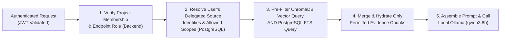

# Security Architecture

> **Classification Key:** **Confirmed Design Decisions** state mandatory security controls across FastAPI-managed platform authentication, non-JS refresh token security, separate source OAuth 2.0 authorisation, delegated per-user source permissions, private encrypted upload storage, handover separation of duties, and auditing. **Proposed Implementation Details** and **Local vs. Production Assumptions** clarify initial implementation baselines and future hardening requirements.

---

## 1. Security Objectives & Threat Boundaries (Confirmed)

The platform aggregates sensitive internal engineering and operational context (source code discussions, bug/vulnerability blockers, Jira roadmaps, internal documents, optional Slack threads, and staff handover responsibilities). Security enforces five foundational guarantees:

1. **Separated Platform & Source Auth**: Platform login uses FastAPI-managed authentication, strictly separated from third-party GitHub/Jira/Slack OAuth 2.0 integrations.
2. **No Unauthorised Access**: Users see only projects, uploaded documents, and external source records permitted by backend RBAC and source-level access policies. Connecting one user's external account never grants access to every project member.
3. **No Unauthorised LLM Exposure**: Source content the requesting user is not authorised to read must **never** be retrieved into hybrid search context or transmitted to Ollama.
4. **Zero Credential or Refresh Token Exposure**: External OAuth tokens, JWT signing secrets, encryption keys, and database credentials stay strictly on the backend; refresh tokens are never exposed to browser JavaScript.
5. **Full Accountability**: Security-relevant and state-changing actions generate immutable audit logs.

---

## 2. Platform Authentication & Token Transport Security (Confirmed)

### 2.1 Separation from Third-Party Source Authorisation

- **Platform Login (FastAPI-Managed)**: Users authenticate to the platform using FastAPI-managed accounts backed by **Argon2id** (`pwdlib[argon2]`, stored in `users.password_hash`) with normalised lowercase emails and minimum password strength enforcement.
- **Source Connections (OAuth 2.0)**: OAuth 2.0 integrations for GitHub, Jira, and optional Slack are triggered **only after** a user is authenticated to the platform and explicitly authorises external source access. Third-party OAuth tokens never substitute for platform session authentication.

### 2.2 Token Lifecycle, Transport & Cookie Security Requirements (Confirmed & Implemented Phase 2.2)

| Token / Secret | Storage & Transport Requirement | Security Rule |
| :--- | :--- | :--- |
| **Access Token (JWT)** | Short-lived signed JWT (`JWT_ACCESS_TOKEN_EXPIRE_MINUTES=15`, `HS256`/`HS384`/`HS512`), held strictly in client memory (or handled server-side in Next.js BFF requests) | Sent via `Authorization: Bearer <token>` over HTTPS/localhost; **never** persisted in `localStorage` or `sessionStorage`; contains `sub`, `sid` (session family ID), `jti`, `type="access"`, `iat`, `exp`, plus `iss`/`aud` when configured—never passwords, refresh tokens, or external OAuth tokens |
| **Refresh Token** | Opaque high-entropy token (`secrets.token_urlsafe(48)`) hashed (SHA-256) in PostgreSQL `refresh_sessions` with rotation (`token_family_id`) & reuse detection | Delivered **exclusively** in an **`HttpOnly` cookie** (`ipkrh_refresh_token`) — **MUST NEVER be exposed to browser JavaScript** |

#### Mandatory Cookie Security Attributes
- **`HttpOnly=True`**: Blocks `document.cookie` / XSS access to refresh tokens.
- **`Secure`**: Set via `COOKIE_SECURE=true` in all staging/production HTTPS deployments (`COOKIE_SECURE=false` permitted only for `http://localhost` local development).
- **`SameSite=Lax`** (or `Strict` where compatible with navigation flow; configured via `COOKIE_SAMESITE`): Protects refresh/logout cookie endpoints against cross-site request forgery.
- **`Path=/api/v1/auth`**: Restricts cookie transmission strictly to authentication endpoints rather than every API call.
- **CSRF Protection (Implemented Phase 2.2)**: Refresh and logout endpoints strictly validate `Origin`/`Referer` against trusted origins (`CORS_ALLOWED_ORIGINS`, plus configured local dev host port in non-production) alongside `SameSite` cookie attributes, rejecting missing, `"null"`, or foreign origins with `403 CSRF_VALIDATION_FAILED`.
- **Rate Limiting Hook (Implemented Phase 2.2)**: `app/core/rate_limit.py` enforces configurable `AUTH_RATE_LIMIT_*` sliding-window limits behind `RateLimiterProtocol` (in-process default for single-node local/MVP; designed to swap cleanly at reverse-proxy/gateway or shared DB store in multi-worker production).

---

## 3. Authorisation, RBAC & Handover Governance

### 3.1 Backend RBAC Enforcement (Confirmed)

- Authorisation is enforced **strictly on the backend** (`Authentication and authorisation` module invoked by FastAPI dependencies). Frontend route guards/disabled buttons are UI conveniences only.

### 3.2 Project-Scoped Roles & Handover Separation of Duties (Confirmed Policy, Proposed Role Matrix)

| Role | Capabilities & Boundaries |
| :--- | :--- |
| **Admin** | System configuration, user/role administration, global audit log inspection |
| **Project Owner** | Create/configure project, link source connections, manage memberships, configure upload visibility policies, initiate handover packages |
| **Designated Reviewer** | Inspect evidence, validate/edit/reject extractions in **Verification Center**, and **issue mandatory handover approval prior to final sharing** |
| **Contributor** | Upload documents, trigger permitted source syncs, curate draft knowledge and handover notes |
| **Viewer / Incoming Assignee** | Read permitted evidence, knowledge, relationships, and shared handovers; query **Project Knowledge Assistant** within permitted scopes; **may record receipt acknowledgment on a handover package** |

- **Confirmed Handover Approval Invariant**:
  - A **designated reviewer** must explicitly approve a handover package before final sharing (`approved_by_id`, `is_shareable = true`).
  - The **incoming assignee** may acknowledge receipt (`acknowledged_by_id`, `acknowledged_at`), which records receipt only and **cannot substitute for designated reviewer approval**.
  - The LLM must never approve handovers or set official status.

---

## 4. Delegated Source-Level Permissions & LLM Data Isolation (Confirmed)

1. **Delegated Per-User Source Authorisation**:
   - Prefer delegated, per-user OAuth 2.0 authorisation (`user_source_authorisations`) for GitHub, Jira, and optional Slack wherever supported.
   - Preserve each user's external source identity (`external_user_id`, granted scopes) and source-level ACL metadata (`source_access_policies`) in PostgreSQL.
2. **No Implicit Project-Wide Exposure**:
   - Connecting one user's external source account **never** assumes every project member is authorised to read that source's repositories, Jira projects, or Slack channels.
   - Access to synced records requires matching verified per-user source identity/grants in PostgreSQL.
3. **Pre-Retrieval LLM Isolation**:
   - Permission filtering executes **before** ChromaDB vector search, PostgreSQL full-text search, result ranking, or prompt assembly. Unauthorised content never reaches Ollama.
4. **Slack Integration Gate**:
   - Slack remains an optional MVP integration (`SLACK_ENABLED=false` by default) and is enabled only after workspace authorisation, API scope review, and data-retention requirements are confirmed.

---

## 5. Secrets Management & Credential Hygiene (Confirmed Rules)

- `.env` and `.env.*` (excluding `.env.example`) are strictly excluded in `.gitignore`.
- Secrets are never hardcoded in source code, tests, fixtures, or documentation.
- `NEXT_PUBLIC_*` variables contain non-sensitive configuration only (`NEXT_PUBLIC_API_BASE_URL`).
- Delegated external OAuth tokens stored in `user_source_authorisations` are encrypted at rest using `TOKEN_ENCRYPTION_KEY`, decrypted solely inside the `Source integrations` module during authorised operations, and redacted from all logs and API responses.

---

## 6. Private Upload Storage, Validation & Encryption at Rest (Confirmed)

### 6.1 Private Storage & File Validation Controls

- **Private Storage Outside Frontend**: Uploaded files are stored exclusively inside backend-private storage (`UPLOAD_STORAGE_PATH`, mounted only to backend API and Python worker containers)—**never** inside Next.js `public/` or any statically served web root.
- **Authenticated Download Only**: Files are never exposed via direct public URLs; preview/download requests route through FastAPI endpoints enforcing RBAC, `source_access_policies`, and audit logging.
- **Validation & Secure Filenames**:
  - Enforce `MAX_UPLOAD_SIZE_MB`, extension allowlists (`.pdf`, `.docx`, supported image formats), MIME verification, and magic-byte inspection.
  - Discard client filenames from disk paths; persist files under opaque server-generated UUID filenames (`opaque_storage_filename`) while storing sanitised original filenames strictly as PostgreSQL metadata.
  - Guard against zip bombs / oversized PDF page floods prior to PyMuPDF / `python-docx` / `glm-ocr:latest` execution.

### 6.2 Encryption at Rest: Local Development Assumptions vs. Production Requirements

| Aspect | Initial Local-Development Assumptions | Future Production Requirements |
| :--- | :--- | :--- |
| **Encryption Mechanism** | Authenticated symmetric encryption (AES-256-GCM or Fernet) applied by backend/worker before writing uploaded files to `UPLOAD_STORAGE_PATH` and encrypting OAuth tokens in PostgreSQL | Envelope encryption: unique per-file Data Encryption Keys (DEKs) wrapped by a cloud/hardware KMS Key Encryption Key (KEK) |
| **Key Management** | Local `.env` backend keys (`FILE_ENCRYPTION_KEY`, `TOKEN_ENCRYPTION_KEY`); acceptable for single-developer Docker Desktop environments assuming local workstation disk security | Dedicated KMS / Secrets Manager (AWS KMS, GCP KMS, Azure Key Vault, or HashiCorp Vault) with zero plaintext keys in environment files |
| **Key Rotation & Versioning** | Track `encryption_key_id` (`local-v1`) in `document_ingestions` so migration/rotation tooling works cleanly | Scheduled automated KEK rotation and versioned DEK re-wrapping without downtime |
| **Storage & Transport Hardening** | Private local Docker volume; `COOKIE_SECURE=false` on `http://localhost` only; `POSTGRES_SSL_MODE=prefer` | Encrypted private object storage (SSE-KMS) or encrypted block volumes, TLS everywhere (`COOKIE_SECURE=true`, `POSTGRES_SSL_MODE=require`), ChromaDB auth tokens, and pre-ingestion malware scanning |

---

## 7. Audit Logging & Prompt Injection Defences

- **Immutable Audit Logs (`audit_logs`)**: Record authentication events (login, refresh, logout, revoked token reuse), RBAC/source policy changes, 403 permission denials, delegated OAuth connections/revocations, document uploads/downloads, verification decisions, handover reviewer approvals, incoming assignee acknowledgments, and assistant retrieval metadata.
- **Prompt Injection Mitigation**: Treat all external text (PR reviews, Jira comments, optional Slack messages, OCR text) as **untrusted data** delimited inside `qwen3:8b` prompts; the LLM has zero direct authority or tool hooks to alter DB records, permissions, verification states, or handovers.
