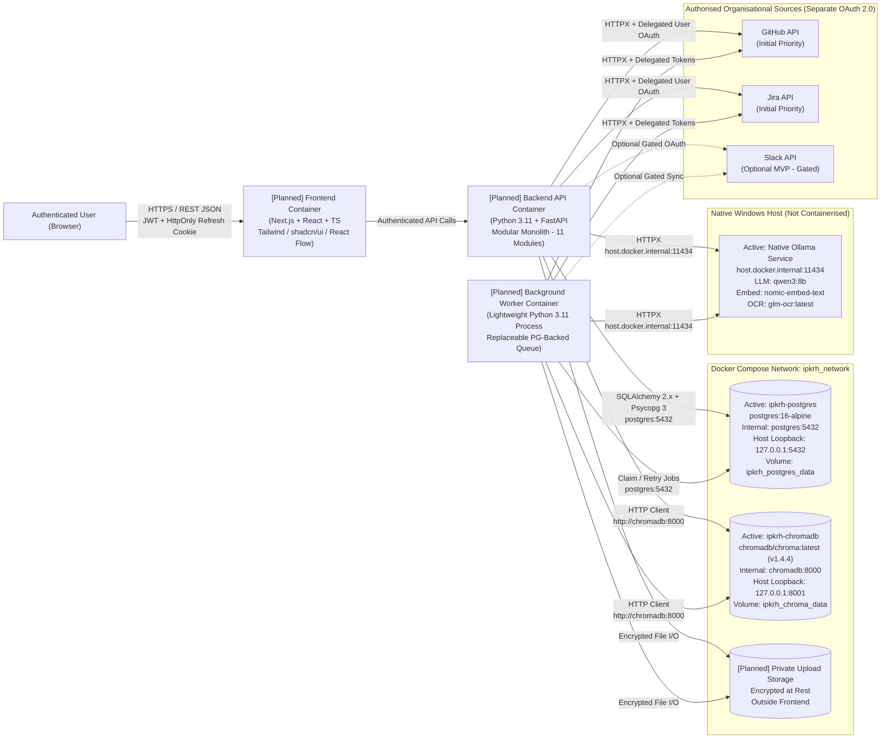

# System Architecture

> **Classification Key:** Throughout this document, **Confirmed Design Decisions** represent fixed baseline requirements and constraints; **Implemented Phase 1.1 Infrastructure** reflects the active Docker Compose services in [`infrastructure/docker/docker-compose.yml`](../../infrastructure/docker/docker-compose.yml); **Proposed Implementation Details** represent planned layouts for application services in subsequent phases.

---

## 1. Architectural Principles & Constraints (Confirmed)

1. **Canonical Structured Store**: PostgreSQL is the sole canonical system of record for projects, users, roles, source identities, access permissions, canonical evidence records, extracted knowledge, relationships, verification decisions, handovers, background job records, and audit logs.
2. **Secondary Vector Index (HTTP Server Mode)**: ChromaDB runs in dedicated HTTP server mode via Docker Compose and stores vector embeddings (`nomic-embed-text`) and retrieval metadata only. ChromaDB must never be the sole repository for project or evidence records and must remain rebuildable from PostgreSQL.
3. **Database Tooling & Relational Knowledge Graph**: Backend data access uses **SQLAlchemy 2.x**, **Alembic** for schema migrations, and **Psycopg 3** (`psycopg`) for PostgreSQL connectivity. Knowledge relationships are stored as structured PostgreSQL records—do **not** introduce a separate graph database.
4. **Lightweight Asynchronous Worker**: Long-running ingestion, OCR, embedding, and AI reconstruction jobs execute in a **separate lightweight Python worker process** backed by PostgreSQL job records (no Redis, Celery, or message broker during initial infrastructure setup), behind a replaceable job interface.
5. **Hybrid Retrieval Architecture**: Retrieval combines ChromaDB semantic vector search and PostgreSQL full-text search through a unified backend retrieval layer, applying source permissions before any evidence reaches the LLM.
6. **Epistemic Separation**: The system strictly distinguishes **Original source evidence**, **Extracted information**, **AI-generated interpretation**, and **Human-verified knowledge**.
7. **Local-First AI & OCR (Native Windows Host Ollama)**: LLM inference (`qwen3:8b`), embeddings (`nomic-embed-text`), and initial OCR (`glm-ocr:latest`) run via the existing **native Ollama installation on the Windows host** (not containerised). OCR sits behind a replaceable backend service abstraction; vLLM or other OCR runtimes must **not** be introduced at this stage.
8. **Separated Auth & Backend-Enforced Security**: FastAPI-managed platform authentication is strictly separate from third-party source OAuth 2.0 integrations. All RBAC and delegated per-user source permissions are enforced on the backend before accessing data or assembling LLM prompts.

---

## 2. High-Level System Context & Container Topology

### 2.1 Confirmed Stack Context

- **Client**: Next.js, React, TypeScript, Tailwind CSS, shadcn/ui, Lucide Icons, React Flow.
- **API & Worker Core**: Python 3.11, FastAPI, Pydantic, SQLAlchemy 2.x, Alembic, Psycopg 3, HTTPX, lightweight Python worker process.
- **Persistence & Search**: PostgreSQL (`postgres:16-alpine`, canonical store + full-text search + job queue) + ChromaDB (`chromadb/chroma:latest`, HTTP server mode, `nomic-embed-text`).
- **AI, OCR & Document Processing**: Native host Ollama (`qwen3:8b`, `nomic-embed-text`, `glm-ocr:latest`), PyMuPDF, `python-docx`.
- **External Authorised Sources**: GitHub API and Jira API (initial priority alongside uploaded documents); Slack API (optional MVP gated by workspace authorisation, API scope review, and data-retention confirmation).
- **Deployment & Tooling**: Docker Desktop, Docker Compose, Git, GitHub.

### 2.2 Container & Host Connectivity Topology

**Implemented in Phase 1.1, Phase 2.1 & Phase 2.2**:
- **Phase 1.1 Data Infrastructure**: `ipkrh-postgres` (`postgres:16-alpine`), `ipkrh-chromadb` (`chromadb/chroma:latest`), dedicated Docker bridge network `ipkrh_network`, persistent volumes `ipkrh_postgres_data` and `ipkrh_chroma_data`, and native host Ollama connectivity (`http://localhost:11434` on host / `http://host.docker.internal:11434` from containers).
- **Phase 2.1 Backend Application Foundation** (host runtime in `backend/`): Centralised Pydantic Settings (`app/core/config.py`), structured JSON logging with `X-Request-ID` correlation & secret redaction, sanitised error handlers, synchronous SQLAlchemy 2.x + Psycopg 3 PostgreSQL engine & request-scoped session management, Alembic baseline wiring (`backend/alembic.ini` -> `infrastructure/database/migrations/`), explicit CORS origin allowlists, and `GET /health`, `GET /health/ready`, and `GET /api/v1/health`.
- **Phase 2.2 Platform Authentication, Identity & RBAC**: FastAPI-managed registration/login/refresh/logout/profile/session routes (`/api/v1/auth/...`) and platform identity/role management routes (`/api/v1/users/...`, `/api/v1/roles`) backed by PostgreSQL (`users`, `refresh_sessions`, `roles`, `permissions`, `role_permissions`, `user_roles` via Alembic revision `0002_auth_identity_rbac`), Argon2id hashing (`pwdlib`), short-lived JWT access tokens (`pyjwt`), rotated SHA-256 `HttpOnly` refresh cookies with reuse detection, CSRF origin validation, fail-closed RBAC dependencies, and configurable auth rate limiting.

**Planned in Subsequent Phases**: `frontend` and `backend` organisation/project workspace modules, delegated external OAuth connectors, document ingestion, lightweight `worker` execution (`SELECT ... FOR UPDATE SKIP LOCKED`), private encrypted upload storage, and containerised backend/frontend compose services.

### 2.3 Docker Networking, Ports & Security Notes (Phase 1.1)

- **Dedicated Bridge Network (`ipkrh_network`)**: Containers resolve PostgreSQL as `postgres:5432` and ChromaDB as `chromadb:8000`.
- **Loopback-Only Host Bindings**: Host ports bind strictly to `127.0.0.1` (`127.0.0.1:5432->5432` for PostgreSQL; `127.0.0.1:8001->8000` for ChromaDB) to avoid unnecessary exposure across external interfaces.
- **Native Ollama via `host.docker.internal`**: Because `localhost` inside any Docker container refers to the container itself rather than the Windows host, containerised backend and worker services must set `OLLAMA_BASE_URL=http://host.docker.internal:11434` while host-executed scripts use `http://localhost:11434`.
- **ChromaDB Authentication Boundary**: Observed `chromadb/chroma:latest` (`chroma 1.4.4`) does not provide built-in token authentication inside the container binary. Local deployments rely on `127.0.0.1` loopback binding and `ipkrh_network` isolation; shared or production deployments must enforce `CHROMA_AUTH_TOKEN` via an authenticated reverse proxy in front of ChromaDB.

---

## 3. Frontend Architecture

### 3.1 Confirmed Frontend Baseline

- **Framework & Language**: Next.js, React, TypeScript (strict typing).
- **Styling & UI Components**: Tailwind CSS, shadcn/ui, Lucide Icons.
- **Graph Visualisation**: React Flow for rendering knowledge relationships in the **Relationship Explorer**.
- **Security Boundary**: Zero private credentials, integration tokens, or refresh tokens stored or exposed in browser JavaScript, Next.js public bundles, or `NEXT_PUBLIC_*` environment variables. Uploaded documents are never placed inside frontend static/public directories.

### 3.2 Product Module Mapping

| Product Module | Primary Workflow Stage | Responsibilities |
| :--- | :--- | :--- |
| **Project Workspace** | `CONNECT` / Overview | Project creation, member RBAC assignment, delegated source connection status, background job status, and handover readiness metrics |
| **Evidence Workspace** | `CONNECT` | Searchable ledger of authorised source records (GitHub, Jira, optional Slack) and encrypted private uploads (PDF, DOCX, scanned docs) with full provenance metadata and OCR/text previews |
| **Knowledge Intelligence** | `RECONSTRUCT` | Structured views across all 8 knowledge domains showing epistemic badges (`Original`, `Extracted`, `AI-Interpreted`, `Human-Verified`) and evidence citations |
| **Relationship Explorer** | `RECONSTRUCT` | Interactive React Flow graph displaying PostgreSQL-stored entities and typed relationships with citation drill-down |
| **Verification Center** | `VERIFY` → `REVIEW` | Human review queue surfacing automated conflict alerts, missing-information gaps, low-confidence extractions, and side-by-side evidence validation |
| **Handover Workspace** | `REVIEW` → `HANDOVER` | Structured handover package composer, readiness gates, designated reviewer approval before final sharing, separate incoming assignee receipt acknowledgment, and export |
| **Project Knowledge Assistant** | Cross-stage | Permission-filtered hybrid RAG conversational workspace providing evidence-cited answers and explicit uncertainty disclosures |

### 3.3 Proposed Frontend Structure & State Patterns

- **App Router Layout (Proposed)**: Next.js App Router with project-scoped routing (`/projects/[projectId]/...`) and shared workspace shell navigation across the seven modules.
- **Token Handling (Confirmed Constraint / Proposed Client Flow)**: Refresh tokens live exclusively in `HttpOnly` cookies (never readable by JS); short-lived JWT access tokens are kept in memory by the client session or proxied via Next.js server handlers without `localStorage` persistence.

---

## 4. Backend & Worker Architecture

### 4.1 Confirmed 11-Module Separation

The FastAPI backend maintains explicit modular separation across eleven domains, shared by the API container and the lightweight Python worker process:

| # | Backend Module | Confirmed Responsibility |
| :--- | :--- | :--- |
| 1 | **API routes** | HTTP routing, request/response Pydantic validation, dependency injection, OpenAPI documentation; enqueues async work via PostgreSQL job records |
| 2 | **Authentication and authorisation** | FastAPI-managed credential auth (password hashing, JWT access tokens, `HttpOnly` cookie refresh tokens), RBAC evaluation, separate per-user delegated source authorisation checks, and audit event emission |
| 3 | **Source integrations** | Authorised connectors for GitHub API and Jira API (initial priority), plus gated optional Slack API (via `HTTPX`); preserves source identities and access permissions per user/scope |
| 4 | **Document ingestion** | Upload validation, opaque filename assignment, encryption at rest in private storage, digital PDF parsing (`PyMuPDF`), Word parsing (`python-docx`), and replaceable **OCR service abstraction** initially backed by native Ollama `glm-ocr:latest` |
| 5 | **Extraction and processing** | Text normalisation, deterministic chunking, content hashing, PostgreSQL full-text vector preparation, and structured candidate extraction across the 8 knowledge categories |
| 6 | **Embedding and retrieval** | Embedding generation via `nomic-embed-text`, ChromaDB HTTP server indexing/sync, and **hybrid retrieval layer** combining ChromaDB semantic search + PostgreSQL full-text search with mandatory pre-retrieval permission filtering |
| 7 | **Knowledge reconstruction** | Synthesis of fragmented evidence into structured project knowledge records with strict source attribution, conflict tagging, and gap analysis |
| 8 | **Relationship management** | Creation, querying, traversal, and curation of structured entity relationships stored in PostgreSQL |
| 9 | **Verification** | Automated verification rule execution (contradiction detection, missing-info checks, ungrounded-claim rejection) and human review state transitions |
| 10 | **Handover** | Handover package compilation, readiness evaluation, **designated reviewer approval gate** before sharing, separate **incoming assignee acknowledgment**, snapshot freezing, and structured export |
| 11 | **AI assistant** | Orchestration for **Project Knowledge Assistant**: permission resolution, hybrid retrieval invocation, native Ollama (`qwen3:8b`) prompt construction, citation verification, and uncertainty formatting |

### 4.2 Background Worker Execution Model (Confirmed)

- **Separate Lightweight Python Process**: Runs alongside the FastAPI server via Docker Compose, executing `document_ingestion`, `source_sync`, `embedding_index`, `knowledge_reconstruction`, and `verification_check` jobs.
- **PostgreSQL-Backed Job Queue**: Claims pending rows from PostgreSQL `background_jobs` (e.g., `SELECT ... FOR UPDATE SKIP LOCKED`), tracks attempt counts, configured retries, and structured error reporting.
- **Replaceable Abstraction**: Domain services enqueue jobs through a minimal `JobDispatcher` interface so a dedicated queue/broker could replace PostgreSQL polling in future phases without refactoring domain modules. No Redis, Celery, or message broker is introduced during initial infrastructure setup.

### 4.3 Backend Layout & Extension Strategy

- **Implemented Phase 2.1–2.2 Backend Architecture (`backend/app/`)**: Clean layered separation across `api/` (`deps.py`, `routes/health.py`, `routes/auth.py`, `routes/users.py`, `v1/router.py`), `core/` (`config.py`, `logging.py`, `middleware.py`, `exceptions.py`, `validators.py`, `security.py`, `rate_limit.py`, `rbac_catalog.py`), `db/` (`base.py`, `session.py`), `models/` (`enums.py`, `user.py`, `auth.py`, `rbac.py`), `schemas/` (`common.py`, `health.py`, `auth.py`, `user.py`), `repositories/` (`system.py`, `user.py`, `auth.py`, `rbac.py`), `services/` (`health.py`, `auth.py`, `rbac.py`, `user.py`), and `main.py` (`create_app()`). Alembic configuration lives in `backend/alembic.ini` targeting `infrastructure/database/migrations/` (currently at revision `0002_auth_identity_rbac`).
- **PostgreSQL Connection Strategy (Confirmed Implementation Detail)**: Synchronous SQLAlchemy 2.x engine with Psycopg 3 (`postgresql+psycopg://`) + `pool_pre_ping=True`, shared across request-scoped FastAPI sessions and Alembic migrations (`build_db_connect_args`), with blocking DB pings offloaded cleanly from async FastAPI routes via threadpool.
- **Planned Phase 2.3+ Extension**: Organisation/project workspace routes, source connectors, document ingestion, RAG/knowledge modules, and the lightweight worker entrypoint (`backend/app/worker.py`) will extend these existing layers across the 11 domain modules as subsequent phases are approved.

---

## 5. Confirmed vs. Proposed Summary & Remaining Open Details

### 5.1 Confirmed & Implemented Baseline Decisions

- **Phase 1 Infrastructure**: `postgres:16-alpine` + `chromadb/chroma:latest` (`chroma 1.4.4`, `/api/v2/heartbeat`, persistent path `/data`), dedicated `ipkrh_network`, named volumes (`ipkrh_postgres_data`, `ipkrh_chroma_data`), `127.0.0.1` loopback port bindings, and native Windows Ollama connectivity via `host.docker.internal:11434`.
- **Phase 2.1 Backend Foundation**: FastAPI app factory (`create_app()`), Pydantic Settings loaded from root `.env` with separated `database`/`chroma`/`ollama`/`security` sub-configs, SQLAlchemy 2.x + Psycopg 3 synchronous engine & request-scoped session dependency, Alembic baseline (`0001_initial_baseline`), `X-Request-ID` correlation + secret-redacting JSON logs, sanitised error envelopes (`ErrorResponse`), and dependency-aware `/health/ready` distinguishing required PostgreSQL availability (`503` if down) from optional Ollama/ChromaDB availability (`200 degraded`).
- **Deferred Architecture Invariants (Confirmed Policies)**: Lightweight Python worker with PostgreSQL-backed job records (no Redis/Celery); local Ollama (`glm-ocr:latest`) behind a replaceable backend OCR abstraction; FastAPI-managed platform authentication separated from GitHub/Jira/Slack OAuth 2.0 integrations; delegated per-user source authorisation; hybrid ChromaDB + PostgreSQL FTS retrieval with pre-retrieval permission filtering; designated reviewer approval gate for handovers; private encrypted upload storage outside frontend directories.

### 5.2 Remaining Open Implementation Details

- Concrete ORM table schemas, authentication flows, RBAC guards, and background worker dispatch (Phase 2.2+).
- Exact hybrid ranking weights, chunking window parameters, and retrieval similarity/abstention thresholds—**explicitly deferred until realistic project evidence benchmarking** (no arbitrary thresholds fixed upfront).
- Production reverse-proxy auth for ChromaDB (`CHROMA_AUTH_TOKEN`) and KMS envelope encryption migration (documented in [`security-architecture.md`](security-architecture.md)).
