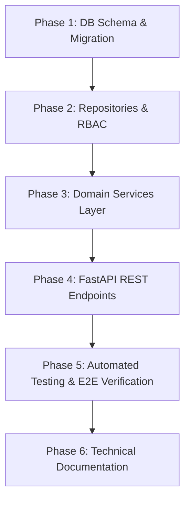

# Handover Workspace — Phased Implementation Plan

**Platform**: The Handover  
**Module**: Handover Workspace (Module 4 / Knowledge Transfer Area)  
**Status**: Executed & Implemented  
**Date**: 2026-11-13  

---

## 1. Architectural Principles & Scope Boundaries

1. **Backend-First Implementation**: Build complete backend services, models, migrations, schemas, repositories, and REST APIs before any Next.js frontend components.
2. **Package Compilation != Ownership Transfer**: Generating a package snapshot and altering project permissions are strictly isolated operations. Ownership transfer requires prior approval and acknowledgement.
3. **Immutable Version Snapshots**: Package versions are the central transactional unit. Once compiled, a version cannot be modified; modifications require a new version assembly.
4. **Four-Tier Epistemic Separation**: Extracted → AI-Interpreted → Human-Verified. Only human-verified knowledge enters released handover packages.
5. **Separation of Duties**: Departing members cannot approve their own handover packages as reviewers.
6. **No Fabricated Data**: Zero synthetic test data represented as genuine source evidence.

---

## 2. Implementation Phases

### Phase 1: Database Schema & Alembic Migration
- Define `HandoverCaseStatus`, `HandoverPackageSectionType`, `HandoverReadinessCategory`, and auxiliary enums in `backend/app/models/enums.py`.
- Implement 14 SQLAlchemy ORM models in `backend/app/models/handover.py`.
- Author Alembic migration `20261113_0013_handover_workspace.py` with reversible upgrade/downgrade logic.
- Execute migration against PostgreSQL database.

### Phase 2: Data-Access Repositories & RBAC Catalog
- Build repositories in `backend/app/repositories/handover.py` for all 14 entities using SQLAlchemy 2.x `selectinload` patterns.
- Extend RBAC catalog in `backend/app/core/rbac_catalog.py` with 11 granular `handover.*` permission codes.
- Assign handover permissions to standard roles (`ORG_OWNER`, `ORG_ADMIN`, `PROJECT_MANAGER`, `REVIEWER`, `PROJECT_MEMBER`).

### Phase 3: Core Domain Services Layer
- `HandoverCaseService`: Case CRUD, optimistic concurrency control (version increments), 14-state validation, and status history tracking.
- `PackageAssemblyService`: Deterministic 8-domain assembly engine, eligibility gate checks, snapshot JSON generation, and SHA-256 version content hashing.
- `HandoverReadinessEngine`: 9-category scoring (0-100), readiness levels, blocker/warning attribution, and sign-off eligibility gating.
- `ChecklistService`: Dynamic checklist generation from standard templates and readiness blockers, item status updating, and progress tracking.
- `HandoverSignoffService`: Three-phase sign-off protocol, separation of duties validation, cryptographic signature hashing, package delivery, and successor acknowledgement.
- `OwnershipTransferService`: Responsibility transfer mappings and discrete ownership transfer execution with rollback support.
- `HandoverNarrativeService`: Optional AI drafting using Qwen3 8B with fallback deterministic synthesis and manual section editing.

### Phase 4: FastAPI REST Endpoints & Schemas
- Model comprehensive Pydantic v2 request/response DTOs in `backend/app/schemas/handover.py`.
- Implement 24 REST API endpoints in `backend/app/api/routes/handover.py` mounted under `/api/v1/projects/{project_id}/handover`.
- Register router in `backend/app/api/v1/router.py`.

### Phase 5: Verification, Testing & Acceptance
- Develop comprehensive automated tests covering:
  - Case lifecycle state transitions
  - Package assembly across all 8 domains
  - Downstream eligibility filtering
  - 9-category readiness scoring
  - Three-phase sign-offs and separation of duties
  - Delivery and successor acknowledgement
  - Explicit ownership transfer and rollback
- Verify full regression suite against upstream modules.

### Phase 6: Documentation Delivery
- Product specification, architecture documentation, API reference, and testing guide.
