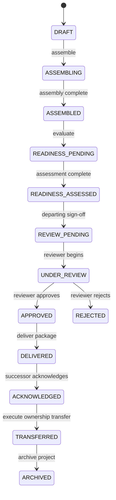

# Handover Workspace — Product Specification

**Platform**: The Handover  
**Formal Description**: Intelligent Project Knowledge Reconstruction & Handover Platform  
**Product Tagline**: Prevent Critical Knowledge From Leaving With People.  
**Module**: Handover Workspace (Module 4 / Knowledge Transfer Area)  
**Status**: Implemented (Backend Verified)  
**Date**: 2026-11-13  

---

## 1. Product Mission & Purpose

When employees, volunteers, researchers, or developers transition off a project, critical institutional knowledge is routinely lost or scattered across fragmented channels. 

The **Handover Workspace** transforms reconstructed, verified project intelligence into an actionable, structured, and auditable knowledge-transfer package. It ensures that an incoming successor receives complete context, validated decisions, unblocked responsibilities, and traceable evidence citations—without relying on unverified claims or synthetic assumptions.

---

## 2. Core User Personas & Workflows

### 2.1 The Departing Member
- **Role**: Originator of project context, architectural decisions, and current work.
- **Workflow**:
  1. Initiates or reviews a handover case.
  2. Maps individual responsibilities to designated successors.
  3. Reviews assembled package sections and provides narrative context.
  4. Signs Phase 1 (`DEPARTING_SIGNOFF`), certifying that the documented knowledge is complete and accurate.

### 2.2 The Project Reviewer
- **Role**: Authorized team lead, architect, or manager responsible for verification quality.
- **Workflow**:
  1. Evaluates 9-category package readiness scores.
  2. Inspects supporting evidence citations and unresolved conflicts.
  3. Validates offboarding checklist items.
  4. Signs Phase 2 (`REVIEWER_APPROVAL`), approving the package for release.
  *Note: Departing members are prohibited from approving their own packages.*

### 2.3 The Incoming Successor
- **Role**: Recipient who will assume operational ownership of project components.
- **Workflow**:
  1. Receives delivered package snapshot.
  2. Reviews structured knowledge across all 8 canonical domains.
  3. Executes knowledge transfer walkthroughs and checklist tasks.
  4. Signs Phase 3 (`SUCCESSOR_ACKNOWLEDGEMENT`), confirming receipt and understanding.

### 2.4 The Administrator / Project Manager
- **Role**: Organization governance lead.
- **Workflow**:
  1. Authorizes explicit internal ownership transfers once the package is acknowledged.
  2. Audits immutable sign-off histories and delivery receipts.
  3. Rolls back transfers if operational needs dictate.

---

## 3. The 8 Canonical Knowledge Domains

The handover package deterministically compiles findings across eight persistent domains:
1. **Project Overview & Strategic Context**: Core mission, stakeholders, and high-level project goals.
2. **Key Architecture & Technical Decisions**: Architecture decision records (ADRs), rationales, and alternatives considered.
3. **System Architecture, Services & Schemas**: Component topologies, data models, and API interfaces.
4. **Active Work, Backlog & In-Flight Tasks**: In-progress PRs, sprint issues, and milestone status.
5. **Component Ownership & Team Roles**: Service maintainers, operational ownership, and domain experts.
6. **Upstream/Downstream Dependencies**: External APIs, shared libraries, and inter-service dependencies.
7. **Known Issues, Blockers & Open Risks**: Production bugs, technical debt, and pending blockers.
8. **Operational Procedures & Runbooks**: Deployment workflows, monitoring runbooks, and disaster recovery guides.

---

## 4. Nine-Category Readiness Evaluation

Before a package can be approved, the Handover Readiness Engine evaluates nine dimensions:
1. **Evidence Coverage** (15%): Ratio of findings backed by direct source citations.
2. **Verification Completeness** (20%): Proportion of claims verified by authorized humans.
3. **Conflict Resolution** (15%): Absence of open cross-source contradictions.
4. **Knowledge Freshness** (10%): Freedom from stale knowledge or disconnected sources.
5. **Relationship Validation** (10%): Proportion of verified relational graph edges.
6. **Responsibility Coverage** (15%): Completeness of departing member duty transitions.
7. **Risk Assessment** (5%): Documentation of known risks and active bugs.
8. **Dependency Mapping** (10%): Completeness of component and architectural dependencies.
9. **Overall Quality**: Weighted aggregate score (0–100) and readiness classification:
   - `READY`: Score ≥ 90%, zero blockers.
   - `READY_WITH_WARNINGS`: Score 75–89%, zero blockers.
   - `PARTIALLY_READY`: Score 50–74%, non-critical gaps.
   - `NOT_READY`: Score < 50% or active blockers present.

---

## 5. Lifecycle State Machine

